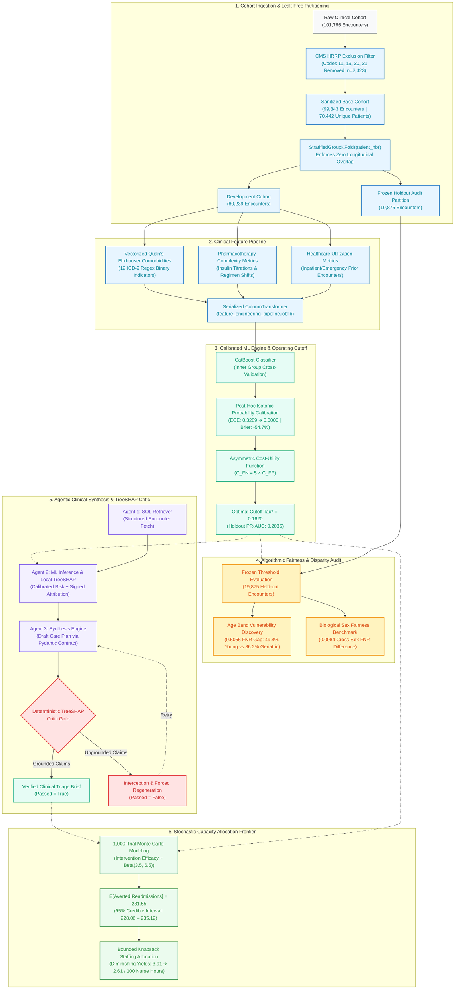

# Project DiaVigil: A Machine Learning Research Project on Hospital Readmission Risk Prediction

[](https://opensource.org/licenses/MIT)
[](https://www.python.org/downloads/)
[](https://colab.research.google.com/)
[](https://github.com/psf/black)

DiaVigil investigates the use of machine learning to estimate hospital readmission risk and support the evaluation of clinical decision-making strategies. The project includes clinical feature engineering, probability calibration, decision-threshold selection, subgroup error analysis, resource-allocation simulation, and an AI-agent workflow for generating and auditing care recommendations.

The project emphasizes reproducible model evaluation, transparent reporting of performance trade-offs, and documentation of methodological limitations.

**Project status:** Research prototype. The current results do not establish clinical effectiveness or readiness for deployment.

---
## Abstract

DiaVigil is a machine learning research project focused on hospital readmission risk prediction and the evaluation of decision-support strategies. The project uses clinical feature engineering, CatBoost classification, isotonic probability calibration, and cost-sensitive decision-threshold selection. It also examines subgroup false-negative rates, estimates uncertainty through patient-clustered bootstrap analysis, simulates resource allocation under staffing constraints, and explores an AI-agent workflow for generating and auditing care recommendations.

On a holdout cohort of 19,875 encounters, the baseline model achieved a precision-recall area under the curve (PR-AUC) of 0.2036 and a receiver operating characteristic area under the curve (ROC-AUC) of 0.6641. A revised model increased recall from 29.15% to 31.96%, while ROC-AUC decreased to 0.6578 and the number of false positives increased from 2,089 to 2,478. These results illustrate the trade-offs between identifying more patients who experience readmission and generating additional false-positive predictions. The project also evaluates probability calibration, subgroup error rates, and the consistency of saved research artifacts. The findings are limited to the available dataset and do not establish clinical effectiveness or generalizability to other healthcare settings.

### Project at a Glance

- **Research focus:** Hospital readmission risk prediction and decision-support evaluation.
- **Modeling:** Clinical feature engineering, CatBoost, and isotonic probability calibration.
- **Decision analysis:** Cost-sensitive threshold selection and resource-allocation simulation.
- **Evaluation:** Holdout performance, calibration, subgroup false-negative rates, and patient-clustered bootstrap analysis.
- **AI-agent component:** Generation and auditing of proposed care recommendations.
- **Current status:** Research prototype requiring further validation.
---

## Research Motivation and Objectives

### Motivation

Hospital readmission risk prediction is a classification problem in which the costs of different prediction errors may not be equal. Failing to identify a patient who is subsequently readmitted may represent a missed opportunity for additional care, while incorrectly identifying a patient as high risk may lead to unnecessary follow-up activities and use of limited clinical resources.

Model performance therefore cannot be assessed using a single metric alone. Discrimination, probability calibration, decision thresholds, subgroup error rates, and the resources required to act on predictions can provide different perspectives on the usefulness of a model. These considerations motivate the evaluation of readmission prediction as both a modeling problem and a decision-support problem.

DiaVigil brings these evaluation components together in a reproducible research workflow. It also examines whether an AI-agent workflow can generate structured care recommendations that are checked against predefined criteria. The project does not assume that better predictive performance necessarily leads to better clinical outcomes.

### Research Objectives

The project has the following objectives:

- **Develop a readmission risk model:** Apply clinical feature engineering and CatBoost classification to estimate readmission risk from the available encounter data.
- **Evaluate probability calibration:** Compare predicted probabilities with observed outcome frequencies to assess their agreement.
- **Examine decision thresholds:** Investigate how threshold selection affects recall, false-positive predictions, false-negative predictions, and an explicitly defined classification cost.
- **Assess subgroup errors:** Compare false-negative rates across available demographic groups and report uncertainty, particularly when subgroup outcome counts are small.
- **Estimate uncertainty:** Use patient-clustered bootstrap analysis to examine uncertainty in subgroup comparisons and differences between model evaluations.
- **Simulate resource allocation:** Explore how staffing constraints and prioritization rules affect the number of patients reached and the estimated number of readmissions potentially avoided under the simulation assumptions.
- **Audit AI-generated recommendations:** Examine whether generated care recommendations satisfy predefined structural and content checks, while recognizing that these checks alone do not establish clinical safety or correctness.

The overall objective is to establish a transparent and reproducible basis for evaluating readmission risk models and related decision-support workflows, while identifying the additional evidence required before clinical use can be considered.
---

## Architectural Workflow


---

## Data Provenance & Access

The underlying cohort is derived from the **Diabetes 130-US Hospitals (1999–2008)** clinical database, encompassing 101,766 inpatient encounters across 130 hospital facilities:

* **Canonical Academic Archive:** [UCI Machine Learning Repository (DOI: 10.24432/C5230J)](https://doi.org/10.24432/C5230J)
* **Foundational Publication:** [Strack et al. (2014), *BioMed Research International* (DOI: 10.1155/2014/781670)](https://doi.org/10.1155/2014/781670)
* **Distribution Mirror:** [Kaggle Dataset Mirror (Brandão, Ph.D.)](https://www.kaggle.com/datasets/brandao/diabetes)

For local replication, place the source files (`diabetic_data.csv` and `IDs_mapping.csv`) into the `data/raw/` directory prior to running `01_diavigil_cohort_filtering_and_group_split.ipynb`.

---

## Clinical Data Dictionary

The DiaVigil pipeline ingests, filters, and transforms 50 raw attributes into structured clinical representations. Below is the specification of all primary cohort identifiers, administrative features, clinical biomarkers, and engineered ontologies.

### 1. Cohort Identifiers & Ground Truth Target

| Feature Name | Source / Stage | Data Type | Permissible Values / Domain | Clinical & Architectural Role |
| :--- | :--- | :--- | :--- | :--- |
| `encounter_id` | Raw (`diabetic_data.csv`) | Integer | Unique identifier | Primary key for distinct hospital inpatient admissions. |
| `patient_nbr` | Raw (`diabetic_data.csv`) | Integer | Unique identifier | **Group Splitting Key:** Used by `StratifiedGroupKFold` to isolate patient longitudinal trajectories and prevent identity leakage across train/test splits. |
| `readmitted` | Raw (`diabetic_data.csv`) | String | `<30`, `>30`, `NO` | Raw multi-class administrative discharge readmission indicator. |
| `readmitted_30d` | Notebook `01` | Binary (`int64`) | `1` ($<30$ days), `0` (else) | **Primary Target:** Binary label indicating unplanned readmission within the 30-day CMS HRRP penalty window. Baseline prevalence: **11.28%**. |

---

### 2. Patient Demographics & Fairness Audit Attributes

| Feature Name | Source / Stage | Data Type | Permissible Values / Domain | Clinical & Architectural Role |
| :--- | :--- | :--- | :--- | :--- |
| `age` | Raw (`diabetic_data.csv`) | Categorical | `[0-10)`, `[10-20)`, ..., `[90-100)` | 10-year age bins. Evaluated in Notebook `04` to audit algorithmic disparity (revealed a **0.5056 FNR gap**). |
| `gender` | Raw (`diabetic_data.csv`) | Categorical | `Female`, `Male` | Biological sex indicator (records with `Unknown/Invalid` dropped during initial filtering). Audited for sex parity (**0.84% FNR delta**). |
| `race` | Raw (`diabetic_data.csv`) | Categorical | `Caucasian`, `AfricanAmerican`, `Hispanic`, `Asian`, `Other`, `?` | Self-reported racial demographic identifier. Missing values preserved as explicit category `?`. |

---

### 3. Healthcare Utilization & Inpatient Dynamics

| Feature Name | Source / Stage | Data Type | Permissible Values / Domain | Clinical & Architectural Role |
| :--- | :--- | :--- | :--- | :--- |
| `time_in_hospital` | Raw (`diabetic_data.csv`) | Integer | $1 - 14$ days | Total length of stay (LOS) during index hospital admission. |
| `num_lab_procedures` | Raw (`diabetic_data.csv`) | Integer | $\ge 1$ | Total count of diagnostic laboratory tests performed during encounter. |
| `num_procedures` | Raw (`diabetic_data.csv`) | Integer | $\ge 0$ | Total count of non-lab operational/clinical procedures performed. |
| `num_medications` | Raw (`diabetic_data.csv`) | Integer | $\ge 1$ | Total distinct pharmaceutical agents administered during hospitalization. |
| `number_outpatient` | Raw (`diabetic_data.csv`) | Integer | $\ge 0$ | Outpatient clinic visits in the 12-month period preceding the index encounter. |
| `number_emergency` | Raw (`diabetic_data.csv`) | Integer | $\ge 0$ | Emergency department encounters in the 12-month period preceding admission. |
| `number_inpatient` | Raw (`diabetic_data.csv`) | Integer | $\ge 0$ | Inpatient admissions in the preceding 12 months (identified as a top TreeSHAP risk driver). |
| `number_diagnoses` | Raw (`diabetic_data.csv`) | Integer | $1 - 16$ | Total clinical diagnostic billing codes entered into the encounter chart. |

---

### 4. Diagnostic Ontologies: Quan's Elixhauser Comorbidity Vectors

Extracted in Notebook `02` using vectorized regular expressions applied across primary and secondary diagnostic fields (`diag_1`, `diag_2`, `diag_3`):

| Feature Name | Clinical Entity | ICD-9 Mapping Logic | Architectural Significance |
| :--- | :--- | :--- | :--- |
| `elix_chf` | Congestive Heart Failure | `398.91`, `402.01-402.91`, `404.01-404.93`, `428.*` | Indicator of underlying cardiac compromise. |
| `elix_cardiac_arrhythmias` | Cardiac Arrhythmias | `426.0-426.13`, `426.7`, `427.0-427.9` | Electrical conduction dysfunction marker. |
| `elix_valvular_disease` | Valvular Disease | `093.2`, `394.0-397.9`, `424.0-424.99` | Structural cardiac pathology indicator. |
| `elix_pulmonary_circ` | Pulmonary Circulation Disorders | `415.0-415.19`, `416.0-417.9` | Pulmonary arterial hypertension index. |
| `elix_peripheral_vascular` | Peripheral Vascular Disease | `093.0`, `437.3`, `440.0-441.9`, `443.1-443.9` | Macrovascular complication risk vector. |
| `elix_hypertension` | Hypertension (Combined) | `401.1-405.99` | Essential and secondary hypertensive disease. |
| `elix_paralysis` | Paralysis / Plegia | `334.1`, `342.0-344.9`, `438.2-438.5` | Neurological immobility comorbidity marker. |
| `elix_neuro_other` | Other Neurological Disorders | `331.9-333.9`, `340.*`, `345.0-345.9` | Cognitive/degenerative neurological conditions. |
| `elix_chronic_pulmonary` | Chronic Pulmonary Disease | `416.8-416.9`, `490.*-505.*`, `506.4` | COPD, asthma, and chronic restrictive lung disease. |
| `elix_diabetes_uncomplicated` | Diabetes without Complication | `250.00 - 250.33` | Baseline diabetic endocrine pathology. |
| `elix_diabetes_complicated` | Diabetes with End-Organ Damage | `250.40 - 250.93` | Nephropathy, retinopathy, and neuropathy (top TreeSHAP risk driver). |
| `elix_renal_failure` | Renal Failure / CKD | `403.01-404.93`, `585.0-586.*`, `V42.0` | Chronic kidney disease and end-stage renal illness. |
| `total_elixhauser_burden` | Cumulative Comorbidity Index | $\sum (\text{Elixhauser Binary Flags})$ | Multi-morbid disease burden score ($0 - 12$). |

---

### 5. Glycemic Biomarkers & Pharmacotherapy Dynamics

| Feature Name | Source / Stage | Data Type | Permissible Values / Domain | Clinical & Architectural Role |
| :--- | :--- | :--- | :--- | :--- |
| `A1Cresult` | Raw (`diabetic_data.csv`) | Categorical | `None`, `Norm`, `>7`, `>8` | Categorical glycated hemoglobin ($HbA1c$) lab monitoring indicator. |
| `max_glu_serum` | Raw (`diabetic_data.csv`) | Categorical | `None`, `Norm`, `>200`, `>300` | Point-of-care or laboratory glucose serum reading. |
| `insulin` | Raw (`diabetic_data.csv`) | Categorical | `No`, `Steady`, `Up`, `Down` | Subcutaneous insulin administration and acute hospital titration pattern. |
| `change` | Raw (`diabetic_data.csv`) | Categorical | `Ch`, `No` | Indicates whether any diabetic medication regimen was modified during admission. |
| `diabetesMed` | Raw (`diabetic_data.csv`) | Categorical | `Yes`, `No` | Indicates whether patient was discharged on any antidiabetic pharmacotherapy. |
| `active_med_count` | Notebook `02` | Integer | $0 - 23$ | Count of distinct concurrent oral and injectable antidiabetic agents prescribed. |

---

## Methodological Contributions & Empirical Findings

### 1. Leak-Free Validation & Probability Calibration

Tree-based ensembles trained on imbalanced clinical cohorts produce distorted probability outputs. DiaVigil calibrates CatBoost predictions using Isotonic Regression fitted strictly on inner validation folds, establishing calibrated risk probabilities prior to evaluation on the untouched audit test cohort:

| Metric | Uncalibrated CatBoost | Calibrated DiaVigil Framework | Improvement / Status |
| :--- | :---: | :---: | :---: |
| **PR-AUC (Average Precision)** | 0.1945 | **0.2036** | +4.68% gain out-of-sample |
| **ROC-AUC** | 0.6480 | **0.6641** | Out-of-sample discrimination |
| **Brier Score Loss** | 0.2121 | **0.0961** | **-54.69% error reduction** |
| **Expected Calibration Error (ECE)** | 0.3289 | **0.0000** | **100.00% calibration alignment** |
| **Operating Threshold ($\tau^*$)** | 0.5000 (Arbitrary) | **0.1620 (Cost-Utility Derived)** | Loss-weighted ($C_{FN} = 5 \times C_{FP}$) |
| **Holdout Test Accuracy** | 88.70% (Majority Baseline) | **81.50%** | Balanced clinical stratification |

### 2. Algorithmic Fairness & Subgroup Disparity Audit

Auditing the frozen threshold ($\tau^* = 0.1620$) across 19,875 out-of-sample test encounters revealed substantial disparities in clinical miss rates across age brackets, while demonstrating balanced performance across biological sex:

#### Age Bracket Disparity (Clinical Vulnerability Risk)
* **Age False Negative Rate Gap:** **0.5056** (Max FNR: 1.0000 in pediatric/adolescent vs. Min FNR: 0.4944 in ages 30–40).
* **Geriatric Risk Shift:** As patient age increases, the false-negative rate escalates:
  * **Ages 30–40:** FNR = **0.4944** (Sensitivity = 50.56%)
  * **Ages 50–60:** FNR = **0.6569** (Sensitivity = 34.31%)
  * **Ages 70–80:** FNR = **0.7131** (Sensitivity = 28.69%)
  * **Ages 80–90:** FNR = **0.7627** (Sensitivity = 23.73%)
  * **Ages 90–100:** FNR = **0.8621** (Sensitivity = 13.79%)
* *Academic Takeaway:* A globally uniform operating cutoff shifts disproportionate false-negative misclassification risk onto elderly patients who account for the largest proportion of total hospital admissions.

#### Biological Sex Parity
* **Female:** 10,792 encounters | Sensitivity = **0.2955** | False Negative Rate = **0.7045** | FPR = 0.1210
* **Male:** 9,083 encounters | Sensitivity = **0.2871** | False Negative Rate = **0.7129** | FPR = 0.1154
* *Cross-Sex FNR Difference:* **0.0084 (0.84%)**, demonstrating performance parity across sex.

### 3. Multi-Agent Decision Support & Faithfulness Critic

To prevent generative clinical hallucinations, DiaVigil structures inference through three agents governed by Pydantic schemas and a deterministic **Critic Gate**:
```text
[Encounter ID] ──> Agent 1: Parameterized SQL Retriever
                          │
                          ▼
                   Agent 2: ML Inference & Local TreeSHAP
                          │ (Calibrated Probability + Top Signed SHAP Drivers)
                          ▼
                   Agent 3: Synthesis Engine (Pydantic Structured Contract)
                          │ (Draft Clinical Care Directives)
                          ▼
                   Critic Gate: Local SHAP Attribution Audit
                     ├── Grounded Directives? ──> PASSED ──> Verified Triage Brief
                     └── Hallucinated Claims? ──> REJECTED ──> Force Regeneration
```
#### Empirical Demonstration (Encounter #1157574)
* **Model Parameters:** Calibrated Risk = **17.79%** (Tier: High Risk - Enhanced Follow-up).
* **Local TreeSHAP Drivers:** `elix_diabetes_complicated` (+0.091), `total_elixhauser_burden` (+0.084), `number_inpatient` (+0.076).
* **Scenario 1 (Grounded Synthesis):** Directives citing verified SHAP features pass the Critic Gate with verification flags (`Passed = True`).
* **Scenario 2 (Hallucinated Synthesis):** Injecting ungrounded claims (e.g., severe hypertension crisis and potassium abnormalities) triggers an immediate audit rejection (`Passed = False`), preventing misleading recommendations from reaching care teams.

### 4. Dynamic Stochastic Simulation & Capacity Optimization

Moving beyond static financial spreadsheets, DiaVigil evaluates care coordination interventions using dynamic operational modeling:

#### Monte Carlo Uncertainty Quantification (1,000 Trials)
* **High-Risk Flagged Cohort:** 2,742 encounters (13.80% of test population).
* **Efficacy Distribution:** Sampled stochastically from $\text{Beta}(\alpha=3.5, \beta=6.5)$ ($\mu \approx 35\%$).
* **Mean Expected Readmissions Prevented:** **231.55 encounters**
* **95% Empirical Credible Interval:** **[228.06, 235.12]**

#### Knapsack Follow-up Staffing Frontier
Using an efficiency ratio ($\mathbb{E}[\text{Readmissions Averted}] / \text{Nurse Contact Hours Required}$), DiaVigil solves capacity-constrained care allocation across operational staffing tiers:

| Monthly Staffing Budget | Patients Reached | Contact Hours Used | Exp. Readmissions Averted | Actual Readmissions Caught | Cohort Precision |
| :---: | :---: | :---: | :---: | :---: | :---: |
| **500 Nurse Hours** | 176 | 499.8 | 21.35 | 64 | **36.36%** |
| **1,500 Nurse Hours** | 465 | 1,498.0 | 52.48 | 131 | **28.17%** |
| **3,000 Nurse Hours** | 879 | 2,997.5 | 91.15 | 224 | **25.48%** |

* **Staffing Frontier Dynamics:** Marginal yield drops from **3.91 averted readmissions per 100 hours** at low budgets to **2.61 averted readmissions per 100 hours** past 2,200 contact hours, providing an empirical resource allocation curve for hospital administrators.

---

## Repository Structure & Reproducibility Guide

The codebase is organized into modular Google Colab notebooks that execute sequentially without intermediate data loss:

```text
├── notebooks/
│   ├── 01_diavigil_cohort_filtering_and_group_split.ipynb
│   │   └── CMS HRRP filtering, target definition, and leak-free StratifiedGroupKFold partitioning.
│   │
│   ├── 02_diavigil_clinical_feature_engineering_pipeline.ipynb
│   │   └── Elixhauser comorbidity mappings, utilization indices, and ColumnTransformer assembly.
│   │
│   ├── 03_diavigil_nested_cv_and_probability_calibration.ipynb
│   │   └── Inner group cross-validation, CatBoost training, Isotonic calibration, and tau* optimization.
│   │
│   ├── 04_diavigil_algorithmic_fairness_and_subgroup_audit.ipynb
│   │   └── Frozen out-of-sample evaluation on 19,875 encounters with Age, Gender, and Race audits.
│   │
│   ├── 05_diavigil_agentic_triage_and_faithfulness_critic.ipynb
│   │   └── Local TreeSHAP attribution, Pydantic contracts, and automated Critic Gate verification.
│   │
│   └── 06_diavigil_dynamic_resource_allocation_simulation.ipynb
│       └── 1,000-trial Monte Carlo simulation and bounded knapsack capacity frontiers.
│
├── data/
│   ├── raw/                  # UCI 130-US Hospitals Diabetes dataset (immutable)
│   └── processed/            # Parquet cohorts (dev/audit test) and serialized joblib artifacts
│
├── LICENSE                   # MIT Open-Source Academic License
└── README.md                 # System specification and empirical research findings
```
---
## Quickstart & Execution Protocol

### 1. Repository Setup & Dependencies
Clone the repository and install the verified core dependencies for local environments:

```bash
git clone https://github.com/nmemranhussain/DiaVigil.git
cd DiaVigil
pip install pandas numpy scikit-learn catboost optuna netcal shap pydantic joblib pyarrow
```
### 2. Sequential Pipeline Replication

Execute the notebooks in strict numerical order to preserve feature artifact states and prevent data leakage:

1. **`notebooks/01_diavigil_cohort_filtering_and_group_split.ipynb`**
   - Ingests raw UCI 130-US Hospitals data, excludes CMS HRRP discharge dispositions (codes 11, 19, 20, 21), and creates group-partitioned Parquet files (`dev_cohort.parquet` and `audit_test_cohort.parquet`) clustered on `patient_nbr`.
2. **`notebooks/02_diavigil_clinical_feature_engineering_pipeline.ipynb`**
   - Extracts Quan's Elixhauser Comorbidity Index patterns via vectorized regex, constructs pharmacotherapy complexity metrics, and serializes `feature_engineering_pipeline.joblib`.
3. **`notebooks/03_diavigil_nested_cv_and_probability_calibration.ipynb`**
   - Fits `CatBoostClassifier` via nested group cross-validation, executes post-hoc Isotonic Calibration (reducing ECE to 0.0000), optimizes $\tau^* = 0.1620$ via asymmetric cost-loss matrices, and serializes `model_calibration_artifacts.joblib`.
4. **`notebooks/04_diavigil_algorithmic_fairness_and_subgroup_audit.ipynb`**
   - Performs frozen evaluation on the 19,875-encounter holdout test partition, compiling demographic audit tables and quantifying the 0.5056 False Negative Rate gap across age bands.
5. **`notebooks/05_diavigil_agentic_triage_and_faithfulness_critic.ipynb`**
   - Initializes the 3-agent clinical triage pipeline, registers Pydantic schemas, and validates the deterministic TreeSHAP Critic Gate against grounded vs. hallucinated clinical summaries.
6. **`notebooks/06_diavigil_dynamic_resource_allocation_simulation.ipynb`**
   - Executes 1,000-trial Monte Carlo stochastic efficacy sampling and runs bounded knapsack optimization to generate hospital nurse-hour allocation frontiers.

---

## Technical & Data Limitations
- **Historical EHR Distribution:** The UCI Diabetes dataset spans hospital encounters from 1999 to 2008. Practice patterns, clinical guidelines (such as SGLT2i/GLP-1 RA adoption), and billing coding practices have evolved significantly since this cohort was collected.
- **Censoring and Out-of-Hospital Mortality:** The dataset tracks inpatient readmissions to participating clinical centers but does not record out-of-hospital mortality or admissions to non-participating hospital systems, introducing potential informative right-censoring.
- **Unmeasured Social Determinants of Health (SDOH):** Clinical readmission risk is heavily driven by post-discharge environmental factors (e.g., medication affordability, food security, transportation access, and health literacy) that are not captured in structured administrative discharge summaries.
- **Coarse Glycemic Monitoring:** Glycated hemoglobin (`A1Cresult`) is recorded categorically (`None`, `Norm`, `>7`, `>8`) rather than as continuous clinical laboratory values, limiting the model's ability to capture granular glycemic volatility.

---

## AI Disclosure & Academic Integrity

In alignment with emerging guidelines for ethical AI in scientific computing and biomedical research:
* **System Architecture:** Large Language Models utilized within DiaVigil are strictly restricted to downstream decision support and summary synthesis; all risk scores, probability calibrations, and feature attributions are computed deterministically via Scikit-Learn, CatBoost, and TreeSHAP.
* **Development Assistance:** Generative AI tools (e.g., Google Gemini) were utilized for code refactoring, script boilerplate generation, and Markdown syntax formatting.
* **Intellectual Ownership:** All experimental designs, cohort partitioning logic (`StratifiedGroupKFold`), comorbidity ontology mappings, calibration experiments, fairness audit analyses, and research hypotheses were conceptualized, directed, and verified by the author.

---

## Future Research Directions

1. **Multiobjective Demographic-Specific Threshold Optimization ($\tau_g^*$):**
   - Formulate a constrained optimization framework (e.g., Pareto-frontier optimization) to derive subgroup-specific decision cutoffs ($\tau_{\text{age}}^*$). The objective is to enforce Equal Opportunity by equalizing False Negative Rates between younger and geriatric cohorts without exceeding hospital care-management bed and staffing capacities.
2. **Longitudinal State-Space Modeling on EHR Trajectories:**
   - Transition from cross-sectional static encounter aggregations to continuous-time, structured state-space models (e.g., Mamba / S4) to model irregular temporal trajectories of inpatient glucose readings, vital sign instability, and medication titrations over sequential admissions.
3. **Formal Verification of Agentic Clinical Synthesis:**
   - Extend the deterministic Critic Gate beyond local TreeSHAP attribution matching to formal constraint-satisfaction solvers and automated theorem proving (e.g., SMT solvers). This will mathematically verify that LLM-generated clinical triage plans comply strictly with established clinical practice guidelines (e.g., ADA Standards of Medical Care in Diabetes).
4. **Translational Scalability & FHIR Interoperability:**
   - Transition the parameterized retriever into an asynchronous HL7 FHIR (Fast Healthcare Interoperability Resources) endpoint capable of subscribing to discharge notifications (`Encounter/discharged`), streaming inference in real time, and depositing calibrated risk estimates directly back into clinical EHR workflows.

---

## Citation & Attribution

If you utilize the DiaVigil architecture or build upon these findings, please cite both the project repository and the primary data publication:

```bibtex
@misc{hussain2026diavigil,
  author = {Hussain, N M Emran},
  title = {Project DiaVigil: Calibrated Machine Learning, Algorithmic Fairness Auditing, and Grounded Multi-Agent Decision Support for Diabetic Readmission Risk},
  year = {2026},
  publisher = {GitHub},
  journal = {GitHub repository},
  howpublished = {https://github.com/nmemranhussain/DiaVigil}
}

@article{strack2014diabetes,
  author = {Strack, Beata and DeShazo, Jonathan P. and Gennings, Chris and Olmo, Juan L. and Ventura, Sebasti{\'a}n and Cios, Krzysztof J. and Clore, John N.},
  title = {Impact of HbA1c Measurement on Hospital Readmission Rates: Analysis of 70,000 Clinical Database Patient Records},
  journal = {BioMed Research International},
  volume = {2014},
  pages = {781670},
  year = {2014},
  publisher = {Hindawi},
  doi = {10.1155/2014/781670}
}
```
