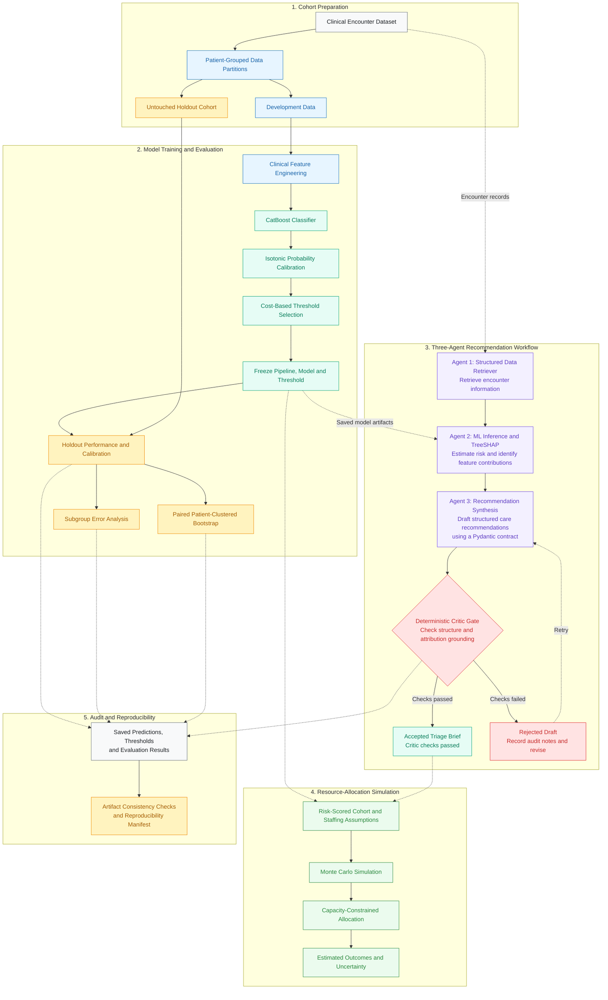

# Project DiaVigil: A Machine Learning Research Project on Hospital Readmission Risk Prediction

[](https://opensource.org/licenses/MIT)
[](https://www.python.org/downloads/)
[](https://colab.research.google.com/)
[](https://github.com/psf/black)

DiaVigil investigates the use of machine learning to estimate hospital readmission risk and support the evaluation of clinical decision-making strategies. The project includes clinical feature engineering, probability calibration, decision-threshold selection, subgroup error analysis, resource-allocation simulation, and an AI-agent workflow for generating and auditing care recommendations.

The project emphasizes reproducible model evaluation, transparent reporting of performance trade-offs, and documentation of methodological limitations.

**Project status:** Research prototype. The current results do not establish clinical effectiveness or readiness for deployment.

---
## Abstract

DiaVigil is a machine learning research project focused on hospital readmission risk prediction and the evaluation of decision-support strategies. The project uses clinical feature engineering, CatBoost classification, isotonic probability calibration, and cost-sensitive decision-threshold selection. It also examines subgroup false-negative rates, estimates uncertainty through patient-clustered bootstrap analysis, simulates resource allocation under staffing constraints, and explores an AI-agent workflow for generating and auditing care recommendations.

On a holdout cohort of 19,875 encounters, the baseline model achieved a precision-recall area under the curve (PR-AUC) of 0.2036 and a receiver operating characteristic area under the curve (ROC-AUC) of 0.6641. A revised model increased recall from 29.15% to 31.96%, while ROC-AUC decreased to 0.6578 and the number of false positives increased from 2,089 to 2,478. These results illustrate the trade-offs between identifying more patients who experience readmission and generating additional false-positive predictions. The project also evaluates probability calibration, subgroup error rates, and the consistency of saved research artifacts. The findings are limited to the available dataset and do not establish clinical effectiveness or generalizability to other healthcare settings.

### Project at a Glance

- **Research focus:** Hospital readmission risk prediction and decision-support evaluation.
- **Modeling:** Clinical feature engineering, CatBoost, and isotonic probability calibration.
- **Decision analysis:** Cost-sensitive threshold selection and resource-allocation simulation.
- **Evaluation:** Holdout performance, calibration, subgroup false-negative rates, and patient-clustered bootstrap analysis.
- **AI-agent component:** Generation and auditing of proposed care recommendations.
- **Current status:** Research prototype requiring further validation.
---


## Quickstart & Execution Protocol

This section describes how to set up DiaVigil, prepare the required data, execute the analytical workflow, and verify the generated artifacts. DiaVigil is organized into six analytical notebooks and one reproducibility-audit notebook.

### 1. Repository Setup & Dependencies

Clone the repository and install the core Python dependencies in a suitable environment.

```bash
git clone https://github.com/nmemranhussain/DiaVigil.git
cd DiaVigil

python -m venv .venv
```

Activate the environment before installing dependencies.

**macOS/Linux:**

```bash
source .venv/bin/activate
```

**Windows PowerShell:**

```powershell
.venv\Scripts\Activate.ps1
```

Install the packages used by the workflow:

```bash
python -m pip install --upgrade pip
pip install pandas numpy scikit-learn catboost optuna netcal shap pydantic joblib pyarrow
```

For reproducible execution, use the project's verified dependency specification when available. The command above installs packages but does not guarantee that every package version matches the environment used to generate the reported results.

### 2. Data Preparation & Artifact Requirements

DiaVigil uses the Diabetes 130-US Hospitals dataset covering hospital encounters from 1999–2008.

Before executing the workflow:

- Obtain the dataset from the documented source in the **Data Provenance & Access** section.
- Place the required source files, including `diabetic_data.csv` and `IDs_mapping.csv`, in the expected `data/raw/` directory.
- Review the data-processing and cohort-selection logic before generating derived datasets.
- Confirm that the required directories exist and that the environment has permission to read and write the relevant files.

The notebooks generate intermediate datasets and serialized model artifacts under the project's configured data directories. Later stages depend on outputs created by earlier stages; therefore, a fresh checkout should not be assumed to contain all required generated artifacts.

### 3. Notebook Execution Order

Execute the six analytical notebooks in numerical order. Each notebook performs a distinct stage of the research workflow.

**Step 1 — Cohort Filtering and Group Split**

`notebooks/01_diavigil_cohort_filtering_and_group_split.ipynb`

Constructs the analytical cohort, defines the target outcome, applies the documented exclusion criteria, and creates development and holdout partitions using patient-level grouping to reduce leakage across encounters belonging to the same patient.

**Step 2 — Clinical Feature Engineering**

`notebooks/02_diavigil_clinical_feature_engineering_pipeline.ipynb`

Builds the clinical feature-transformation pipeline, including comorbidity-related features and medication and healthcare-utilization indicators, and saves the fitted or configured feature-engineering artifact.

**Step 3 — Model Development and Probability Calibration**

`notebooks/03_diavigil_nested_cv_and_probability_calibration.ipynb`

Trains and evaluates the classification model, performs the documented validation and probability-calibration procedures, and selects a decision threshold under the specified error-cost assumptions. The notebook saves the model and calibration artifacts required by downstream stages.

**Step 4 — Holdout Evaluation and Subgroup Audit**

`notebooks/04_diavigil_algorithmic_fairness_and_subgroup_audit.ipynb`

Evaluates the selected model on the reserved holdout cohort, reports classification and calibration metrics, and examines subgroup error rates across the available demographic categories. Patient-clustered bootstrap analysis is used where implemented to quantify uncertainty in selected comparisons.

**Step 5 — AI-Agent Recommendation and Audit Workflow**

`notebooks/05_diavigil_agentic_triage_and_faithfulness_critic.ipynb`

Demonstrates encounter-level risk retrieval, model-based feature attribution, structured recommendation generation, and critic-based checks of whether generated recommendations are grounded in the available model-related evidence.

**Step 6 — Resource-Allocation Simulation**

`notebooks/06_diavigil_dynamic_resource_allocation_simulation.ipynb`

Simulates hypothetical resource-allocation scenarios under configured staffing and intervention-effectiveness assumptions. The workflow estimates patient outreach, potential readmissions averted, and the marginal yield of additional nursing hours.

The simulation results are conditional estimates, not evidence that the same outcomes would occur in a real hospital.

### 4. Reproducibility and Artifact Verification

After generating the required artifacts, execute the reproducibility-audit notebook:

`notebooks/00_DiaVigil_Reproducibility_Audit.ipynb`

This notebook supports inspection of saved artifacts, recorded software-environment details, artifact metadata, and implemented consistency or integrity checks.

The audit notebook is a verification stage rather than the first step of the analytical pipeline. Run it after its required inputs and artifacts are available.

A successful artifact-integrity check confirms the tested properties of the checked files; it does not, by itself, establish that the complete workflow can be recreated from raw data in a clean environment.

### 5. Expected Outputs

Depending on the notebook and configuration, the workflow produces:

- Development and holdout cohort datasets.
- Feature-engineering and model-calibration artifacts.
- Holdout evaluation and subgroup-audit results.
- Model-comparison and uncertainty-analysis reports.
- Resource-allocation simulation outputs.
- Structured AI-agent demonstration artifacts.
- A reproducibility manifest and associated verification results.

Output filenames and locations should be confirmed against the corresponding notebook code and the project's current artifact configuration.

### 6. Reproducibility Considerations

For a reliable reproduction attempt:

- Use the documented source data and exclusion criteria.
- Preserve patient-level separation between development and holdout cohorts.
- Follow the notebook dependency order.
- Use compatible package versions and the documented configuration.
- Verify that saved artifacts correspond to the intended dataset and model configuration.
- Review notebook outputs and logs for errors before interpreting the results.

**Research status:** DiaVigil is a research prototype for evaluating hospital readmission-risk prediction and related decision-support workflows. Its results do not independently establish clinical effectiveness, fairness in every relevant population, or readiness for deployment.


---
## Research Motivation and Objectives

### Motivation

Hospital readmission risk prediction is a classification problem in which the costs of different prediction errors may not be equal. Failing to identify a patient who is subsequently readmitted may represent a missed opportunity for additional care, while incorrectly identifying a patient as high risk may lead to unnecessary follow-up activities and use of limited clinical resources.

Model performance therefore cannot be assessed using a single metric alone. Discrimination, probability calibration, decision thresholds, subgroup error rates, and the resources required to act on predictions can provide different perspectives on the usefulness of a model. These considerations motivate the evaluation of readmission prediction as both a modeling problem and a decision-support problem.

DiaVigil brings these evaluation components together in a reproducible research workflow. It also examines whether an AI-agent workflow can generate structured care recommendations that are checked against predefined criteria. The project does not assume that better predictive performance necessarily leads to better clinical outcomes.

### Research Objectives

The project has the following objectives:

- **Develop a readmission risk model:** Apply clinical feature engineering and CatBoost classification to estimate readmission risk from the available encounter data.
- **Evaluate probability calibration:** Compare predicted probabilities with observed outcome frequencies to assess their agreement.
- **Examine decision thresholds:** Investigate how threshold selection affects recall, false-positive predictions, false-negative predictions, and an explicitly defined classification cost.
- **Assess subgroup errors:** Compare false-negative rates across available demographic groups and report uncertainty, particularly when subgroup outcome counts are small.
- **Estimate uncertainty:** Use patient-clustered bootstrap analysis to examine uncertainty in subgroup comparisons and differences between model evaluations.
- **Simulate resource allocation:** Explore how staffing constraints and prioritization rules affect the number of patients reached and the estimated number of readmissions potentially avoided under the simulation assumptions.
- **Audit AI-generated recommendations:** Examine whether generated care recommendations satisfy predefined structural and content checks, while recognizing that these checks alone do not establish clinical safety or correctness.

The overall objective is to establish a transparent and reproducible basis for evaluating readmission risk models and related decision-support workflows, while identifying the additional evidence required before clinical use can be considered.
---

## Data Provenance & Access

The underlying cohort is derived from the **Diabetes 130-US Hospitals (1999–2008)** clinical database, encompassing 101,766 inpatient encounters across 130 hospital facilities:

* **Canonical Academic Archive:** [UCI Machine Learning Repository (DOI: 10.24432/C5230J)](https://doi.org/10.24432/C5230J)
* **Foundational Publication:** [Strack et al. (2014), *BioMed Research International* (DOI: 10.1155/2014/781670)](https://doi.org/10.1155/2014/781670)
* **Distribution Mirror:** [Kaggle Dataset Mirror (Brandão, Ph.D.)](https://www.kaggle.com/datasets/brandao/diabetes)

For local replication, place the source files (`diabetic_data.csv` and `IDs_mapping.csv`) into the `data/raw/` directory prior to running `01_diavigil_cohort_filtering_and_group_split.ipynb`.
---
## Clinical Data Dictionary

DiaVigil uses encounter-level data from the Diabetes 130-US Hospitals dataset to study hospital readmission-risk prediction. The data include demographic information, diagnoses, diabetes medication records, laboratory-related results, and healthcare-utilization measures. The project derives additional features from these fields for model training, evaluation, subgroup analysis, and the AI-agent demonstration.

This dictionary describes the principal variables used in the current workflow. The exact columns retained in each processed dataset may differ from those in the original source files.

### 1. Identifiers and Outcome

| Variable | Description | Role |
|---|---|---|
| `encounter_id` | Identifier for an individual hospital encounter. | Record identification |
| `patient_nbr` | Identifier used to associate encounters with the same patient. | Patient grouping and leakage prevention |
| `target` | Binary outcome label used for readmission-risk classification. | Prediction target |

**Outcome-definition note:** The precise mapping from the original `readmitted` field to `target` must be documented from the cohort-preparation code. Confirm whether the positive class represents readmission within 30 days and how other readmission categories are handled before publishing the final definition.

The identifiers are retained for cohort construction, evaluation, and patient-level grouping. They are excluded from the model's predictor matrix.

### 2. Demographic and Diagnostic Variables

| Variable | Description | Use in DiaVigil |
|---|---|---|
| `age` | Age category recorded in the source dataset. | Subgroup false-negative-rate analysis |
| `gender` | Gender category recorded in the source dataset. | Subgroup analysis |
| `race` | Race category recorded in the source dataset, including an unknown category where present. | Subgroup analysis |
| `diag_1` | Primary diagnosis code recorded for the encounter. | Comorbidity feature engineering |
| `diag_2` | Secondary diagnosis code recorded for the encounter. | Comorbidity feature engineering |
| `diag_3` | Additional diagnosis code recorded for the encounter. | Comorbidity feature engineering |

Diagnosis codes are processed using selected ICD-9 code patterns to derive binary comorbidity indicators. These indicators are computational features, not independent clinical diagnoses.

### 3. Healthcare Utilization and Encounter Variables

| Variable | Description | Use in DiaVigil |
|---|---|---|
| `time_in_hospital` | Number of days spent in the hospital during the encounter. | Feature engineering |
| `number_outpatient` | Number of recorded outpatient visits in the source data. | Utilization feature |
| `number_emergency` | Number of recorded emergency visits in the source data. | Utilization feature |
| `number_inpatient` | Number of recorded inpatient visits in the source data. | Utilization feature |
| `num_medications` | Number of medications recorded for the encounter. | Encounter feature engineering |
| `num_lab_procedures` | Number of laboratory procedures recorded for the encounter. | Encounter feature engineering |
| `A1Cresult` | Recorded HbA1c result category, such as `Norm`, `>7`, `>8`, or `None`. | Glycemic-status feature engineering |

The project also uses other source variables retained by the preprocessing pipeline. Their definitions and permitted values should be documented if they are included in the final model's input schema.

### 4. Derived Clinical Features

The feature-engineering pipeline derives the following variables from the source data.

| Derived variable | Definition |
|---|---|
| `elix_congestive_heart_failure` | Binary indicator based on selected ICD-9 code patterns for congestive heart failure. |
| `elix_cardiac_arrhythmias` | Binary indicator based on selected ICD-9 code patterns for cardiac arrhythmias. |
| `elix_valvular_disease` | Binary indicator based on selected ICD-9 code patterns for valvular disease. |
| `elix_pulmonary_circulation` | Binary indicator based on selected ICD-9 code patterns for pulmonary circulation disorders. |
| `elix_peripheral_vascular` | Binary indicator based on selected ICD-9 code patterns for peripheral vascular disease. |
| `elix_hypertension_uncomplicated` | Binary indicator based on selected ICD-9 code patterns for uncomplicated hypertension. |
| `elix_hypertension_complicated` | Binary indicator based on selected ICD-9 code patterns for complicated hypertension. |
| `elix_diabetes_complicated` | Binary indicator based on selected ICD-9 code patterns for complicated diabetes. |
| `elix_renal_failure` | Binary indicator based on selected ICD-9 code patterns for renal failure. |
| `elix_fluid_electrolyte` | Binary indicator based on selected ICD-9 code patterns for fluid and electrolyte disorders. |
| `elix_chronic_pulmonary` | Binary indicator based on selected ICD-9 code patterns for chronic pulmonary disease. |
| `elix_coagulopathy` | Binary indicator based on selected ICD-9 code patterns for coagulopathy. |
| `total_elixhauser_burden` | Sum of the 12 binary comorbidity indicators above. |
| `healthcare_utilization_index` | Weighted utilization measure: outpatient visits + 2 × emergency visits + 3 × inpatient visits. |
| `active_diabetes_med_count` | Count of diabetes medication fields whose recorded value is not `No`. |
| `dosage_titration_count` | Count of diabetes medication fields recorded as `Up` or `Down`. |
| `on_insulin` | Binary indicator set to 1 when the insulin field is not recorded as `No`; otherwise 0. |
| `encounter_severity_index` | Derived measure calculated as hospital days × medication count ÷ (laboratory procedure count + 1). |
| `glycemic_status_code` | Encoded HbA1c category: `None` → 0, `Norm` → 1, and `>7` or `>8` → 2. |

**Interpretation notes:**

- These engineered variables are operational definitions implemented in the project code. They should not automatically be interpreted as validated clinical severity scores.
- `total_elixhauser_burden` counts the indicators produced by this implementation; it is not necessarily equivalent to a validated comorbidity index.
- The utilization index uses project-defined weights rather than empirically validated resource costs.
- The `glycemic_status_code` combines the `>7` and `>8` categories. The `None` category is also mapped to zero, so the resulting feature does not distinguish an unrecorded result from a normal result.
- Medication changes and counts describe recorded medication fields; they do not independently establish treatment adherence or clinical appropriateness.

### 5. Model and AI-Agent Output Fields

These fields are generated during prediction or the agent-audit workflow. They are not original clinical measurements.

| Variable | Description |
|---|---|
| `readmission_risk` | Calibrated model-estimated probability of the project's positive outcome. |
| `risk_tier` | Risk category assigned by the agent workflow. |
| `primary_risk_drivers` | Features with positive local TreeSHAP attributions selected for the encounter brief. |
| `protective_factors` | Features with negative local TreeSHAP attributions selected for the encounter brief. |
| `synthesized_care_directives` | Proposed care recommendations generated by the agent workflow. |
| `critic_audit_passed` | Boolean flag indicating whether the generated brief passed the implemented audit checks. |
| `critic_audit_notes` | Text describing the audit decision or recorded reason for rejection. |

The calibrated risk is a model estimate, not a clinical diagnosis. TreeSHAP attributions describe the model's behavior and do not establish causal relationships. Passing the critic audit does not establish that a proposed recommendation is clinically correct or safe.

### 6. Cohort Construction and Data Handling

The project begins with 101,766 source encounters. The documented cohort-preparation workflow removes 2,423 encounters under its configured discharge-disposition exclusion rules, producing a sanitized cohort of 99,343 encounters across 70,442 unique patients.

The development and holdout partitions are constructed using patient-grouped splitting to prevent encounters from the same patient from appearing across those partitions. The reserved holdout contains 19,875 encounters and is used for final evaluation rather than model fitting, probability calibration, or decision-threshold selection.

The exact outcome construction, exclusion rules, missing-value handling, and category encodings should be documented alongside the corresponding preprocessing code.

### 7. Scope and Limitations

This dictionary describes the variables and transformations documented in the current DiaVigil workflow. It is not a complete dictionary for every column in the original dataset.

The source data represent hospital encounters from 1999–2008. Variable definitions, coding conventions, and missingness patterns should be considered when interpreting results. Further documentation should identify the precise target-label mapping, all retained model inputs, and any preprocessing differences between the raw, development, and holdout datasets.

DiaVigil is a research prototype. Neither the data dictionary nor the derived features establish clinical validity, fairness, or readiness for use in patient care.

---

## Methodology and System Architecture

DiaVigil follows a sequence of data preparation, model development, probability calibration, decision-threshold selection, holdout evaluation, and decision-support analysis. The workflow also includes resource-allocation simulation and an AI-agent component for generating and checking structured care recommendations.

### 1. Data Preparation and Cohort Separation

The project uses an encounter-level dataset containing clinical, medication, healthcare-utilization, and demographic information. The available data are divided into development and holdout cohorts.

Within the development cohort, patient-grouped partitions are used to separate model training, probability calibration, and decision-threshold selection. Encounters belonging to the same patient are kept within the same partition to reduce the risk of patient-level information leakage.

The holdout cohort is reserved for final evaluation. It is not used to fit the model, calibrate its probabilities, or select its decision threshold.

### 2. Clinical Feature Engineering

A custom feature-engineering transformer derives additional variables from the available encounter data. These include:

- Comorbidity indicators derived from selected ICD-9 diagnosis codes.
- A summary measure of Elixhauser comorbidity burden.
- A healthcare-utilization index based on outpatient, emergency, and inpatient encounters.
- Diabetes medication counts and indicators of medication dosage changes.
- An insulin-use indicator.
- An encounter-severity measure based on length of stay, medication count, and laboratory procedures.
- A categorical code derived from the recorded HbA1c result.

The transformed features are passed to a preprocessing pipeline before model training and evaluation.

### 3. Model Training

DiaVigil uses CatBoost as its classification model. The current model configuration uses 400 boosting iterations, a learning rate of 0.05, a tree depth of 6, and balanced class weights.

Model training is performed using the training partition of the development cohort. The project also retains an earlier baseline model to support comparison with the revised workflow.

### 4. Probability Calibration

The model's predicted probabilities are calibrated using isotonic regression. Calibration is fitted using a separate calibration partition and a model fitted on the training partition.

Calibration is evaluated by comparing predicted risk with observed outcome frequencies across probability bins and by calculating the Brier score and expected calibration error (ECE).

These measures assess the agreement between predicted probabilities and observed outcomes; they do not, by themselves, establish that using the predictions improves clinical decisions.

### 5. Decision-Threshold Selection

A decision threshold is selected on a separate threshold-selection partition. The current implementation evaluates classification thresholds using an asymmetric cost function that assigns a higher cost to false negatives than to false positives.

The configured costs are:

- False-positive cost (\(C_{FP}\)): 1
- False-negative cost (\(C_{FN}\)): 5

The selected threshold determines which encounters are classified as positive. Changing this threshold affects recall, precision, false-positive counts, and false-negative counts.

These costs represent modeling assumptions and should not be interpreted as validated estimates of actual clinical or financial costs.

### 6. Holdout Evaluation

The selected model, calibrator, and threshold are evaluated on the reserved holdout cohort. The evaluation includes:

- Precision-recall area under the curve (PR-AUC).
- Receiver operating characteristic area under the curve (ROC-AUC).
- Brier score and calibration analysis.
- Confusion matrix, precision, recall, and false-negative rate.
- Subgroup error analysis across available age, gender, and race categories.
- Patient-clustered bootstrap estimates of uncertainty in selected comparisons.

The baseline and revised model are compared using the same holdout cohort. This comparison makes their measured performance differences easier to interpret, but it does not establish that either model will generalize to other healthcare settings.

### 7. Resource-Allocation Simulation

A Monte Carlo simulation examines how assumed intervention efficacy and available nursing hours affect resource allocation among high-risk encounters. The workflow estimates patients reached, expected readmissions potentially avoided, and uncertainty around the simulated estimates.

A capacity-constrained allocation procedure also ranks candidates using an estimated efficiency measure based on expected readmissions potentially avoided per required nursing hour.

The results depend on the simulation assumptions, intervention-efficacy distribution, and resource constraints. They are estimates from a model, not observed clinical outcomes or demonstrated cost savings.

### 8. AI-Agent Recommendation and Audit Workflow

DiaVigil includes an AI-agent workflow that generates structured care-recommendation briefs from model-related information. The briefs contain fields for estimated readmission risk, risk tier, potential risk drivers, protective factors, and proposed care directives.

A separate audit component checks generated outputs against predefined criteria. The current demonstration includes an example that passes the checks and an example that is rejected.

These checks provide an initial assessment of output structure and specified requirements. Further evaluation is needed to establish factual accuracy, clinical appropriateness, consistency, and safety. The generated recommendations are not intended to replace clinician judgment.

### 9. Reproducibility and Artifact Management

The workflow saves model artifacts, evaluation results, simulation outputs, and research audit reports for subsequent inspection. The project also includes consistency checks to verify selected relationships between saved labels, predictions, thresholds, calibration results, and evaluation artifacts.

A reproducibility manifest records the presence, file sizes, and SHA-256 hashes of key artifacts, along with the software environment versions recorded during the audit.

These checks support reproducibility and traceability within the tested workflow. They do not independently establish the correctness of every modeling decision or guarantee identical results across all software environments.

## Architectural Workflow


---

## Experimental Results

### Evaluation Setup

The baseline and revised models were evaluated on the same untouched holdout cohort of **19,875 encounters**. The cohort was kept separate from model training, probability calibration, and decision-threshold selection. Both models were evaluated using their saved predictions and operating thresholds.

The evaluation examined discrimination, probability error, classification performance, and the trade-off between false-positive and false-negative predictions.

### Holdout Performance

| Metric | Original baseline | Revised model |
|---|---:|---:|
| Holdout encounters | 19,875 | 19,875 |
| PR-AUC | 0.2036 | 0.2013 |
| ROC-AUC | 0.6641 | 0.6578 |
| Brier score | 0.0962 | 0.0961 |
| Precision | 23.81% | 22.42% |
| Recall | 29.15% | 31.96% |
| False-positive rate | 11.85% | 14.05% |
| False positives | 2,089 | 2,478 |
| False negatives | 1,587 | 1,524 |
| False-negative rate | 70.85% | 68.04% |

\*False-positive rate (FPR) = FP / (FP + TN), representing the proportion of actual negative cases incorrectly classified as positive.
The revised model used a selected decision threshold of approximately **0.1620** and an assumed classification cost of 1 for a false positive and 5 for a false negative.

### Interpretation of the Results

The revised model increased recall from 29.15% to 31.96% and reduced false negatives from 1,587 to 1,524. This represents 63 fewer missed positive cases in the evaluated cohort.

However, false positives increased from 2,089 to 2,478, while precision decreased from 23.81% to 22.42%. ROC-AUC also decreased from 0.6641 to 0.6578, and PR-AUC decreased from 0.2036 to 0.2013. The Brier score changed only slightly, from 0.096154 to 0.096093.

These results indicate a change in the operating-point trade-off rather than a consistent improvement across all metrics.

### Paired Patient-Clustered Bootstrap Analysis

A paired patient-clustered bootstrap with 1,000 valid replicates was used to estimate uncertainty in the differences between the two models. Encounters belonging to the same patient were sampled together to account for repeated encounters within patients.

| Metric difference (revised − baseline) | Estimate | 95% bootstrap confidence interval |
|---|---:|---:|
| PR-AUC | −0.00227 | [−0.00807, 0.00362] |
| ROC-AUC | −0.00627 | [−0.01091, −0.00136] |
| Brier score | −0.000061 | [−0.000411, 0.000276] |
| Recall | +0.02813 | [+0.01543, +0.04162] |
| False-negative rate | −0.02813 | [−0.04162, −0.01543] |
| Cost per 1,000 encounters* | +3.72 | [−4.50, +11.75] |

\*Calculated using the project's assumed false-positive and false-negative costs.

The paired analysis indicates that the 95% bootstrap confidence intervals for the recall increase and false-negative-rate reduction excluded zero. The ROC-AUC decrease was also distinguishable from zero. The confidence intervals for PR-AUC, Brier score, and estimated cost per 1,000 encounters included zero.

These comparisons do not establish that the revised model is universally preferable. Model selection depends on the intended use, the relative consequences of each error type, and the validity of the assumed cost structure.

### Calibration and Subgroup Evaluation

The audit also examined agreement between predicted probabilities and observed outcome frequencies, as well as false-negative rates across available age, gender, and race categories. Patient-clustered bootstrap analysis was used to quantify uncertainty in selected subgroup comparisons.

Subgroup estimates require particular caution when positive-outcome counts are small. Differences in observed error rates do not, by themselves, establish the cause of a disparity or demonstrate that a model is fair or unfair in every relevant sense.

Calibration and subgroup analyses are reported as evaluation results for this dataset. They do not establish clinical usefulness, fairness in other populations, or improved patient outcomes.

### Summary

On the evaluated holdout cohort, the revised model traded some discrimination and precision for higher recall and fewer false negatives. *The paired bootstrap confidence interval for the recall difference excluded zero*, but did not establish a reduction in the project's estimated classification cost.

DiaVigil therefore treats model performance as a set of related measures rather than relying on a single score. Further validation on an independent cohort, review of the assumed error costs, and assessment of clinical and operational requirements are necessary before drawing conclusions about clinical use.

---

## Calibration and Subgroup Fairness Analysis

### Probability Calibration

Probability calibration examines whether predicted readmission risks agree with observed outcome frequencies. For example, among encounters assigned a predicted risk of 10%, the observed outcome rate should be close to 10% if the probabilities are well calibrated.

DiaVigil evaluates calibration using an equal-frequency, 10-bin analysis. Within each bin, the mean predicted risk is compared with the observed outcome rate. Expected calibration error (ECE) summarizes the weighted average absolute difference between these quantities.

On the holdout cohort of 19,875 encounters, the revised model achieved an ECE of **0.00656**. This corresponds to a weighted average absolute difference of approximately 0.656 percentage points across the evaluated bins.

Calibration describes the agreement between predicted probabilities and observed outcomes. It does not establish that the model identifies the patients who would benefit most from intervention or that using its predictions improves clinical outcomes.

### False-Negative Rate by Age Group

The subgroup audit examines false-negative rates (FNRs) across age groups. FNR measures the proportion of actual positive outcomes that the model fails to identify:

`FNR = False Negatives / (False Negatives + True Positives)`

The audit uses a minimum of 50 positive outcomes when calculating the observed FNR gap between groups. The following table presents the age groups that meet this requirement.

| Age group | Positive outcomes | False negatives | FNR |
|---|---:|---:|---:|
| 30–40 | 89 | 51 | 57.30% |
| 40–50 | 191 | 133 | 69.63% |
| 50–60 | 341 | 220 | 64.52% |
| 60–70 | 486 | 343 | 70.58% |
| 70–80 | 603 | 407 | 67.50% |
| 80–90 | 413 | 286 | 69.25% |
| 90–100 | 58 | 48 | 82.76% |

Among groups meeting the minimum-count requirement, the observed FNR ranged from 57.30% for ages 30–40 to 82.76% for ages 90–100, a difference of 25.46 percentage points.

This difference identifies an area for further investigation. The oldest group's estimate is based on 58 positive outcomes, so uncertainty remains important. Groups with fewer than 50 positive outcomes were excluded from this particular gap calculation because their estimates may be less stable.

### False-Negative Rate by Gender

The audit compared observed FNRs across the two reported gender categories.

| Group | Positive outcomes | False negatives | FNR |
|---|---:|---:|---:|
| Female | 1,188 | 802 | 67.51% |
| Male | 1,052 | 722 | 68.63% |

The observed FNR was 1.12 percentage points higher for the male group. This is a descriptive difference within the evaluated cohort. It does not establish equivalent model performance across all populations or prove that the model is fair across gender categories.

### False-Negative Rate by Race

The audit also examined FNRs across the available race categories. The primary gap calculation included only groups with at least 50 positive outcomes.

| Group | Positive outcomes | False negatives | FNR |
|---|---:|---:|---:|
| African American | 417 | 285 | 68.35% |
| Caucasian | 1,731 | 1,177 | 68.00% |

The observed difference between these groups was approximately 0.35 percentage points, with a higher FNR for the African American group.

Other race categories had fewer than 50 positive outcomes and were excluded from this minimum-count comparison. Their exclusion from the gap calculation does not mean that their results are unimportant; rather, estimates based on small numbers of positive outcomes require particular caution.

The small observed difference between the two groups included in the comparison does not establish fairness across race categories. It also does not identify the causes of any differences in model performance.

### Limitations and Interpretation

The calibration and subgroup analyses have several limitations:

- **Dataset dependence:** The results describe the evaluated holdout cohort and may differ in other healthcare settings.
- **Small subgroup counts:** FNR estimates based on relatively few positive outcomes may be uncertain.
- **Metric selection:** Similar FNRs do not establish fairness across other error measures, demographic groups, or clinical outcomes.
- **Calibration versus clinical usefulness:** Agreement between predicted risks and observed outcome frequencies does not demonstrate that the predictions improve care.
- **No causal conclusions:** Differences in observed error rates do not, by themselves, explain why the differences occur.

DiaVigil uses these analyses to document model behavior, identify subgroup differences for further investigation, and report calibration and error patterns in the available data. Independent validation, additional uncertainty analysis, and clinical review would be required before drawing conclusions about clinical use.

---

## Resource-Allocation Simulation

DiaVigil includes a resource-allocation simulation to examine how different nursing-hour budgets may affect patient outreach and the estimated number of hospital readmissions potentially averted. The simulation uses model-derived risk estimates, assumed intervention effectiveness, and staffing constraints. Its outputs are estimates under the specified assumptions, not measurements of actual clinical outcomes.

### Simulation Setup

The workflow evaluates allocation scenarios with different nursing-hour budgets and estimates the number of patients reached, nursing hours utilized, and readmissions potentially averted. It also examines the marginal estimated yield associated with additional nursing hours.

The saved simulation artifact contains three outputs:

- **Allocation summary:** Compares selected nursing-hour budgets and reports patients reached, hours utilized, expected readmissions averted, true readmissions caught, and cohort precision.
- **Capacity frontier:** Evaluates 25 nursing-hour budgets, ranging from 200 to 5,000 hours, to examine how patient outreach and estimated readmissions averted change as capacity increases.
- **Monte Carlo bounds:** Records the simulated mean estimate and its associated uncertainty bounds under the configured assumptions.

### Selected Resource-Allocation Results

| Nurse-hour budget | Patients reached | Hours utilized | Expected readmissions averted | True readmissions caught | Cohort precision |
|---:|---:|---:|---:|---:|---:|
| 500 | 176 | 499.8 | 21.35 | 64 | 36.36% |
| 1,500 | 465 | 1,498.0 | 52.48 | 131 | 28.17% |
| 3,000 | 879 | 2,997.5 | 91.15 | 224 | 25.48% |

### Capacity Frontier and Marginal Yield

The capacity-frontier analysis estimates how outreach and potential readmission prevention change across a wider range of staffing budgets. In the saved results, estimated readmissions averted increase from approximately 9.91 at 200 nurse-hours to 135.08 at 5,000 nurse-hours.

The estimated marginal yield declines as the budget increases. For example, the saved output reports approximately 3.91 additional estimated readmissions averted per 100 nurse-hours at the 400-hour point, compared with approximately 2.07 at the 5,000-hour point. This pattern suggests diminishing marginal yield within the simulation.

These estimates describe the behavior of the configured allocation model. They do not establish that increasing nursing hours in a real hospital would produce the same outcomes.

### Monte Carlo Results

The saved simulation artifact reports the following summary:

- **Mean estimated readmissions averted:** 231.55
- **Lower uncertainty bound:** 228.06
- **Upper uncertainty bound:** 235.12

These bounds reflect the simulation's assumptions and implementation. They should not be interpreted as a clinical confidence interval or as evidence of realized reductions in readmissions.

### Limitations

The resource-allocation results depend on the assumptions used to estimate intervention effectiveness, the risk model's predictions, and the available staffing capacity. The simulation does not independently demonstrate that an intervention prevents readmissions, that the allocation strategy improves patient outcomes, or that a hospital would achieve financial savings.

Further evaluation would require defensible intervention-effectiveness estimates, operational validation of staffing assumptions, and evidence from an appropriate external or prospective study.

### Summary  
The simulation provides a way to compare hypothetical staffing budgets and examine the relationship between outreach capacity and estimated readmission prevention. It supports resource-allocation analysis with the DiaVigil research prototype but does not establish clinical effectiveness or real world- cost savings.

---

## AI-Agent Recommendation and Audit Workflow

DiaVigil includes an AI-agent workflow that generates structured care-recommendation briefs using encounter data, readmission-risk predictions, and model-derived feature attributions. The workflow is intended to demonstrate how model outputs can be organized into recommendations and checked against predefined criteria.

### Agent 1: Encounter Data Retrieval

The first component identifies an encounter for review and supplies the information needed by the subsequent workflow. The demonstration selects a high-risk encounter from the evaluation data, falling back to the encounter with the highest predicted risk when no encounter exceeds the configured threshold.

The available implementation uses saved evaluation predictions when the corresponding audit artifact exists. Otherwise, it computes predictions from the saved feature pipeline and probability calibrator. The encounter is then passed to the agent workflow for further processing.

### Agent 2: Risk Inference and Feature Attribution

The second component obtains the encounter's estimated readmission risk and identifies features contributing to the model's prediction. The workflow uses the saved feature-engineering pipeline, probability calibrator, and decision threshold. Local TreeSHAP attributions are used to identify risk-related and protective features.

These attributions provide information about the model's prediction; they do not establish causal relationships between individual features and readmission outcomes.

### Agent 3: Structured Recommendation Generation

The third component generates a structured brief containing the encounter identifier, estimated readmission risk, risk category, contributing and protective features, and proposed care directives.

The brief follows a defined data structure so that its fields can be inspected and evaluated by the audit component. The generated directives are proposed recommendations, not independently validated clinical instructions.

### Critic Audit and Pass/Reject Evaluation

A separate critic evaluates whether the generated directives are supported by the model-derived risk information. The saved demonstration contains two examples:

- **Accepted example:** The audit passed, with three care directives reported as grounded in verified risk drivers.
- **Rejected example:** The audit failed because the directives referenced clinical factors that were unsupported by the local TreeSHAP attributions. The saved audit notes indicate that regeneration was required.

These examples demonstrate the intended pass/reject behavior for the tested cases. They do not establish that every unsupported statement will be detected or that rejected recommendations are automatically regenerated.

### Limitations

The agent workflow is a research demonstration. Passing the critic's checks does not establish that a recommendation is clinically correct, safe, complete, or appropriate for a particular patient. TreeSHAP attributions explain model behavior rather than clinical causation, and the audit depends on the criteria implemented in the critic.

Further evaluation would be needed to measure the reliability of recommendation generation, the critic's ability to detect unsupported claims, and the effectiveness of any regeneration process. Clinical review and human oversight would be required before considering use in patient care.

### Summary

DiaVigil demonstrates a workflow that connects encounter-level risk estimation, local feature attribution, structured recommendation generation, and a pass/reject audit. The saved examples provide evidence of both accepted and rejected outputs, while the system's clinical accuracy and safety remain unvalidated.

---


## Reproducibility and Artifact Management

DiaVigil saves model artifacts, cohort data, evaluation results, simulation outputs, and research audit reports to support inspection and verification of the completed workflow. A reproducibility manifest records the saved artifacts and selected details of the software environment.

### Reproducibility Manifest

The Step 30 manifest (`step30_reproducibility_manifest.json`) records the project name, manifest creation timestamp, Python version, operating platform, selected package versions, and metadata for each listed artifact.

The recorded environment includes Python 3.13.16 on Linux x86-64, with versions specified for NumPy, pandas, scikit-learn, CatBoost, joblib, and PyArrow.

### Artifact Inventory and Integrity

The manifest lists 15 artifacts, including:

- Development and holdout cohort files in Parquet format.
- The saved feature-engineering pipeline and model calibration artifacts.
- Holdout evaluation and subgroup fairness results.
- Baseline comparison and patient-clustered bootstrap results.
- Resource-allocation simulation outputs and agent-audit examples.
- Research audit and final model-decision reports.

A subsequent integrity check confirmed that all 15 listed artifacts existed and that their current file sizes and SHA-256 hashes matched the manifest. This provides evidence that the checked files had not changed relative to their recorded metadata at the time of verification.

### Cross-Artifact Consistency

The workflow also includes checks of selected relationships between saved cohort labels, predictions, decision thresholds, evaluation results, calibration outputs, and subgroup audit artifacts. In Step 28C, all 18 implemented consistency checks passed.

These checks establish consistency for the tested relationships. They do not independently establish the correctness of every model prediction, the validity of the modeling assumptions, or the clinical usefulness of the results.

### Reproducibility Limitations

The manifest documents selected environment details and saved-artifact metadata, but it does not, by itself, demonstrate that the entire project can be recreated from raw data in a fresh environment. The recorded package versions also do not constitute a complete dependency specification.

Reproducing the full workflow would require access to the necessary source notebooks, input data, dependencies, configuration settings, and execution procedures. Further validation in a clean environment would help establish whether the workflow can be rerun and its results reproduced.

### Summary

DiaVigil includes a manifest-based record of its saved artifacts, recorded software versions, SHA-256 hashes, and selected cross-artifact consistency checks. All 15 listed artifacts passed the documented integrity verification, and all 18 Step 28C consistency checks passed. These results support artifact traceability and consistency within the tested workflow, while full end-to-end reproducibility remains a separate requirement.

---

## Repository Structure & Reproducibility Guide

DiaVigil is organized into modular Jupyter notebooks covering cohort construction, clinical feature engineering, model development, probability calibration, subgroup evaluation, AI-agent recommendation auditing, and resource-allocation simulation.

### Notebook Inventory

```text
notebooks/
├── 01_diavigil_cohort_filtering_and_group_split.ipynb
│   └── Cohort construction, target definition, and patient-level data splitting
├── 02_diavigil_clinical_feature_engineering_pipeline.ipynb
│   └── Clinical feature engineering and transformation pipeline
├── 03_diavigil_nested_cv_and_probability_calibration.ipynb
│   └── Model training, cross-validation, probability calibration, and threshold selection
├── 04_diavigil_algorithmic_fairness_and_subgroup_audit.ipynb
│   └── Holdout evaluation and subgroup error analysis
├── 05_diavigil_agentic_triage_and_faithfulness_critic.ipynb
│   └── Structured recommendation generation and critic-based auditing
├── 06_diavigil_dynamic_resource_allocation_simulation.ipynb
│   └── Monte Carlo simulation and capacity-constrained resource allocation
└── 00_DiaVigil_Reproducibility_Audit.ipynb
    └── Artifact integrity and reproducibility checks
```

### Execution and Reproducibility

Run the analytical notebooks in their documented dependency order, beginning with cohort construction and continuing through feature engineering, model development, evaluation, recommendation auditing, and simulation.

Run the reproducibility audit after the required artifacts have been generated. The audit notebook should be treated as a verification step rather than automatically as the first notebook to execute.

The workflow may depend on source data, saved artifacts, software versions, configuration settings, and access to the required files. Successful execution of an individual notebook does not by itself establish end-to-end reproducibility.

---

# Limitations and Future Work

DiaVigil is a research prototype for evaluating hospital readmission risk prediction, probability calibration, decision thresholds, subgroup errors, resource-allocation strategies, and AI-generated care recommendations. Its results provide a reproducible basis for methodological investigation but do not establish clinical effectiveness, operational readiness, or generalizability to other healthcare settings.

## Dataset and Cohort Definition

The project uses the UCI Diabetes 130-US Hospitals dataset, which contains hospital encounters from 1999–2008. Its historical setting limits the extent to which findings can be generalized to contemporary clinical practice, coding conventions, treatment patterns, and patient populations.

The available structured data also omit potentially important determinants of readmission, including medication affordability, food security, transportation access, and health literacy. The categorical representation of glycated hemoglobin (`A1Cresult`) limits the analysis of granular glycemic variation. In addition, the dataset may not capture out-of-hospital mortality or readmissions to non-participating facilities, potentially limiting the completeness of observed outcomes.

Future work should document the cohort construction and outcome definition in greater detail, evaluate the effects of missing information, and validate the workflow using more recent, independent data.

## Model Evaluation and Selection

The revised model increased recall from 29.15% to 31.96% and reduced false negatives from 1,587 to 1,524 on the evaluated holdout cohort. However, it also produced more false positives and lower PR-AUC and ROC-AUC than the baseline model. The paired patient-clustered bootstrap analysis did not establish a statistically distinguishable improvement in the principal discrimination metrics or the project's assumed classification cost.

These findings illustrate the trade-offs associated with model selection and decision-threshold changes. Future experiments should define the intended decision-support objective in advance, justify the assumed costs of false-positive and false-negative predictions, and evaluate whether the observed trade-offs are appropriate for that objective.

## Probability Calibration

The project evaluates probability calibration using the Brier score and expected calibration error (ECE). These metrics describe agreement between predicted probabilities and observed outcome frequencies in the evaluated cohort, but they do not establish that the predictions improve clinical decisions.

Future work should include calibration plots, uncertainty estimates, complementary calibration metrics, and evaluation on an independent cohort to assess whether calibration performance generalizes beyond the current dataset.

## Subgroup Error Analysis

The subgroup audit examines false-negative rates across available age groups, gender categories, and race categories. The observed differences identify areas for further investigation, but some subgroup estimates are based on relatively few positive outcomes and may therefore be uncertain.

Future analysis should report subgroup sample sizes and uncertainty intervals alongside observed error rates, investigate the stability of the results across independent cohorts, and evaluate proposed fairness interventions against both overall performance and subgroup outcomes. Subgroup comparisons alone do not establish the cause of observed disparities or demonstrate that the model is fair or unfair in every relevant setting.

## AI-Agent Recommendation and Audit Workflow

DiaVigil includes a multi-agent workflow that generates structured care-recommendation briefs and checks whether proposed directives are supported by model-derived feature attributions. The saved demonstration includes an accepted example and a rejected example containing unsupported claims. These examples demonstrate the intended behavior for the tested cases, but they do not establish the reliability of recommendation generation or the critic's ability to detect all unsupported statements.

Future work should evaluate a broader range of encounters and failure conditions, measure the frequency of unsupported recommendations, and assess the consistency of audit decisions. Stronger rule-based or formal constraint verification could be explored to supplement the existing attribution-grounding checks. Clinical review and human oversight would remain necessary before any consideration of patient-care use.

## Resource-Allocation Simulation

The resource-allocation component estimates patient outreach and potentially averted readmissions under specified intervention-effectiveness and staffing assumptions. Its outputs describe the behavior of the configured simulation; they are not observed reductions in readmissions or demonstrated hospital savings.

Future work should justify the intervention-effectiveness assumptions, test alternative staffing constraints and allocation strategies, and evaluate the sensitivity of the results to uncertain inputs. Operational or financial benefits should not be claimed without appropriate empirical evidence.

## External Validation and Reproducibility

The current findings are based on the available dataset and its reserved holdout cohort. The reproducibility manifest and artifact-integrity checks support traceability of the saved artifacts, while the documented consistency checks support the specific relationships tested within the workflow. These checks do not independently establish clinical validity or guarantee that the entire project can be reproduced from raw data in a clean environment.

Future work should evaluate the workflow on an independent, contemporary cohort and document the dependencies, configuration settings, data-access requirements, and execution procedures needed for a clean-environment reproduction. If supported by appropriate data governance and clinical partnerships, integration with healthcare interoperability standards such as HL7 FHIR could be explored as a separate future development.

## AI Assistance Disclosure

Generative AI tools were used to assist with development tasks such as code refactoring, boilerplate generation, and Markdown formatting. The project uses conventional machine-learning and explainability components for risk prediction, probability calibration, and feature attribution, while the AI-agent workflow organizes and audits proposed recommendations. This disclosure describes the assistance used during development; it does not replace documentation of the actual implementation or independent verification of experimental results.

## Summary

DiaVigil demonstrates a research workflow that connects readmission risk prediction with calibration, decision-threshold analysis, subgroup auditing, resource-allocation simulation, AI-generated recommendations, and artifact management. Its findings highlight performance trade-offs and areas requiring further investigation. The next stage should prioritize independent validation, uncertainty-aware subgroup analysis, stronger recommendation auditing, sensitivity analysis of simulation assumptions, and improved end-to-end reproducibility before any claims of clinical effectiveness or deployment readiness are considered.

---

## Citation & Attribution

If you use the DiaVigil codebase, adapt its methodology, or refer to its reported findings, please cite the project repository and the relevant original data sources.

### DiaVigil Project

```bibtex
@misc{hussain2026diavigil,
  author       = {Hussain, N M Emran},
  title        = {Project DiaVigil: Calibrated Machine Learning,
                  Algorithmic Fairness Auditing, and Grounded
                  Multi-Agent Decision Support},
  year         = {2026},
  publisher    = {GitHub},
  howpublished = {\url{https://github.com/nmemranhussain/DiaVigil}}
}
```

### Underlying Dataset and Research

- **Dataset:** UCI Machine Learning Repository, *Diabetes 130-US Hospitals for Years 1999–2008*. Cite the dataset record when using or discussing the underlying data.
- **Related publication:** Strack, B., DeShazo, J. P., Gennings, C., et al. (2014). *Impact of HbA1c Measurement on Hospital Readmission Rates: Analysis of 70,000 Clinical Database Patient Records*. *BioMed Research International*. https://doi.org/10.1155/2014/781670

Please distinguish the original dataset and published research from DiaVigil's own implementation, experiments, and findings. The project is a research prototype, and its results require independent validation before clinical conclusions can be drawn.
