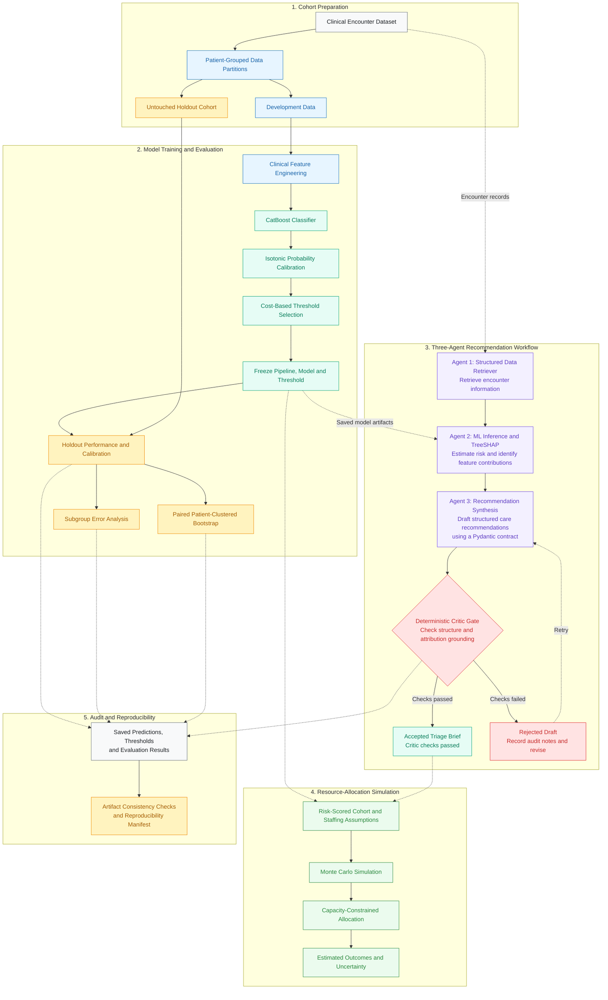

# Project DiaVigil: A Machine Learning Research Project on Hospital Readmission Risk Prediction

[](https://opensource.org/licenses/MIT)
[](https://www.python.org/downloads/)
[](https://colab.research.google.com/)
[](https://github.com/psf/black)

- DiaVigil investigates the use of machine learning to estimate hospital readmission risk and examine related decision-support methods using historical hospital encounter data. The project includes clinical feature engineering, probability calibration, decision-threshold selection, subgroup error analysis, resource-allocation simulation, and an experimental AI-agent workflow for generating structured care recommendations and checking them against predefined criteria.

- The project focuses on evaluating predictive performance, examining trade-offs between missed readmissions and false-positive predictions, assessing subgroup differences, and documenting the methods and limitations of the analysis. Saved research artifacts and consistency checks support verification of the reported results.

- **Project status:** Research prototype evaluated on historical data. The results do not establish clinical effectiveness, recommendation safety, generalizability to other healthcare settings, or readiness for deployment.

---
## Abstract

DiaVigil is a machine learning research project examining hospital readmission risk prediction and related decision-support methods using the Diabetes 130-US Hospitals dataset (1999–2008). The study evaluates predictive performance, probability calibration, classification thresholds, subgroup error rates, and the use of model outputs in experimental resource-allocation and care-recommendation workflows.

Following the documented cohort exclusions, 100,114 hospital encounters were eligible for analysis. The study used patient-level separation between development and holdout cohorts, reserving 19,875 encounters for evaluation. A CatBoost classification model was trained using clinical feature engineering, followed by isotonic probability calibration and cost-sensitive threshold selection. The evaluation also included subgroup false-negative analysis and paired patient-cluster bootstrap comparisons with 1,000 replicates.

On the holdout cohort, the revised model achieved a precision-recall area under the curve (PR-AUC) of 0.2013 and a receiver operating characteristic area under the curve (ROC-AUC) of 0.6578, compared with 0.2036 and 0.6641 for the original baseline. Recall increased from 29.15% to 31.96%, while false-positive predictions increased from 2,089 to 2,478. The paired bootstrap analysis indicated a decrease in ROC-AUC and an increase in recall, illustrating a trade-off between discrimination and identifying additional positive outcomes.

The project also demonstrates hypothetical resource-allocation simulations and a structured AI-agent recommendation workflow with predefined audit checks. These components have not been clinically validated. The findings are limited to the evaluated historical dataset and do not establish clinical effectiveness, generalizability, recommendation safety, or readiness for deployment.

---
## Project at a Glance

- **Research focus:** Hospital readmission risk prediction and evaluation of related decision-support methods using historical hospital encounter data.
- **Dataset:** Diabetes 130-US Hospitals dataset (1999–2008), with 100,114 eligible encounters after documented exclusions and 19,875 encounters reserved for holdout evaluation.
- **Modeling:** CatBoost classification, clinical feature engineering, isotonic probability calibration, and cost-sensitive decision-threshold selection.
- **Evaluation:** Holdout PR-AUC, ROC-AUC, Brier score, precision, recall, confusion-matrix outcomes, and subgroup false-negative rates.
- **Uncertainty analysis:** Paired patient-cluster bootstrap with 1,000 replicates to estimate uncertainty in differences between the original baseline and revised model.
- **Resource-allocation simulation:** Hypothetical nursing-hour allocation scenarios examining estimated patient outreach and potentially averted readmissions under specified assumptions.
- **AI-agent workflow:** Experimental generation of structured care-recommendation briefs using model-derived information, followed by deterministic checks against predefined criteria.
- **Reproducibility:** Saved research artifacts, prediction-alignment verification, cross-artifact consistency checks, and recorded artifact metadata and SHA-256 hashes.
- **Current status:** Research prototype evaluated on historical data; independent external validation and clinical assessment have not been performed.

---

## Quickstart & Execution Protocol

This section describes how to set up DiaVigil, prepare the required data, execute the analytical workflow, and verify the generated artifacts. DiaVigil is organized into six analytical notebooks and one reproducibility-audit notebook.

### 1. Repository Setup & Dependencies

Clone the DiaVigil repository and create a Python virtual environment.

```bash
git clone https://github.com/nmemranhussain/DiaVigil.git
cd DiaVigil

python -m venv .venv
```

Activate the virtual environment.

**macOS/Linux:**

```bash
source .venv/bin/activate
```

**Windows PowerShell:**

```powershell
.\.venv\Scripts\Activate.ps1
```

Install the main Python dependencies:

```bash
python -m pip install --upgrade pip
python -m pip install numpy pandas scikit-learn catboost optuna netcal shap pydantic joblib pyarrow
```

The research notebooks were executed using Google Colab with Google Drive storage. Some notebook paths and environment setup instructions are specific to that environment and may require modification for local execution.

**Recorded research environment**

Notebook 00, Step 30, recorded the following package versions:

| Package | Recorded version |
|---|---|
| Python | 3.13.16 |
| NumPy | 2.1.3 |
| pandas | 2.2.3 |
| scikit-learn | 1.6.1 |
| CatBoost | 1.2.10 |
| joblib | 1.6.0 |
| PyArrow | 23.0.1 |

These versions document the environment recorded during the artifact audit. The installation command above does not pin package versions, and the project has not yet demonstrated complete end-to-end reproduction in a fresh environment.

### 2. Data Preparation & Artifact Requirements

DiaVigil uses the Diabetes 130-US Hospitals dataset covering hospital encounters from 1999–2008.

Before executing the workflow:

- Obtain the dataset from the documented source in the **Data Provenance & Access** section.
- Place the required source files, including `diabetic_data.csv` and `IDs_mapping.csv`, in the expected `data/raw/` directory.
- Review the data-processing and cohort-selection logic before generating derived datasets.
- Confirm that the required directories exist and that the environment has permission to read and write the relevant files.

The notebooks generate intermediate datasets and serialized model artifacts under the project's configured data directories. Later stages depend on outputs created by earlier stages; therefore, a fresh checkout should not be assumed to contain all required generated artifacts.

The published notebooks use Google Drive paths under `/content/drive/MyDrive/DiaVigil/`. Researchers executing them locally must adapt these paths and ensure that the expected input files and intermediate artifacts are available.

### 3. Notebook Execution Order

Execute analytical Notebooks 01–06 in numerical order. After their required artifacts have been generated, execute Notebook 00 for the revised-model development, comparative evaluation, and research-artifact verification.

**Step 1 — Cohort Filtering and Group Split**

`notebooks/01_diavigil_cohort_filtering_and_group_split.ipynb`

- Constructs the analytical cohort, defines the target outcome, applies the documented exclusion criteria, and creates development and holdout partitions using patient-level grouping to reduce leakage across encounters belonging to the same patient.

**Step 2 — Clinical Feature Engineering**

`notebooks/02_diavigil_clinical_feature_engineering_pipeline.ipynb`

- Builds the clinical feature-transformation pipeline, including comorbidity-related features and medication and healthcare-utilization indicators, and saves the fitted or configured feature-engineering artifact.

**Step 3 — Model Development and Probability Calibration**

`notebooks/03_diavigil_nested_cv_and_probability_calibration.ipynb`

- Trains the original CatBoost classification model using patient-grouped cross-validation, applies isotonic probability calibration, and selects a decision threshold under the specified error-cost assumptions. The notebook saves the original model and calibration artifacts used in subsequent evaluation and comparison.

- The revised modeling procedure is documented separately in Notebook 00, Steps 23A–23C, which use distinct patient-grouped training, calibration, and threshold-selection partitions.

**Step 4 — Holdout Evaluation and Subgroup Audit**

`notebooks/04_diavigil_algorithmic_fairness_and_subgroup_audit.ipynb`

- Evaluates the original model on the reserved holdout cohort and reports classification performance and subgroup error rates across the available demographic categories.

- The revised model's holdout evaluation, calibration analysis, subgroup false-negative audit, and paired patient-cluster bootstrap comparison are documented in Notebook 00, Steps 23–27.

**Step 5 — AI-Agent Recommendation and Audit Workflow**

`notebooks/05_diavigil_agentic_triage_and_faithfulness_critic.ipynb`

- Demonstrates encounter-level risk retrieval, model-based feature attribution, structured recommendation generation, and critic-based checks of whether generated recommendations are grounded in the available model-related evidence.

**Step 6 — Resource-Allocation Simulation**

`notebooks/06_diavigil_dynamic_resource_allocation_simulation.ipynb`

- Simulates hypothetical resource-allocation scenarios under configured staffing and intervention-effectiveness assumptions. The workflow estimates patient outreach, potential readmissions averted, and the marginal yield of additional nursing hours.

- The simulation results are conditional estimates, not evidence that the same outcomes would occur in a real hospital.

**Final Stage — Research Audit and Artifact Verification**

`notebooks/00_DiaVigil_Reproducibility_Audit.ipynb`

- Notebook 00 contains the revised modeling and evaluation workflow and the subsequent research-audit procedures:

- Steps 23–24: Revised model development, holdout evaluation, calibration, and subgroup false-negative analysis.

- Steps 25–27: Same-holdout baseline comparison, paired patient-cluster bootstrap, and research summary.

- Steps 28–29: Artifact inspection, cross-artifact consistency checks, and final research decision report.

- Step 30: Artifact manifest containing recorded environment details, file sizes, and SHA-256 hashes.

- Step 31: Verification that saved baseline and revised-model predictions can be reproduced from their respective saved artifacts on the same holdout rows.

- Notebook 00 depends on outputs from the earlier analytical notebooks. It should be executed after those required artifacts have been generated, rather than treated as the first notebook in the pipeline.

- The verification results support the documented artifact relationships and saved-prediction consistency. They do not independently establish complete end-to-end reproducibility from raw data.

### 4. Reproducibility and Artifact Verification

After generating the required analytical artifacts, execute:

`notebooks/00_DiaVigil_Reproducibility_Audit.ipynb`

The notebook documents the revised modeling procedure, comparative evaluation, and research-artifact verification.

The recorded audit results include:

- **Artifact inventory:** All 15 expected research artifacts were present.
- **Artifact inspection:** Six selected serialized artifacts were successfully loaded and inspected.
- **Cross-artifact consistency:** All 18 implemented checks passed.
- **Prediction verification:** Step 31 reproduced the saved baseline and Step 23 probability arrays from their respective saved model artifacts on the same 19,875 holdout encounters.
- **Artifact manifest:** Step 30 recorded software-environment information, artifact sizes, and SHA-256 hashes for 15 research files.

These checks confirm the tested artifact availability, successful loading, internal consistency, and saved-prediction reproducibility within the recorded environment. The SHA-256 manifest supports subsequent file-integrity verification. These results do not demonstrate that the complete workflow has been independently reproduced from raw data in a clean environment.

The saved model artifacts should be loaded only from trusted sources because serialized Python objects may execute code during deserialization.

### 5. Expected Outputs

Depending on the notebook and configuration, the workflow produces:

- Development and holdout cohort datasets.
- Feature-engineering and model-calibration artifacts.
- Holdout evaluation and subgroup-audit results.
- Model-comparison and uncertainty-analysis reports.
- Resource-allocation simulation outputs.
- Structured AI-agent demonstration artifacts.
- A reproducibility manifest and associated verification results.

Output filenames and locations should be confirmed against the corresponding notebook code and the project's current artifact configuration.

### 6. Reproducibility Considerations

For a reliable reproduction attempt:

- Use the documented source data and exclusion criteria.
- Preserve patient-level separation between development and holdout cohorts.
- Follow the notebook dependency order.
- Use compatible package versions and the documented configuration.
- Verify that saved artifacts correspond to the intended dataset and model configuration.
- Review notebook outputs and logs for errors before interpreting the results.

**Research status:** DiaVigil is a research prototype for evaluating hospital readmission-risk prediction and related decision-support workflows. Its results do not independently establish clinical effectiveness, fairness in every relevant population, or readiness for deployment.

---

## Research Motivation and Objectives

### Research Motivation

Hospital readmissions are an important subject of healthcare quality and resource-management research. Predicting which patients may experience readmission can help researchers examine how risk estimates might inform follow-up planning and the allocation of limited care-management resources. However, predictive models must be evaluated beyond their overall classification accuracy, particularly when missed readmissions and unnecessary interventions have different consequences.

DiaVigil uses historical hospital encounter data to investigate these questions. The project examines whether machine learning risk estimates can be evaluated through probability calibration, cost-sensitive decision thresholds, subgroup error analysis, and hypothetical resource-allocation scenarios. It also explores the use of structured AI-generated care-recommendation briefs with predefined checks, without assuming that these recommendations are clinically appropriate or effective.

### Research Objectives

1. **Evaluate readmission-risk prediction:** Develop and compare CatBoost-based classification models for predicting the dataset-defined readmission outcome within 30 days, using patient-level separation and a reserved holdout cohort to assess predictive performance.

2. **Examine calibration and decision thresholds:** Assess predicted probabilities and investigate how different classification thresholds affect recall, false-positive predictions, and estimated error costs under specified assumptions.

3. **Investigate subgroup performance and statistical uncertainty:** Examine false-negative rates across available age, gender, and race categories, and use paired patient-cluster bootstrap analysis to estimate uncertainty in selected differences between models.

4. **Explore decision-support applications:** Evaluate hypothetical nursing-resource allocation scenarios and demonstrate a structured AI-agent workflow that generates recommendation briefs and checks them against predefined criteria. These experiments assess computational workflows rather than clinical effectiveness.

### Scope of the Research

DiaVigil is an exploratory machine learning research project based on the Diabetes 130-US Hospitals dataset (1999–2008). Its findings are limited to the available historical data, implemented modeling procedures, and specified simulation assumptions.

The project does not establish that its predictions, resource-allocation strategies, or generated care recommendations would improve patient outcomes in clinical practice. Independent external validation, clinical review, and prospective evaluation would be necessary before considering operational use.

---

## Data Provenance & Access

### Dataset Source

DiaVigil uses the **Diabetes 130-US Hospitals dataset (1999–2008)**, a historical collection of hospital encounter records involving patients with diabetes from 130 U.S. hospitals and integrated delivery networks.

The dataset is available through the UCI Machine Learning Repository:

**Dataset:** [Diabetes 130-US Hospitals for Years 1999–2008](https://archive.ics.uci.edu/dataset/296/diabetes+130+us+hospitals+for+years+1999+2008)

**Dataset reference:**

Strack, B., DeShazo, J. P., Gennings, C., Olmo, J. L., Ventura, S., Cios, K. J., & Clore, J. N. (2014). Impact of HbA1c measurement on hospital readmission rates: Analysis of 70,000 clinical database patient records. *BioMed Research International*, 2014, Article 781670. https://doi.org/10.1155/2014/781670

The data are historical and may not reflect current patient populations, clinical practices, or hospital operations.

### Data Files and Access

The original dataset can be obtained from the UCI repository. The primary source files used by the project are:

| File | Purpose |
|---|---|
| `diabetic_data.csv` | Hospital encounter records, including demographic information, diagnoses, medications, utilization variables, and readmission categories. |
| `IDs_mapping.csv` | Reference mappings for selected coded variables in the dataset. |

Place the source files in the project's configured `data/raw/` directory before executing the analytical workflow.

The published notebooks were developed using Google Colab and Google Drive. Their file paths may need adjustment when running the project in another environment.

Access to the original dataset does not imply access to all processed cohorts, trained models, or intermediate research artifacts. These must be generated or obtained separately as appropriate.

### Analytical Cohort

DiaVigil applies cohort-selection and preprocessing procedures to construct the analytical dataset used for model development and evaluation.

The recorded workflow reports the following encounter counts:

| Cohort | Hospital encounters |
|---|---:|
| Eligible analytical cohort | 100,114 |
| Development cohort | 80,239 |
| Reserved holdout cohort | 19,875 |

The development and holdout cohorts are separated at the patient level to prevent encounters from the same recorded patient identifier appearing in both cohorts.

The reserved holdout cohort was used for the documented evaluation of the original and revised models. The revised model's development procedure additionally separates training, probability calibration, and decision-threshold selection into distinct patient-grouped partitions.

The cohort-selection implementation and generated partitions should be reviewed in Notebook 01 and the relevant sections of Notebook 00.
### Outcome Definition

DiaVigil defines the binary prediction target using the `readmitted` field in the Diabetes 130-US Hospitals dataset.

| Original category | Binary target | Interpretation |
|---|---|---|
| `<30` | 1 | Readmission recorded within 30 days |
| `>30` | 0 | Readmission recorded after 30 days |
| `NO` | 0 | No recorded readmission |

The eligible analytical cohort contains 11,357 encounters with a recorded readmission within 30 days, representing approximately 11.34% of eligible encounters.

The target mapping was verified against the cohort data. All 100,114 eligible encounters had nonmissing target values consistent with the documented binary definition.

The outcome represents recorded readmission in the historical dataset. It does not independently establish readmission preventability, clinical severity, or intervention effectiveness.

### Cohort Selection and Data Processing

The original dataset contains 101,766 hospital encounters. DiaVigil excludes encounters associated with death-related discharge disposition codes 11, 19, 20, and 21.

The verification results identified 1,652 excluded encounters, leaving 100,114 eligible encounters for analysis.

| Cohort | Encounters | Unique patients |
|---|---:|---:|
| Eligible analytical cohort | 100,114 | — |
| Development cohort | 80,239 | 56,417 |
| Reserved holdout cohort | 19,875 | 14,022 |

The development and holdout partitions were constructed using patient-grouped stratified splitting with a fixed random seed of 42.

Verification confirmed that:

- No patient identifiers were shared between the development and holdout partitions.
- No encounter identifiers were shared between the partitions.
- Together, the partitions contained all 100,114 eligible encounters.
- The key fields `encounter_id`, `patient_nbr`, `readmitted`, and `target` contained no missing values in the eligible cohort.

The resulting datasets were saved as `dev_cohort.parquet` and `audit_test_cohort.parquet`.

Subsequent clinical feature transformations are implemented separately in Notebook 02. The verified cohort checks do not establish the correctness of every downstream feature transformation or modeling procedure.

Relevant implementation files:

- `notebooks/01_diavigil_cohort_filtering_and_group_split.ipynb`
- `notebooks/02_diavigil_clinical_feature_engineering_pipeline.ipynb`
- `notebooks/00_DiaVigil_Reproducibility_Audit.ipynb`

### Data Limitations and Responsible Use

The dataset has several limitations relevant to interpreting DiaVigil's findings:

- **Historical coverage:** Records originate from 1999–2008 and may not represent contemporary clinical practice.
- **Population scope:** The dataset concerns hospital encounters involving patients with diabetes; results should not be generalized to all hospitalized patients.
- **Recorded outcomes:** Readmission categories do not independently establish preventability, clinical severity, or the benefit of a particular intervention.
- **Demographic representation:** Available age, gender, and race categories may contain unequal sample sizes, missing information, or small positive-outcome counts.
- **External validity:** Evaluation on the reserved holdout cohort does not establish performance at independent hospitals or on later patient populations.

DiaVigil uses these data for retrospective machine learning research and experimental decision-support analysis. The dataset and model outputs should not be used as substitutes for clinical assessment or as evidence of demonstrated patient benefit.

---
## Clinical Data Dictionary

DiaVigil uses encounter-level data from the Diabetes 130-US Hospitals dataset to study hospital readmission-risk prediction. The data include demographic information, diagnoses, diabetes medication records, laboratory-related results, and healthcare-utilization measures. The project derives additional features from these fields for model training, evaluation, subgroup analysis, and the AI-agent demonstration.

This dictionary describes the principal variables used in the current workflow. The exact columns retained in each processed dataset may differ from those in the original source files.

### 1. Identifiers and Outcome

| Variable | Description | Role |
|---|---|---|
| `encounter_id` | Identifier for an individual hospital encounter. | Record identification |
| `patient_nbr` | Identifier used to associate encounters with the same patient. | Patient grouping and leakage prevention |
| `target` | Binary outcome label used for readmission-risk classification. | Prediction target |

**Outcome-definition note:** The precise mapping from the original `readmitted` field to `target` must be documented from the cohort-preparation code. Confirm whether the positive class represents readmission within 30 days and how other readmission categories are handled before publishing the final definition.

The identifiers are retained for cohort construction, evaluation, and patient-level grouping. They are excluded from the model's predictor matrix.

### 2. Demographic and Diagnostic Variables

| Variable | Description | Use in DiaVigil |
|---|---|---|
| `age` | Age category recorded in the source dataset. | Subgroup false-negative-rate analysis |
| `gender` | Gender category recorded in the source dataset. | Subgroup analysis |
| `race` | Race category recorded in the source dataset, including an unknown category where present. | Subgroup analysis |
| `diag_1` | Primary diagnosis code recorded for the encounter. | Comorbidity feature engineering |
| `diag_2` | Secondary diagnosis code recorded for the encounter. | Comorbidity feature engineering |
| `diag_3` | Additional diagnosis code recorded for the encounter. | Comorbidity feature engineering |

Diagnosis codes are processed using selected ICD-9 code patterns to derive binary comorbidity indicators. These indicators are computational features, not independent clinical diagnoses.

### 3. Healthcare Utilization and Encounter Variables

| Variable | Description | Use in DiaVigil |
|---|---|---|
| `time_in_hospital` | Number of days spent in the hospital during the encounter. | Feature engineering |
| `number_outpatient` | Number of recorded outpatient visits in the source data. | Utilization feature |
| `number_emergency` | Number of recorded emergency visits in the source data. | Utilization feature |
| `number_inpatient` | Number of recorded inpatient visits in the source data. | Utilization feature |
| `num_medications` | Number of medications recorded for the encounter. | Encounter feature engineering |
| `num_lab_procedures` | Number of laboratory procedures recorded for the encounter. | Encounter feature engineering |
| `A1Cresult` | Recorded HbA1c result category, such as `Norm`, `>7`, `>8`, or `None`. | Glycemic-status feature engineering |

The project also uses other source variables retained by the preprocessing pipeline. Their definitions and permitted values should be documented if they are included in the final model's input schema.

### 4. Derived Clinical Features

The feature-engineering pipeline derives the following variables from the source data.

| Derived variable | Definition |
|---|---|
| `elix_congestive_heart_failure` | Binary indicator based on selected ICD-9 code patterns for congestive heart failure. |
| `elix_cardiac_arrhythmias` | Binary indicator based on selected ICD-9 code patterns for cardiac arrhythmias. |
| `elix_valvular_disease` | Binary indicator based on selected ICD-9 code patterns for valvular disease. |
| `elix_pulmonary_circulation` | Binary indicator based on selected ICD-9 code patterns for pulmonary circulation disorders. |
| `elix_peripheral_vascular` | Binary indicator based on selected ICD-9 code patterns for peripheral vascular disease. |
| `elix_hypertension_uncomplicated` | Binary indicator based on selected ICD-9 code patterns for uncomplicated hypertension. |
| `elix_hypertension_complicated` | Binary indicator based on selected ICD-9 code patterns for complicated hypertension. |
| `elix_diabetes_complicated` | Binary indicator based on selected ICD-9 code patterns for complicated diabetes. |
| `elix_renal_failure` | Binary indicator based on selected ICD-9 code patterns for renal failure. |
| `elix_fluid_electrolyte` | Binary indicator based on selected ICD-9 code patterns for fluid and electrolyte disorders. |
| `elix_chronic_pulmonary` | Binary indicator based on selected ICD-9 code patterns for chronic pulmonary disease. |
| `elix_coagulopathy` | Binary indicator based on selected ICD-9 code patterns for coagulopathy. |
| `total_elixhauser_burden` | Sum of the 12 binary comorbidity indicators above. |
| `healthcare_utilization_index` | Weighted utilization measure: outpatient visits + 2 × emergency visits + 3 × inpatient visits. |
| `active_diabetes_med_count` | Count of diabetes medication fields whose recorded value is not `No`. |
| `dosage_titration_count` | Count of diabetes medication fields recorded as `Up` or `Down`. |
| `on_insulin` | Binary indicator set to 1 when the insulin field is not recorded as `No`; otherwise 0. |
| `encounter_severity_index` | Project-defined composite feature calculated as `time_in_hospital × num_medications + num_lab_procedures + 1`. It summarizes selected encounter characteristics and is not a validated clinical severity score. |
| `glycemic_status_code` | Encoded HbA1c result category: None = 0, Norm = 1, and both >7 and >8 = 2. This is a project-defined categorical encoding, not a validated clinical severity scale. |

**Interpretation notes:**

- These engineered variables are operational definitions implemented in the project code. They should not automatically be interpreted as validated clinical severity scores.
- `total_elixhauser_burden` counts the indicators produced by this implementation; it is not necessarily equivalent to a validated comorbidity index.
- The utilization index uses project-defined weights rather than empirically validated resource costs.
- The `glycemic_status_code` combines the `>7` and `>8` categories. The `None` category is also mapped to zero, so the resulting feature does not distinguish an unrecorded result from a normal result.
- Medication changes and counts describe recorded medication fields; they do not independently establish treatment adherence or clinical appropriateness.

### 5. Model and AI-Agent Output Fields

These fields are generated during prediction or the agent-audit workflow. They are not original clinical measurements.

| Variable | Description |
|---|---|
| `readmission_risk` | Calibrated model-estimated probability of the project's positive outcome. |
| `risk_tier` | Risk category assigned by the agent workflow. |
| `primary_risk_drivers` | Features with positive local TreeSHAP attributions selected for the encounter brief. |
| `protective_factors` | Features with negative local TreeSHAP attributions selected for the encounter brief. |
| `synthesized_care_directives` | Proposed care recommendations generated by the agent workflow. |
| `critic_audit_passed` | Boolean flag indicating whether the generated brief passed the implemented audit checks. |
| `critic_audit_notes` | Text describing the audit decision or recorded reason for rejection. |

The calibrated risk is a model estimate, not a clinical diagnosis. TreeSHAP attributions describe the model's behavior and do not establish causal relationships. Passing the critic audit does not establish that a proposed recommendation is clinically correct or safe.

### 6. Cohort Construction and Data Handling

- The project begins with 101,766 source encounters. The documented cohort-preparation workflow excludes 1,652 encounters under the configured discharge-disposition criteria, producing an eligible cohort of 100,114 encounters.

- Patient-grouped splitting partitions this eligible cohort into 80,239 development encounters and 19,875 untouched holdout encounters. The holdout cohort is reserved for final evaluation and is excluded from model fitting, probability calibration, and decision-threshold selection.

- The development and holdout partitions are constructed using patient-grouped splitting to prevent encounters from the same patient from appearing across those partitions. The reserved holdout contains 19,875 encounters and is used for final evaluation rather than model fitting, probability calibration, or decision-threshold selection.

- The exact outcome construction, exclusion rules, missing-value handling, and category encodings should be documented alongside the corresponding preprocessing code.

### 7. Scope and Limitations

This dictionary describes the variables and transformations documented in the current DiaVigil workflow. It is not a complete dictionary for every column in the original dataset.

The source data represent hospital encounters from 1999–2008. Variable definitions, coding conventions, and missingness patterns should be considered when interpreting results. Further documentation should identify the precise target-label mapping, all retained model inputs, and any preprocessing differences between the raw, development, and holdout datasets.

DiaVigil is a research prototype. Neither the data dictionary nor the derived features establish clinical validity, fairness, or readiness for use in patient care.

---

## Methodology and System Architecture

DiaVigil is a machine learning research prototype for hospital readmission risk prediction and decision-support evaluation. Its workflow covers clinical data preparation, feature engineering, model training, probability calibration, decision-threshold optimization, holdout evaluation, subgroup auditing, resource-allocation simulation, and AI-agent recommendation auditing.

The workflow is designed to support transparent model evaluation and reproducible research. Its outputs represent experimental findings on a historical clinical dataset, not evidence of clinical effectiveness or readiness for deployment.

### 1. Data Preparation and Cohort Separation

DiaVigil uses the UCI Diabetes 130-US Hospitals dataset, which contains 101,766 inpatient encounters recorded between 1999 and 2008. The cohort-construction workflow applies the configured CMS Hospital Readmissions Reduction Program (HRRP)-related exclusion criteria, removing 1,652 encounters associated with specified discharge dispositions.

After these exclusions, the eligible cohort contains 100,114 encounters. Notebook 01 partitions this cohort into:

- **Development cohort:** 80,239 encounters used for model development and associated analyses.
- **Untouched holdout cohort:** 19,875 encounters reserved for final evaluation.

Patient-level grouping is used during the development/holdout split to prevent encounters belonging to the same patient from appearing in both partitions. The holdout cohort is excluded from model fitting and decision-threshold selection.

Within the development cohort, Notebook 03 uses patient-grouped cross-validation to separate model fitting from internal validation. The current implementation fits the probability calibrator and selects the operating threshold using the internal validation fold. Because these operations use the same fold, the resulting internal calibration and threshold-optimization diagnostics should not be interpreted as independent estimates of generalization performance. The untouched holdout evaluation provides a separate assessment of the saved workflow.

### 2. Clinical Feature Engineering

DiaVigil implements a custom feature-engineering transformer that derives additional variables from the available encounter-level data. The current pipeline includes:

- **Comorbidity indicators:** Binary features derived from selected ICD-9 diagnosis codes using predefined Elixhauser-related mappings.
- **Comorbidity burden:** A summary measure based on the derived comorbidity indicators.
- **Healthcare utilization:** An index combining outpatient, emergency, and inpatient encounter counts.
- **Medication complexity:** Counts of diabetes medications and indicators of medication changes based on recorded medication fields.
- **Insulin use:** An indicator derived from the recorded insulin medication field.
- **Encounter severity:** A constructed index based on length of hospital stay, medication count, and laboratory procedure count.
- **Glycemic status:** A categorical numeric encoding of the recorded HbA1c result.

The transformer is incorporated into a preprocessing pipeline so that feature construction can be applied consistently during training and inference.

These variables are derived from the available administrative and clinical fields. They should not be interpreted as validated clinical severity scores or comprehensive measures of disease status.

### 3. Model Training

DiaVigil uses CatBoost as its primary classification algorithm to estimate the probability of a qualifying readmission outcome.

The current model configuration uses:

- Boosting iterations: 400
- Learning rate: 0.05
- Tree depth: 6
- Class weighting: Balanced
- Random seed: 42

Model fitting is performed on the training portion of the development cohort within the patient-grouped validation workflow. The project also retains an earlier baseline model to support comparisons with the revised modeling approach.

The model configuration and associated preprocessing pipeline are saved as research artifacts for subsequent evaluation. Performance is assessed using multiple metrics because no single metric fully characterizes the trade-offs involved in identifying potentially high-risk encounters.

### 4. Probability Calibration

Probability calibration assesses whether predicted readmission probabilities agree with observed outcome frequencies. DiaVigil uses isotonic regression to calibrate the CatBoost model's predicted probabilities.

Calibration is evaluated using the Brier score and expected calibration error (ECE). ECE summarizes the weighted average absolute difference between mean predicted risks and observed outcome frequencies across probability bins.

During the internal validation run, Notebook 03 reported an uncalibrated ECE of 0.3289 and a calibrated ECE of 0.0000, rounded to four decimal places. However, the calibrator was fitted and evaluated on the same validation fold. These figures therefore describe the internal development-fold result and do not establish independent calibration performance on unseen encounters.

The saved calibration artifact is subsequently used in the holdout evaluation workflow. Calibration performance should be interpreted using the results calculated on the untouched holdout cohort, alongside the Brier score and other predictive metrics.

Good calibration does not, by itself, establish that a model ranks patients correctly, identifies those most likely to benefit from intervention, or improves clinical outcomes.

### 5. Decision-Threshold Selection

DiaVigil selects an operating threshold by minimizing an explicitly configured classification-cost function. The current implementation assigns different penalties to false-positive and false-negative predictions:

- False-positive cost (\(C_{FP}\)): 1
- False-negative cost (\(C_{FN}\)): 5

Under this assumed cost structure, a missed positive outcome receives five times the penalty assigned to a false-positive prediction. The internal validation workflow reported an optimal decision threshold of approximately **0.1620**.

The threshold determines which encounters are classified as positive. Lowering the threshold generally increases the number of encounters flagged as positive, potentially increasing recall while also increasing false-positive predictions. Raising it generally reduces the number flagged, potentially missing more positive outcomes.

The reported threshold is an optimization result under the configured assumptions, not a clinically validated decision boundary. Because threshold optimization uses the same internal validation fold as calibration in the current implementation, its development-fold cost estimate may be optimistic. Independent evaluation is required to assess performance at the selected threshold.

### 6. Holdout Evaluation

The selected modeling workflow is evaluated on the untouched holdout cohort of 19,875 encounters. The holdout cohort is not used to fit the model or select the operating threshold.

The evaluation includes:

- **Discrimination:** Precision-recall area under the curve (PR-AUC) and receiver operating characteristic area under the curve (ROC-AUC).
- **Probability error:** Brier score and calibration analysis.
- **Classification performance:** Precision, recall, confusion-matrix counts, false-positive rate, and false-negative rate at the selected threshold.
- **Subgroup evaluation:** Descriptive error-rate comparisons across available age, gender, and race categories.
- **Uncertainty analysis:** Patient-clustered bootstrap estimates for selected differences between model evaluations.

The baseline and revised models are evaluated on the same holdout cohort to facilitate paired comparisons. The results are interpreted across multiple metrics, including trade-offs between recall, precision, false-positive counts, false-negative counts, and discrimination.

These comparisons describe performance on the available holdout cohort. They do not establish that the revised model is universally preferable or that either model will generalize to other hospitals, more recent patient populations, or prospective clinical workflows.

### 7. Resource-Allocation Simulation

DiaVigil includes a Monte Carlo simulation to examine how hypothetical intervention effectiveness and available nursing hours may affect resource allocation among encounters identified as high risk.

The simulation evaluates scenarios under specified staffing budgets and intervention-effectiveness assumptions. Its outputs include estimated patients reached, nursing hours utilized, estimated readmissions potentially averted, simulated readmissions captured, and uncertainty bounds under the configured model.

A capacity-constrained allocation procedure also ranks candidates according to an estimated efficiency measure based on expected readmissions potentially averted per required nursing hour.

These outputs are conditional on the risk predictions, assumed intervention-effectiveness distribution, staffing constraints, and allocation rules. They are simulation estimates rather than observed clinical outcomes, demonstrated intervention effects, or verified hospital cost savings.

### 8. AI-Agent Recommendation and Audit Workflow

DiaVigil includes an AI-agent workflow that generates structured care-recommendation briefs using encounter information, model-estimated readmission risk, and model-derived feature attributions.

The workflow consists of three conceptual stages:

1. **Encounter data retrieval:** Retrieves the selected encounter's available information and relevant model outputs.
2. **Risk inference and feature attribution:** Obtains the estimated risk and identifies model-associated risk and protective factors using the saved feature pipeline and TreeSHAP-based attribution.
3. **Structured recommendation generation:** Produces a recommendation brief containing an encounter identifier, estimated risk, risk category, contributing features, and proposed care directives.

A separate deterministic audit component checks generated outputs against predefined structural and grounding criteria. The current demonstration includes an accepted example and a rejected example containing unsupported claims.

The audit checks provide evidence that the implemented rules can accept and reject the tested examples. They do not establish that all generated recommendations are factually correct, clinically appropriate, complete, or safe. Feature attributions describe model behavior and should not be interpreted as causal explanations of readmission.

The AI-agent workflow is an experimental decision-support demonstration. Its outputs are not intended to replace clinician judgment, and clinical review and human oversight would be necessary before considering use in patient care.

### 9. Reproducibility and Artifact Management

DiaVigil saves model artifacts, processed cohort files, evaluation outputs, simulation results, and research audit reports to support inspection of the completed workflow.

The reproducibility manifest records selected software-environment details, artifact filenames, file sizes, and SHA-256 hashes. An integrity check confirmed that all 15 listed artifacts existed and matched their recorded file sizes and hashes at the time of verification.

The workflow also includes cross-artifact consistency checks for selected relationships among saved cohort labels, predictions, decision thresholds, calibration outputs, and evaluation results. The documented run reported that all 18 implemented consistency checks passed.

These checks support artifact integrity and traceability within the tested workflow. They do not independently establish the correctness of every model prediction, the validity of the modeling assumptions, or the clinical usefulness of the results. Full end-to-end reproducibility would additionally require verification that the notebooks, source data, dependencies, configuration, and execution instructions can reproduce the workflow in a clean environment.


---

## Architectural Workflow


---

## Experimental Results

### Holdout Model Comparison

The original baseline and the Step 23 model were evaluated on the same untouched holdout cohort of 19,875 encounters, using the selected decision threshold of approximately 0.1620.

| Metric | Original baseline | Step 23 model |
|---|---:|---:|
| PR-AUC | 0.203595 | 0.201322 |
| ROC-AUC | 0.664123 | 0.657848 |
| Brier score | 0.096154 | 0.096093 |
| Precision | 23.81% | 22.42% |
| Recall | 29.15% | 31.96% |
| False-positive rate | 11.83% | 14.05% |
| False-negative rate | 70.85% | 68.04% |
| False positives | 2,089 | 2,478 |
| False negatives | 1,587 | 1,524 |
| True positives | 653 | 716 |
| True negatives | 15,546 | 15,157 |

The Step 23 model identified 63 additional positive outcomes and reduced false negatives by 63 compared with the baseline. Recall increased by 2.81 percentage points, while precision declined by approximately 1.40 percentage points. The model also produced 389 additional false positives.

PR-AUC declined by 0.002273 and ROC-AUC declined by 0.006274. The Brier score improved slightly, from 0.096154 to 0.096093. These results show a trade-off between identifying more positive outcomes and maintaining discrimination and precision.

### Paired Patient-Cluster Bootstrap

A paired bootstrap with 1,000 replicates resampled 14,022 unique holdout patient clusters to estimate uncertainty in the differences between the two models.

| Metric | Difference (Step 23 − baseline) | 95% bootstrap confidence interval |
|---|---:|---:|
| PR-AUC | −0.002273 | [−0.008068, 0.003624] |
| ROC-AUC | −0.006274 | [−0.010908, −0.001361] |
| Brier score | −0.000061 | [−0.000411, 0.000276] |
| Recall | +0.028125 | [+0.015426, +0.041615] |
| False-negative rate | −0.028125 | [−0.041615, −0.015426] |
| Cost per 1,000 encounters | +3.723270 | [−4.495490, 11.750153] |

The bootstrap confidence intervals for ROC-AUC and recall exclude zero, indicating differences in opposite directions for these metrics in the evaluated cohort. The intervals for PR-AUC, Brier score, and cost per 1,000 encounters include zero.

The results do not establish that the Step 23 model is uniformly better than the baseline. Model selection depends on the intended use, the consequences of missed cases and false alarms, and the uncertainty associated with each metric.

### Interpretation

The Step 23 model is more sensitive to positive outcomes at the selected threshold, but this comes with more false positives, lower precision, and a lower ROC-AUC. Its slightly lower Brier score and improved recall do not independently establish clinical usefulness.

The classification-cost comparison also requires caution. Under the configured costs of 1 for a false positive and 5 for a false negative, the observed holdout cost was 10,098 for the Step 23 model and 10,024 for the baseline. The bootstrap confidence interval for the cost difference includes zero, so these results do not establish a statistically distinguishable cost advantage for either model.

All findings describe the evaluated historical dataset. Independent external validation and clinical assessment would be needed before drawing conclusions about performance in other healthcare settings.
---

## Calibration and Subgroup Fairness Analysis

### Probability Calibration

Probability calibration examines whether predicted readmission risks agree with observed outcome frequencies. DiaVigil evaluates calibration on the untouched holdout cohort of 19,875 encounters using 10 equal-frequency bins. For each bin, the mean predicted risk is compared with the observed outcome rate.

The Step 24 holdout audit reported an expected calibration error (ECE) of **0.00656**, equivalent to a weighted average absolute difference of approximately 0.656 percentage points across the bins.

The Brier score for the Step 23 model was **0.096093** in the holdout evaluation. ECE and the Brier score measure different aspects of probabilistic prediction error and should be interpreted alongside discrimination and classification performance.

These holdout results are distinct from the internal-validation output in Notebook 03, which reported a calibrated ECE of 0.0000 on the validation data used to fit the calibrator. The internal result should not be presented as the independent holdout result.

Calibration describes agreement between predicted probabilities and observed outcomes. It does not establish that the model identifies patients who would benefit most from intervention or that using its predictions improves clinical outcomes.

### False-Negative Rate by Age Group

The subgroup audit examines false-negative rates (FNRs) across age groups. FNR is the proportion of actual positive outcomes that the model fails to identify:

`FNR = False Negatives / (False Negatives + True Positives)`

The primary age-group comparison requires at least 50 positive outcomes in each group. The Step 24 holdout audit reported:

| Age group | Positive outcomes | False negatives | FNR |
|---|---:|---:|---:|
| 30–40 | 89 | 51 | 57.30% |
| 40–50 | 191 | 133 | 69.63% |
| 50–60 | 341 | 220 | 64.52% |
| 60–70 | 486 | 343 | 70.58% |
| 70–80 | 603 | 407 | 67.50% |
| 80–90 | 413 | 286 | 69.25% |
| 90–100 | 58 | 48 | 82.76% |

Among groups meeting the minimum-count requirement, the observed FNR ranged from 57.30% for ages 30–40 to 82.76% for ages 90–100, a difference of **25.46 percentage points**.

The audit also reported the following groups with fewer than 50 positive outcomes: ages 0–10 (1 positive outcome), 10–20 (11), and 20–30 (47). Their FNRs were 100.00%, 90.91%, and 53.19%, respectively. These groups were excluded from the primary gap calculation because their estimates are based on relatively few positive outcomes.

The observed age-group differences warrant further investigation, particularly for the oldest group, which has 58 positive outcomes. The results are descriptive and do not establish the causes of the differences or demonstrate fairness under every relevant criterion.

### False-Negative Rate by Gender

The audit compared observed FNRs across the two reported gender categories.

| Group | Positive outcomes | False negatives | FNR |
|---|---:|---:|---:|
| Female | 1,188 | 802 | 67.51% |
| Male | 1,052 | 722 | 68.63% |

The observed FNR was approximately **1.12 percentage points higher for the male group**. Both groups meet the minimum-50-positive-outcomes requirement.

This is a descriptive difference within the evaluated cohort. It does not establish equivalent model performance across all populations or prove that the model satisfies broader fairness criteria.

### False-Negative Rate by Race

The primary race comparison includes groups with at least 50 positive outcomes.

| Group | Positive outcomes | False negatives | FNR |
|---|---:|---:|---:|
| African American | 417 | 285 | 68.35% |
| Caucasian | 1,731 | 1,177 | 68.00% |

The observed difference between these groups was approximately **0.35 percentage points**, with a higher FNR for the African American group.

Other categories did not meet the minimum-count requirement: Asian (13 positive outcomes), Hispanic (33), Other (22), and unreported or unknown race (24). Their results are excluded from the primary gap calculation but remain relevant to further investigation. Estimates based on small numbers of positive outcomes require particular caution.

The small observed difference between the two included groups does not establish fairness across race categories, explain the causes of performance differences, or demonstrate that the model satisfies other fairness criteria.

### Limitations and Interpretation

The calibration and subgroup analyses have several limitations:

- **Dataset dependence:** The results describe the evaluated holdout cohort and may differ in other healthcare settings.
- **Small subgroup counts:** Estimates based on relatively few positive outcomes may be unstable. The minimum-count rule reduces reliance on small groups in the primary comparisons but does not eliminate uncertainty.
- **Metric selection:** Similar FNRs do not establish fairness across other error measures, demographic groups, or clinical outcomes.
- **Calibration versus clinical usefulness:** Agreement between predicted probabilities and observed outcome frequencies does not demonstrate that predictions improve care.
- **No causal conclusions:** Differences in observed error rates do not, by themselves, explain why the differences occur.
- **No independent external validation:** These results do not establish generalizability to other hospitals, contemporary patient populations, or prospective clinical workflows.

DiaVigil uses these analyses to document model behavior and identify subgroup differences for further investigation. Independent validation, uncertainty analysis, assessment of additional fairness measures, and clinical review would be required before drawing conclusions about clinical use.

---

## Resource-Allocation Simulation

DiaVigil includes a resource-allocation simulation to examine how different nursing-hour budgets may affect patient outreach and the estimated number of hospital readmissions potentially averted. The simulation uses model-derived risk estimates, assumed intervention effectiveness, and staffing constraints. Its outputs are estimates under the specified assumptions, not measurements of actual clinical outcomes.

### Simulation Setup

The workflow evaluates allocation scenarios with different nursing-hour budgets and estimates the number of patients reached, nursing hours utilized, and readmissions potentially averted. It also examines the marginal estimated yield associated with additional nursing hours.

The saved simulation artifact contains three outputs:

- **Allocation summary:** Compares selected nursing-hour budgets and reports patients reached, hours utilized, expected readmissions averted, true readmissions caught, and cohort precision.
- **Capacity frontier:** Evaluates 25 nursing-hour budgets, ranging from 200 to 5,000 hours, to examine how patient outreach and estimated readmissions averted change as capacity increases.
- **Monte Carlo bounds:** Records the simulated mean estimate and its associated uncertainty bounds under the configured assumptions.

### Selected Resource-Allocation Results

| Nurse-hour budget | Patients reached | Hours utilized | Expected readmissions averted | True readmissions caught | Cohort precision |
|---:|---:|---:|---:|---:|---:|
| 500 | 176 | 499.8 | 21.35 | 64 | 36.36% |
| 1,500 | 465 | 1,498.0 | 52.48 | 131 | 28.17% |
| 3,000 | 879 | 2,997.5 | 91.15 | 224 | 25.48% |

### Capacity Frontier and Marginal Yield

The capacity-frontier analysis estimates how outreach and potential readmission prevention change across a wider range of staffing budgets. In the saved results, estimated readmissions averted increase from approximately 9.91 at 200 nurse-hours to 135.08 at 5,000 nurse-hours.

The estimated marginal yield declines as the budget increases. For example, the saved output reports approximately 3.91 additional estimated readmissions averted per 100 nurse-hours at the 400-hour point, compared with approximately 2.07 at the 5,000-hour point. This pattern suggests diminishing marginal yield within the simulation.

These estimates describe the behavior of the configured allocation model. They do not establish that increasing nursing hours in a real hospital would produce the same outcomes.

### Monte Carlo Results

The saved simulation artifact reports the following summary:

- **Mean estimated readmissions averted:** 231.55
- **Lower uncertainty bound:** 228.06
- **Upper uncertainty bound:** 235.12

These bounds reflect the simulation's assumptions and implementation. They should not be interpreted as a clinical confidence interval or as evidence of realized reductions in readmissions.

### Limitations

The resource-allocation results depend on the assumptions used to estimate intervention effectiveness, the risk model's predictions, and the available staffing capacity. The simulation does not independently demonstrate that an intervention prevents readmissions, that the allocation strategy improves patient outcomes, or that a hospital would achieve financial savings.

Further evaluation would require defensible intervention-effectiveness estimates, operational validation of staffing assumptions, and evidence from an appropriate external or prospective study.

### Summary  
The simulation provides a way to compare hypothetical staffing budgets and examine the relationship between outreach capacity and estimated readmission prevention. It supports resource-allocation analysis with the DiaVigil research prototype but does not establish clinical effectiveness or real world- cost savings.

---

## AI-Agent Recommendation and Audit Workflow

DiaVigil includes an AI-agent workflow that generates structured care-recommendation briefs using encounter data, readmission-risk predictions, and model-derived feature attributions. The workflow is intended to demonstrate how model outputs can be organized into recommendations and checked against predefined criteria.

### Agent 1: Encounter Data Retrieval

The first component identifies an encounter for review and supplies the information needed by the subsequent workflow. The demonstration selects a high-risk encounter from the evaluation data, falling back to the encounter with the highest predicted risk when no encounter exceeds the configured threshold.

The available implementation uses saved evaluation predictions when the corresponding audit artifact exists. Otherwise, it computes predictions from the saved feature pipeline and probability calibrator. The encounter is then passed to the agent workflow for further processing.

### Agent 2: Risk Inference and Feature Attribution

The second component obtains the encounter's estimated readmission risk and identifies features contributing to the model's prediction. The workflow uses the saved feature-engineering pipeline, probability calibrator, and decision threshold. Local TreeSHAP attributions are used to identify risk-related and protective features.

These attributions provide information about the model's prediction; they do not establish causal relationships between individual features and readmission outcomes.

### Agent 3: Structured Recommendation Generation

The third component generates a structured brief containing the encounter identifier, estimated readmission risk, risk category, contributing and protective features, and proposed care directives.

The brief follows a defined data structure so that its fields can be inspected and evaluated by the audit component. The generated directives are proposed recommendations, not independently validated clinical instructions.

### Critic Audit and Pass/Reject Evaluation

A separate critic evaluates whether the generated directives are supported by the model-derived risk information. The saved demonstration contains two examples:

- **Accepted example:** The audit passed, with three care directives reported as grounded in verified risk drivers.
- **Rejected example:** The audit failed because the directives referenced clinical factors that were unsupported by the local TreeSHAP attributions. The saved audit notes indicate that regeneration was required.

These examples demonstrate the intended pass/reject behavior for the tested cases. They do not establish that every unsupported statement will be detected or that rejected recommendations are automatically regenerated.

### Limitations

The agent workflow is a research demonstration. Passing the critic's checks does not establish that a recommendation is clinically correct, safe, complete, or appropriate for a particular patient. TreeSHAP attributions explain model behavior rather than clinical causation, and the audit depends on the criteria implemented in the critic.

Further evaluation would be needed to measure the reliability of recommendation generation, the critic's ability to detect unsupported claims, and the effectiveness of any regeneration process. Clinical review and human oversight would be required before considering use in patient care.

### Summary

DiaVigil demonstrates a workflow that connects encounter-level risk estimation, local feature attribution, structured recommendation generation, and a pass/reject audit. The saved examples provide evidence of both accepted and rejected outputs, while the system's clinical accuracy and safety remain unvalidated.

---


## Reproducibility and Artifact Management

DiaVigil saves model artifacts, cohort data, evaluation results, simulation outputs, and research audit reports to support inspection and verification of the completed workflow. A reproducibility manifest records the saved artifacts and selected details of the software environment.

### Reproducibility Manifest

The Step 30 manifest (`step30_reproducibility_manifest.json`) records the project name, manifest creation timestamp, Python version, operating platform, selected package versions, and metadata for each listed artifact.

The recorded environment includes Python 3.13.16 on Linux x86-64, with versions specified for NumPy, pandas, scikit-learn, CatBoost, joblib, and PyArrow.

### Artifact Inventory and Integrity

The manifest lists 15 artifacts, including:

- Development and holdout cohort files in Parquet format.
- The saved feature-engineering pipeline and model calibration artifacts.
- Holdout evaluation and subgroup fairness results.
- Baseline comparison and patient-clustered bootstrap results.
- Resource-allocation simulation outputs and agent-audit examples.
- Research audit and final model-decision reports.

A subsequent integrity check confirmed that all 15 listed artifacts existed and that their current file sizes and SHA-256 hashes matched the manifest. This provides evidence that the checked files had not changed relative to their recorded metadata at the time of verification.

### Cross-Artifact Consistency

The workflow also includes checks of selected relationships between saved cohort labels, predictions, decision thresholds, evaluation results, calibration outputs, and subgroup audit artifacts. In Step 28C, all 18 implemented consistency checks passed.

These checks establish consistency for the tested relationships. They do not independently establish the correctness of every model prediction, the validity of the modeling assumptions, or the clinical usefulness of the results.

### Reproducibility Limitations

The manifest documents selected environment details and saved-artifact metadata, but it does not, by itself, demonstrate that the entire project can be recreated from raw data in a fresh environment. The recorded package versions also do not constitute a complete dependency specification.

Reproducing the full workflow would require access to the necessary source notebooks, input data, dependencies, configuration settings, and execution procedures. Further validation in a clean environment would help establish whether the workflow can be rerun and its results reproduced.

### Summary

DiaVigil includes a manifest-based record of its saved artifacts, recorded software versions, SHA-256 hashes, and selected cross-artifact consistency checks. All 15 listed artifacts passed the documented integrity verification, and all 18 Step 28C consistency checks passed. These results support artifact traceability and consistency within the tested workflow, while full end-to-end reproducibility remains a separate requirement.

---

## Repository Structure & Reproducibility Guide

DiaVigil is organized into modular Jupyter notebooks covering cohort construction, clinical feature engineering, model development, probability calibration, subgroup evaluation, AI-agent recommendation auditing, and resource-allocation simulation.

### Notebook Inventory

```text
notebooks/
├── 01_diavigil_cohort_filtering_and_group_split.ipynb
│   └── Cohort construction, target definition, and patient-level data splitting
├── 02_diavigil_clinical_feature_engineering_pipeline.ipynb
│   └── Clinical feature engineering and transformation pipeline
├── 03_diavigil_nested_cv_and_probability_calibration.ipynb
│   └── Model training, cross-validation, probability calibration, and threshold selection
├── 04_diavigil_algorithmic_fairness_and_subgroup_audit.ipynb
│   └── Holdout evaluation and subgroup error analysis
├── 05_diavigil_agentic_triage_and_faithfulness_critic.ipynb
│   └── Structured recommendation generation and critic-based auditing
├── 06_diavigil_dynamic_resource_allocation_simulation.ipynb
│   └── Monte Carlo simulation and capacity-constrained resource allocation
└── 00_DiaVigil_Reproducibility_Audit.ipynb
    └── Artifact integrity and reproducibility checks
```

### Execution and Reproducibility

Run the analytical notebooks in their documented dependency order, beginning with cohort construction and continuing through feature engineering, model development, evaluation, recommendation auditing, and simulation.

Run the reproducibility audit after the required artifacts have been generated. The audit notebook should be treated as a verification step rather than automatically as the first notebook to execute.

The workflow may depend on source data, saved artifacts, software versions, configuration settings, and access to the required files. Successful execution of an individual notebook does not by itself establish end-to-end reproducibility.

---

# Limitations and Future Work

DiaVigil is a research prototype for evaluating hospital readmission risk prediction, probability calibration, decision thresholds, subgroup errors, resource-allocation strategies, and AI-generated care recommendations. Its results provide a reproducible basis for methodological investigation but do not establish clinical effectiveness, operational readiness, or generalizability to other healthcare settings.

## Dataset and Cohort Definition

The project uses the UCI Diabetes 130-US Hospitals dataset, which contains hospital encounters from 1999–2008. Its historical setting limits the extent to which findings can be generalized to contemporary clinical practice, coding conventions, treatment patterns, and patient populations.

The available structured data also omit potentially important determinants of readmission, including medication affordability, food security, transportation access, and health literacy. The categorical representation of glycated hemoglobin (`A1Cresult`) limits the analysis of granular glycemic variation. In addition, the dataset may not capture out-of-hospital mortality or readmissions to non-participating facilities, potentially limiting the completeness of observed outcomes.

Future work should document the cohort construction and outcome definition in greater detail, evaluate the effects of missing information, and validate the workflow using more recent, independent data.

## Model Evaluation and Selection

The revised model increased recall from 29.15% to 31.96% and reduced false negatives from 1,587 to 1,524 on the evaluated holdout cohort. However, it also produced more false positives and lower PR-AUC and ROC-AUC than the baseline model. The paired patient-clustered bootstrap analysis did not establish a statistically distinguishable improvement in the principal discrimination metrics or the project's assumed classification cost.

These findings illustrate the trade-offs associated with model selection and decision-threshold changes. Future experiments should define the intended decision-support objective in advance, justify the assumed costs of false-positive and false-negative predictions, and evaluate whether the observed trade-offs are appropriate for that objective.

## Probability Calibration

The project evaluates probability calibration using the Brier score and expected calibration error (ECE). These metrics describe agreement between predicted probabilities and observed outcome frequencies in the evaluated cohort, but they do not establish that the predictions improve clinical decisions.

Future work should include calibration plots, uncertainty estimates, complementary calibration metrics, and evaluation on an independent cohort to assess whether calibration performance generalizes beyond the current dataset.

## Subgroup Error Analysis

The subgroup audit examines false-negative rates across available age groups, gender categories, and race categories. The observed differences identify areas for further investigation, but some subgroup estimates are based on relatively few positive outcomes and may therefore be uncertain.

Future analysis should report subgroup sample sizes and uncertainty intervals alongside observed error rates, investigate the stability of the results across independent cohorts, and evaluate proposed fairness interventions against both overall performance and subgroup outcomes. Subgroup comparisons alone do not establish the cause of observed disparities or demonstrate that the model is fair or unfair in every relevant setting.

## AI-Agent Recommendation and Audit Workflow

DiaVigil includes a multi-agent workflow that generates structured care-recommendation briefs and checks whether proposed directives are supported by model-derived feature attributions. The saved demonstration includes an accepted example and a rejected example containing unsupported claims. These examples demonstrate the intended behavior for the tested cases, but they do not establish the reliability of recommendation generation or the critic's ability to detect all unsupported statements.

Future work should evaluate a broader range of encounters and failure conditions, measure the frequency of unsupported recommendations, and assess the consistency of audit decisions. Stronger rule-based or formal constraint verification could be explored to supplement the existing attribution-grounding checks. Clinical review and human oversight would remain necessary before any consideration of patient-care use.

## Resource-Allocation Simulation

The resource-allocation component estimates patient outreach and potentially averted readmissions under specified intervention-effectiveness and staffing assumptions. Its outputs describe the behavior of the configured simulation; they are not observed reductions in readmissions or demonstrated hospital savings.

Future work should justify the intervention-effectiveness assumptions, test alternative staffing constraints and allocation strategies, and evaluate the sensitivity of the results to uncertain inputs. Operational or financial benefits should not be claimed without appropriate empirical evidence.

## External Validation and Reproducibility

The current findings are based on the available dataset and its reserved holdout cohort. The reproducibility manifest and artifact-integrity checks support traceability of the saved artifacts, while the documented consistency checks support the specific relationships tested within the workflow. These checks do not independently establish clinical validity or guarantee that the entire project can be reproduced from raw data in a clean environment.

Future work should evaluate the workflow on an independent, contemporary cohort and document the dependencies, configuration settings, data-access requirements, and execution procedures needed for a clean-environment reproduction. If supported by appropriate data governance and clinical partnerships, integration with healthcare interoperability standards such as HL7 FHIR could be explored as a separate future development.

## AI Assistance Disclosure

Generative AI tools were used to assist with development tasks such as code refactoring, boilerplate generation, and Markdown formatting. The project uses conventional machine-learning and explainability components for risk prediction, probability calibration, and feature attribution, while the AI-agent workflow organizes and audits proposed recommendations. This disclosure describes the assistance used during development; it does not replace documentation of the actual implementation or independent verification of experimental results.

## Summary

DiaVigil demonstrates a research workflow that connects readmission risk prediction with calibration, decision-threshold analysis, subgroup auditing, resource-allocation simulation, AI-generated recommendations, and artifact management. Its findings highlight performance trade-offs and areas requiring further investigation. The next stage should prioritize independent validation, uncertainty-aware subgroup analysis, stronger recommendation auditing, sensitivity analysis of simulation assumptions, and improved end-to-end reproducibility before any claims of clinical effectiveness or deployment readiness are considered.

---

## Citation & Attribution

If you use the DiaVigil codebase, adapt its methodology, or refer to its reported findings, please cite the project repository and the relevant original data sources.

### DiaVigil Project

```bibtex
@misc{hussain2026diavigil,
  author       = {Hussain, N M Emran},
  title        = {Project DiaVigil: Calibrated Machine Learning,
                  Algorithmic Fairness Auditing, and Grounded
                  Multi-Agent Decision Support},
  year         = {2026},
  publisher    = {GitHub},
  howpublished = {\url{https://github.com/nmemranhussain/DiaVigil}}
}
```

### Underlying Dataset and Research

- **Dataset:** UCI Machine Learning Repository, *Diabetes 130-US Hospitals for Years 1999–2008*. Cite the dataset record when using or discussing the underlying data.
- **Related publication:** Strack, B., DeShazo, J. P., Gennings, C., et al. (2014). *Impact of HbA1c Measurement on Hospital Readmission Rates: Analysis of 70,000 Clinical Database Patient Records*. *BioMed Research International*. https://doi.org/10.1155/2014/781670

Please distinguish the original dataset and published research from DiaVigil's own implementation, experiments, and findings. The project is a research prototype, and its results require independent validation before clinical conclusions can be drawn.
