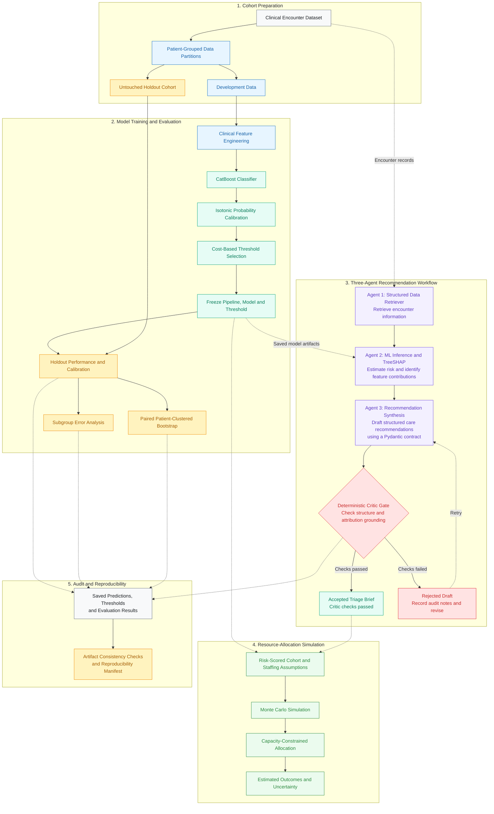

# Project DiaVigil: A Machine Learning Research Project on Hospital Readmission Risk Prediction

[](https://opensource.org/licenses/MIT)
[](https://www.python.org/downloads/)
[](https://colab.research.google.com/)
[](https://github.com/psf/black)

- DiaVigil investigates the use of machine learning to estimate hospital readmission risk and examine related decision-support methods using historical hospital encounter data. The project includes clinical feature engineering, probability calibration, decision-threshold selection, subgroup error analysis, resource-allocation simulation, and an experimental AI-agent workflow for generating structured care recommendations and checking them against predefined criteria.

- The project focuses on evaluating predictive performance, examining trade-offs between missed readmissions and false-positive predictions, assessing subgroup differences, and documenting the methods and limitations of the analysis. Saved research artifacts and consistency checks support verification of the reported results.

- **Project status:** Research prototype evaluated on historical data. The results do not establish clinical effectiveness, recommendation safety, generalizability to other healthcare settings, or readiness for deployment.

---
## Abstract

DiaVigil is a machine learning research project examining hospital readmission risk prediction and related decision-support methods using the Diabetes 130-US Hospitals dataset (1999–2008). The study evaluates predictive performance, probability calibration, classification thresholds, subgroup error rates, and the use of model outputs in experimental resource-allocation and care-recommendation workflows.

Following the documented cohort exclusions, 100,114 hospital encounters were eligible for analysis. The study used patient-level separation between development and holdout cohorts, reserving 19,875 encounters for evaluation. A CatBoost classification model was trained using clinical feature engineering, followed by isotonic probability calibration and cost-sensitive threshold selection. The evaluation also included subgroup false-negative analysis and paired patient-cluster bootstrap comparisons with 1,000 replicates.

On the holdout cohort, the revised model achieved a precision-recall area under the curve (PR-AUC) of 0.2013 and a receiver operating characteristic area under the curve (ROC-AUC) of 0.6578, compared with 0.2036 and 0.6641 for the original baseline. Recall increased from 29.15% to 31.96%, while false-positive predictions increased from 2,089 to 2,478. The paired bootstrap analysis indicated a decrease in ROC-AUC and an increase in recall, illustrating a trade-off between discrimination and identifying additional positive outcomes.

The project also demonstrates hypothetical resource-allocation simulations and a structured AI-agent recommendation workflow with predefined audit checks. These components have not been clinically validated. The findings are limited to the evaluated historical dataset and do not establish clinical effectiveness, generalizability, recommendation safety, or readiness for deployment.

---
## Project at a Glance

- **Research focus:** Hospital readmission risk prediction and evaluation of related decision-support methods using historical hospital encounter data.
- **Dataset:** Diabetes 130-US Hospitals dataset (1999–2008), with 100,114 eligible encounters after documented exclusions and 19,875 encounters reserved for holdout evaluation.
- **Modeling:** CatBoost classification, clinical feature engineering, isotonic probability calibration, and cost-sensitive decision-threshold selection.
- **Evaluation:** Holdout PR-AUC, ROC-AUC, Brier score, precision, recall, confusion-matrix outcomes, and subgroup false-negative rates.
- **Uncertainty analysis:** Paired patient-cluster bootstrap with 1,000 replicates to estimate uncertainty in differences between the original baseline and revised model.
- **Resource-allocation simulation:** Hypothetical nursing-hour allocation scenarios examining estimated patient outreach and potentially averted readmissions under specified assumptions.
- **AI-agent workflow:** Experimental generation of structured care-recommendation briefs using model-derived information, followed by deterministic checks against predefined criteria.
- **Reproducibility:** Saved research artifacts, prediction-alignment verification, cross-artifact consistency checks, and recorded artifact metadata and SHA-256 hashes.
- **Current status:** Research prototype evaluated on historical data; independent external validation and clinical assessment have not been performed.

---

## Repository Structure & Reproducibility Guide

DiaVigil is organized into modular Jupyter notebooks covering cohort construction, clinical feature engineering, model development, probability calibration, subgroup evaluation, AI-agent recommendation auditing, and resource-allocation simulation.

### Notebook Inventory

```text
notebooks/
├── 01_diavigil_cohort_filtering_and_group_split.ipynb
│   └── Cohort construction, target definition, and patient-level data splitting
├── 02_diavigil_clinical_feature_engineering_pipeline.ipynb
│   └── Clinical feature engineering and transformation pipeline
├── 03_diavigil_nested_cv_and_probability_calibration.ipynb
│   └── Model training, cross-validation, probability calibration, and threshold selection
├── 04_diavigil_algorithmic_fairness_and_subgroup_audit.ipynb
│   └── Holdout evaluation and subgroup error analysis
├── 05_diavigil_agentic_triage_and_faithfulness_critic.ipynb
│   └── Structured recommendation generation and critic-based auditing
├── 06_diavigil_dynamic_resource_allocation_simulation.ipynb
│   └── Monte Carlo simulation and capacity-constrained resource allocation
└── 00_DiaVigil_Reproducibility_Audit.ipynb
    └── Artifact integrity and reproducibility checks
```

### Execution and Reproducibility

Run the analytical notebooks in their documented dependency order, beginning with cohort construction and continuing through feature engineering, model development, evaluation, recommendation auditing, and simulation.

Run the reproducibility audit after the required artifacts have been generated. The audit notebook should be treated as a verification step rather than automatically as the first notebook to execute.

The workflow may depend on source data, saved artifacts, software versions, configuration settings, and access to the required files. Successful execution of an individual notebook does not by itself establish end-to-end reproducibility.

---

## Quickstart & Execution Protocol

This section describes how to set up DiaVigil, prepare the required data, execute the analytical workflow, and verify the generated artifacts. DiaVigil is organized into six analytical notebooks and one reproducibility-audit notebook.

### 1. Repository Setup & Dependencies

Clone the DiaVigil repository and create a Python virtual environment.

```bash
git clone https://github.com/nmemranhussain/DiaVigil.git
cd DiaVigil

python -m venv .venv
```

Activate the virtual environment.

**macOS/Linux:**

```bash
source .venv/bin/activate
```

**Windows PowerShell:**

```powershell
.\.venv\Scripts\Activate.ps1
```

Install the main Python dependencies:

```bash
python -m pip install --upgrade pip
python -m pip install numpy pandas scikit-learn catboost optuna netcal shap pydantic joblib pyarrow
```

The research notebooks were executed using Google Colab with Google Drive storage. Some notebook paths and environment setup instructions are specific to that environment and may require modification for local execution.

**Recorded research environment**

Notebook 00, Step 30, recorded the following package versions:

| Package | Recorded version |
|---|---|
| Python | 3.13.16 |
| NumPy | 2.1.3 |
| pandas | 2.2.3 |
| scikit-learn | 1.6.1 |
| CatBoost | 1.2.10 |
| joblib | 1.6.0 |
| PyArrow | 23.0.1 |

These versions document the environment recorded during the artifact audit. The installation command above does not pin package versions, and the project has not yet demonstrated complete end-to-end reproduction in a fresh environment.

### 2. Data Preparation & Artifact Requirements

DiaVigil uses the Diabetes 130-US Hospitals dataset covering hospital encounters from 1999–2008.

Before executing the workflow:

- Obtain the dataset from the documented source in the **Data Provenance & Access** section.
- Place the required source files, including `diabetic_data.csv` and `IDs_mapping.csv`, in the expected `data/raw/` directory.
- Review the data-processing and cohort-selection logic before generating derived datasets.
- Confirm that the required directories exist and that the environment has permission to read and write the relevant files.

The notebooks generate intermediate datasets and serialized model artifacts under the project's configured data directories. Later stages depend on outputs created by earlier stages; therefore, a fresh checkout should not be assumed to contain all required generated artifacts.

The published notebooks use Google Drive paths under `/content/drive/MyDrive/DiaVigil/`. Researchers executing them locally must adapt these paths and ensure that the expected input files and intermediate artifacts are available.

### 3. Notebook Execution Order

Execute analytical Notebooks 01–06 in numerical order. After their required artifacts have been generated, execute Notebook 00 for the revised-model development, comparative evaluation, and research-artifact verification.

**Step 1 — Cohort Filtering and Group Split**

`notebooks/01_diavigil_cohort_filtering_and_group_split.ipynb`

- Constructs the analytical cohort, defines the target outcome, applies the documented exclusion criteria, and creates development and holdout partitions using patient-level grouping to reduce leakage across encounters belonging to the same patient.

**Step 2 — Clinical Feature Engineering**

`notebooks/02_diavigil_clinical_feature_engineering_pipeline.ipynb`

- Builds the clinical feature-transformation pipeline, including comorbidity-related features and medication and healthcare-utilization indicators, and saves the fitted or configured feature-engineering artifact.

**Step 3 — Model Development and Probability Calibration**

`notebooks/03_diavigil_nested_cv_and_probability_calibration.ipynb`

- Trains the original CatBoost classification model using patient-grouped cross-validation, applies isotonic probability calibration, and selects a decision threshold under the specified error-cost assumptions. The notebook saves the original model and calibration artifacts used in subsequent evaluation and comparison.

- The revised modeling procedure is documented separately in Notebook 00, Steps 23A–23C, which use distinct patient-grouped training, calibration, and threshold-selection partitions.

**Step 4 — Holdout Evaluation and Subgroup Audit**

`notebooks/04_diavigil_algorithmic_fairness_and_subgroup_audit.ipynb`

- Evaluates the original model on the reserved holdout cohort and reports classification performance and subgroup error rates across the available demographic categories.

- The revised model's holdout evaluation, calibration analysis, subgroup false-negative audit, and paired patient-cluster bootstrap comparison are documented in Notebook 00, Steps 23–27.

**Step 5 — AI-Agent Recommendation and Audit Workflow**

`notebooks/05_diavigil_agentic_triage_and_faithfulness_critic.ipynb`

- Demonstrates encounter-level risk retrieval, model-based feature attribution, structured recommendation generation, and critic-based checks of whether generated recommendations are grounded in the available model-related evidence.

**Step 6 — Resource-Allocation Simulation**

`notebooks/06_diavigil_dynamic_resource_allocation_simulation.ipynb`

- Simulates hypothetical resource-allocation scenarios under configured staffing and intervention-effectiveness assumptions. The workflow estimates patient outreach, potential readmissions averted, and the marginal yield of additional nursing hours.

- The simulation results are conditional estimates, not evidence that the same outcomes would occur in a real hospital.

**Final Stage — Research Audit and Artifact Verification**

`notebooks/00_DiaVigil_Reproducibility_Audit.ipynb`

- Notebook 00 contains the revised modeling and evaluation workflow and the subsequent research-audit procedures:

- Steps 23–24: Revised model development, holdout evaluation, calibration, and subgroup false-negative analysis.

- Steps 25–27: Same-holdout baseline comparison, paired patient-cluster bootstrap, and research summary.

- Steps 28–29: Artifact inspection, cross-artifact consistency checks, and final research decision report.

- Step 30: Artifact manifest containing recorded environment details, file sizes, and SHA-256 hashes.

- Step 31: Verification that saved baseline and revised-model predictions can be reproduced from their respective saved artifacts on the same holdout rows.

- Notebook 00 depends on outputs from the earlier analytical notebooks. It should be executed after those required artifacts have been generated, rather than treated as the first notebook in the pipeline.

- The verification results support the documented artifact relationships and saved-prediction consistency. They do not independently establish complete end-to-end reproducibility from raw data.

### 4. Reproducibility and Artifact Verification

After generating the required analytical artifacts, execute:

`notebooks/00_DiaVigil_Reproducibility_Audit.ipynb`

The notebook documents the revised modeling procedure, comparative evaluation, and research-artifact verification.

The recorded audit results include:

- **Artifact inventory:** All 15 expected research artifacts were present.
- **Artifact inspection:** Six selected serialized artifacts were successfully loaded and inspected.
- **Cross-artifact consistency:** All 18 implemented checks passed.
- **Prediction verification:** Step 31 reproduced the saved baseline and Step 23 probability arrays from their respective saved model artifacts on the same 19,875 holdout encounters.
- **Artifact manifest:** Step 30 recorded software-environment information, artifact sizes, and SHA-256 hashes for 15 research files.

These checks confirm the tested artifact availability, successful loading, internal consistency, and saved-prediction reproducibility within the recorded environment. The SHA-256 manifest supports subsequent file-integrity verification. These results do not demonstrate that the complete workflow has been independently reproduced from raw data in a clean environment.

The saved model artifacts should be loaded only from trusted sources because serialized Python objects may execute code during deserialization.

### 5. Expected Outputs

Depending on the notebook and configuration, the workflow produces:

- Development and holdout cohort datasets.
- Feature-engineering and model-calibration artifacts.
- Holdout evaluation and subgroup-audit results.
- Model-comparison and uncertainty-analysis reports.
- Resource-allocation simulation outputs.
- Structured AI-agent demonstration artifacts.
- A reproducibility manifest and associated verification results.

Output filenames and locations should be confirmed against the corresponding notebook code and the project's current artifact configuration.

### 6. Reproducibility Considerations

For a reliable reproduction attempt:

- Use the documented source data and exclusion criteria.
- Preserve patient-level separation between development and holdout cohorts.
- Follow the notebook dependency order.
- Use compatible package versions and the documented configuration.
- Verify that saved artifacts correspond to the intended dataset and model configuration.
- Review notebook outputs and logs for errors before interpreting the results.

**Research status:** DiaVigil is a research prototype for evaluating hospital readmission-risk prediction and related decision-support workflows. Its results do not independently establish clinical effectiveness, fairness in every relevant population, or readiness for deployment.

---

## Research Motivation and Objectives

### Research Motivation

Hospital readmissions are an important subject of healthcare quality and resource-management research. Predicting which patients may experience readmission can help researchers examine how risk estimates might inform follow-up planning and the allocation of limited care-management resources. However, predictive models must be evaluated beyond their overall classification accuracy, particularly when missed readmissions and unnecessary interventions have different consequences.

DiaVigil uses historical hospital encounter data to investigate these questions. The project examines whether machine learning risk estimates can be evaluated through probability calibration, cost-sensitive decision thresholds, subgroup error analysis, and hypothetical resource-allocation scenarios. It also explores the use of structured AI-generated care-recommendation briefs with predefined checks, without assuming that these recommendations are clinically appropriate or effective.

### Research Objectives

1. **Evaluate readmission-risk prediction:** Develop and compare CatBoost-based classification models for predicting the dataset-defined readmission outcome within 30 days, using patient-level separation and a reserved holdout cohort to assess predictive performance.

2. **Examine calibration and decision thresholds:** Assess predicted probabilities and investigate how different classification thresholds affect recall, false-positive predictions, and estimated error costs under specified assumptions.

3. **Investigate subgroup performance and statistical uncertainty:** Examine false-negative rates across available age, gender, and race categories, and use paired patient-cluster bootstrap analysis to estimate uncertainty in selected differences between models.

4. **Explore decision-support applications:** Evaluate hypothetical nursing-resource allocation scenarios and demonstrate a structured AI-agent workflow that generates recommendation briefs and checks them against predefined criteria. These experiments assess computational workflows rather than clinical effectiveness.

### Scope of the Research

DiaVigil is an exploratory machine learning research project based on the Diabetes 130-US Hospitals dataset (1999–2008). Its findings are limited to the available historical data, implemented modeling procedures, and specified simulation assumptions.

The project does not establish that its predictions, resource-allocation strategies, or generated care recommendations would improve patient outcomes in clinical practice. Independent external validation, clinical review, and prospective evaluation would be necessary before considering operational use.

---

## Data Provenance & Access

### Dataset Source

DiaVigil uses the **Diabetes 130-US Hospitals dataset (1999–2008)**, a historical collection of hospital encounter records involving patients with diabetes from 130 U.S. hospitals and integrated delivery networks.

The dataset is available through the UCI Machine Learning Repository:

**Dataset:** [Diabetes 130-US Hospitals for Years 1999–2008](https://archive.ics.uci.edu/dataset/296/diabetes+130+us+hospitals+for+years+1999+2008)

**Dataset reference:**

Strack, B., DeShazo, J. P., Gennings, C., Olmo, J. L., Ventura, S., Cios, K. J., & Clore, J. N. (2014). Impact of HbA1c measurement on hospital readmission rates: Analysis of 70,000 clinical database patient records. *BioMed Research International*, 2014, Article 781670. https://doi.org/10.1155/2014/781670

The data are historical and may not reflect current patient populations, clinical practices, or hospital operations.

### Data Files and Access

The original dataset can be obtained from the UCI repository. The primary source files used by the project are:

| File | Purpose |
|---|---|
| `diabetic_data.csv` | Hospital encounter records, including demographic information, diagnoses, medications, utilization variables, and readmission categories. |
| `IDs_mapping.csv` | Reference mappings for selected coded variables in the dataset. |

Place the source files in the project's configured `data/raw/` directory before executing the analytical workflow.

The published notebooks were developed using Google Colab and Google Drive. Their file paths may need adjustment when running the project in another environment.

Access to the original dataset does not imply access to all processed cohorts, trained models, or intermediate research artifacts. These must be generated or obtained separately as appropriate.

### Analytical Cohort

DiaVigil applies cohort-selection and preprocessing procedures to construct the analytical dataset used for model development and evaluation.

The recorded workflow reports the following encounter counts:

| Cohort | Hospital encounters |
|---|---:|
| Eligible analytical cohort | 100,114 |
| Development cohort | 80,239 |
| Reserved holdout cohort | 19,875 |

The development and holdout cohorts are separated at the patient level to prevent encounters from the same recorded patient identifier appearing in both cohorts.

The reserved holdout cohort was used for the documented evaluation of the original and revised models. The revised model's development procedure additionally separates training, probability calibration, and decision-threshold selection into distinct patient-grouped partitions.

The cohort-selection implementation and generated partitions should be reviewed in Notebook 01 and the relevant sections of Notebook 00.
### Outcome Definition

DiaVigil defines the binary prediction target using the `readmitted` field in the Diabetes 130-US Hospitals dataset.

| Original category | Binary target | Interpretation |
|---|---|---|
| `<30` | 1 | Readmission recorded within 30 days |
| `>30` | 0 | Readmission recorded after 30 days |
| `NO` | 0 | No recorded readmission |

The eligible analytical cohort contains 11,357 encounters with a recorded readmission within 30 days, representing approximately 11.34% of eligible encounters.

The target mapping was verified against the cohort data. All 100,114 eligible encounters had nonmissing target values consistent with the documented binary definition.

The outcome represents recorded readmission in the historical dataset. It does not independently establish readmission preventability, clinical severity, or intervention effectiveness.

### Cohort Selection and Data Processing

The original dataset contains 101,766 hospital encounters. DiaVigil excludes encounters associated with death-related discharge disposition codes 11, 19, 20, and 21.

The verification results identified 1,652 excluded encounters, leaving 100,114 eligible encounters for analysis.

| Cohort | Encounters | Unique patients |
|---|---:|---:|
| Eligible analytical cohort | 100,114 | — |
| Development cohort | 80,239 | 56,417 |
| Reserved holdout cohort | 19,875 | 14,022 |

The development and holdout partitions were constructed using patient-grouped stratified splitting with a fixed random seed of 42.

Verification confirmed that:

- No patient identifiers were shared between the development and holdout partitions.
- No encounter identifiers were shared between the partitions.
- Together, the partitions contained all 100,114 eligible encounters.
- The key fields `encounter_id`, `patient_nbr`, `readmitted`, and `target` contained no missing values in the eligible cohort.

The resulting datasets were saved as `dev_cohort.parquet` and `audit_test_cohort.parquet`.

Subsequent clinical feature transformations are implemented separately in Notebook 02. The verified cohort checks do not establish the correctness of every downstream feature transformation or modeling procedure.

Relevant implementation files:

- `notebooks/01_diavigil_cohort_filtering_and_group_split.ipynb`
- `notebooks/02_diavigil_clinical_feature_engineering_pipeline.ipynb`
- `notebooks/00_DiaVigil_Reproducibility_Audit.ipynb`

### Data Limitations and Responsible Use

The dataset has several limitations relevant to interpreting DiaVigil's findings:

- **Historical coverage:** Records originate from 1999–2008 and may not represent contemporary clinical practice.
- **Population scope:** The dataset concerns hospital encounters involving patients with diabetes; results should not be generalized to all hospitalized patients.
- **Recorded outcomes:** Readmission categories do not independently establish preventability, clinical severity, or the benefit of a particular intervention.
- **Demographic representation:** Available age, gender, and race categories may contain unequal sample sizes, missing information, or small positive-outcome counts.
- **External validity:** Evaluation on the reserved holdout cohort does not establish performance at independent hospitals or on later patient populations.

DiaVigil uses these data for retrospective machine learning research and experimental decision-support analysis. The dataset and model outputs should not be used as substitutes for clinical assessment or as evidence of demonstrated patient benefit.

---
## Clinical Data Dictionary

DiaVigil uses encounter-level data from the Diabetes 130-US Hospitals dataset to study hospital readmission-risk prediction. The data include demographic information, diagnoses, diabetes medication records, laboratory-related results, and healthcare-utilization measures. The project derives additional features from these fields for model training, evaluation, subgroup analysis, and the AI-agent demonstration.

This dictionary describes the principal variables used in the current workflow. The exact columns retained in each processed dataset may differ from those in the original source files.

### 1. Identifiers and Outcome

| Variable | Description | Role |
|---|---|---|
| `encounter_id` | Identifier for an individual hospital encounter. | Record identification |
| `patient_nbr` | Identifier used to associate encounters with the same patient. | Patient grouping and leakage prevention |
| `target` | Binary outcome label used for readmission-risk classification. | Prediction target |

**Outcome-definition note:** The precise mapping from the original `readmitted` field to `target` must be documented from the cohort-preparation code. Confirm whether the positive class represents readmission within 30 days and how other readmission categories are handled before publishing the final definition.

The identifiers are retained for cohort construction, evaluation, and patient-level grouping. They are excluded from the model's predictor matrix.

### 2. Demographic and Diagnostic Variables

| Variable | Description | Use in DiaVigil |
|---|---|---|
| `age` | Age category recorded in the source dataset. | Subgroup false-negative-rate analysis |
| `gender` | Gender category recorded in the source dataset. | Subgroup analysis |
| `race` | Race category recorded in the source dataset, including an unknown category where present. | Subgroup analysis |
| `diag_1` | Primary diagnosis code recorded for the encounter. | Comorbidity feature engineering |
| `diag_2` | Secondary diagnosis code recorded for the encounter. | Comorbidity feature engineering |
| `diag_3` | Additional diagnosis code recorded for the encounter. | Comorbidity feature engineering |

Diagnosis codes are processed using selected ICD-9 code patterns to derive binary comorbidity indicators. These indicators are computational features, not independent clinical diagnoses.

### 3. Healthcare Utilization and Encounter Variables

| Variable | Description | Use in DiaVigil |
|---|---|---|
| `time_in_hospital` | Number of days spent in the hospital during the encounter. | Feature engineering |
| `number_outpatient` | Number of recorded outpatient visits in the source data. | Utilization feature |
| `number_emergency` | Number of recorded emergency visits in the source data. | Utilization feature |
| `number_inpatient` | Number of recorded inpatient visits in the source data. | Utilization feature |
| `num_medications` | Number of medications recorded for the encounter. | Encounter feature engineering |
| `num_lab_procedures` | Number of laboratory procedures recorded for the encounter. | Encounter feature engineering |
| `A1Cresult` | Recorded HbA1c result category, such as `Norm`, `>7`, `>8`, or `None`. | Glycemic-status feature engineering |

The project also uses other source variables retained by the preprocessing pipeline. Their definitions and permitted values should be documented if they are included in the final model's input schema.

### 4. Derived Clinical Features

The feature-engineering pipeline derives the following variables from the source data.

| Derived variable | Definition |
|---|---|
| `elix_congestive_heart_failure` | Binary indicator based on selected ICD-9 code patterns for congestive heart failure. |
| `elix_cardiac_arrhythmias` | Binary indicator based on selected ICD-9 code patterns for cardiac arrhythmias. |
| `elix_valvular_disease` | Binary indicator based on selected ICD-9 code patterns for valvular disease. |
| `elix_pulmonary_circulation` | Binary indicator based on selected ICD-9 code patterns for pulmonary circulation disorders. |
| `elix_peripheral_vascular` | Binary indicator based on selected ICD-9 code patterns for peripheral vascular disease. |
| `elix_hypertension_uncomplicated` | Binary indicator based on selected ICD-9 code patterns for uncomplicated hypertension. |
| `elix_hypertension_complicated` | Binary indicator based on selected ICD-9 code patterns for complicated hypertension. |
| `elix_diabetes_complicated` | Binary indicator based on selected ICD-9 code patterns for complicated diabetes. |
| `elix_renal_failure` | Binary indicator based on selected ICD-9 code patterns for renal failure. |
| `elix_fluid_electrolyte` | Binary indicator based on selected ICD-9 code patterns for fluid and electrolyte disorders. |
| `elix_chronic_pulmonary` | Binary indicator based on selected ICD-9 code patterns for chronic pulmonary disease. |
| `elix_coagulopathy` | Binary indicator based on selected ICD-9 code patterns for coagulopathy. |
| `total_elixhauser_burden` | Sum of the 12 binary comorbidity indicators above. |
| `healthcare_utilization_index` | Weighted utilization measure: outpatient visits + 2 × emergency visits + 3 × inpatient visits. |
| `active_diabetes_med_count` | Count of diabetes medication fields whose recorded value is not `No`. |
| `dosage_titration_count` | Count of diabetes medication fields recorded as `Up` or `Down`. |
| `on_insulin` | Binary indicator set to 1 when the insulin field is not recorded as `No`; otherwise 0. |
| `encounter_severity_index` | Project-defined composite feature calculated as `time_in_hospital × num_medications + num_lab_procedures + 1`. It summarizes selected encounter characteristics and is not a validated clinical severity score. |
| `glycemic_status_code` | Encoded HbA1c result category: None = 0, Norm = 1, and both >7 and >8 = 2. This is a project-defined categorical encoding, not a validated clinical severity scale. |

**Interpretation notes:**

- These engineered variables are operational definitions implemented in the project code. They should not automatically be interpreted as validated clinical severity scores.
- `total_elixhauser_burden` counts the indicators produced by this implementation; it is not necessarily equivalent to a validated comorbidity index.
- The utilization index uses project-defined weights rather than empirically validated resource costs.
- The `glycemic_status_code` combines the `>7` and `>8` categories. The `None` category is also mapped to zero, so the resulting feature does not distinguish an unrecorded result from a normal result.
- Medication changes and counts describe recorded medication fields; they do not independently establish treatment adherence or clinical appropriateness.

### 5. Model and AI-Agent Output Fields

These fields are generated during prediction or the agent-audit workflow. They are not original clinical measurements.

| Variable | Description |
|---|---|
| `readmission_risk` | Calibrated model-estimated probability of the project's positive outcome. |
| `risk_tier` | Risk category assigned by the agent workflow. |
| `primary_risk_drivers` | Features with positive local TreeSHAP attributions selected for the encounter brief. |
| `protective_factors` | Features with negative local TreeSHAP attributions selected for the encounter brief. |
| `synthesized_care_directives` | Proposed care recommendations generated by the agent workflow. |
| `critic_audit_passed` | Boolean flag indicating whether the generated brief passed the implemented audit checks. |
| `critic_audit_notes` | Text describing the audit decision or recorded reason for rejection. |

The calibrated risk is a model estimate, not a clinical diagnosis. TreeSHAP attributions describe the model's behavior and do not establish causal relationships. Passing the critic audit does not establish that a proposed recommendation is clinically correct or safe.

### 6. Cohort Construction and Data Handling

- The project begins with 101,766 source encounters. The documented cohort-preparation workflow excludes 1,652 encounters under the configured discharge-disposition criteria, producing an eligible cohort of 100,114 encounters.

- Patient-grouped splitting partitions this eligible cohort into 80,239 development encounters and 19,875 untouched holdout encounters. The holdout cohort is reserved for final evaluation and is excluded from model fitting, probability calibration, and decision-threshold selection.

- The development and holdout partitions are constructed using patient-grouped splitting to prevent encounters from the same patient from appearing across those partitions. The reserved holdout contains 19,875 encounters and is used for final evaluation rather than model fitting, probability calibration, or decision-threshold selection.

- The exact outcome construction, exclusion rules, missing-value handling, and category encodings should be documented alongside the corresponding preprocessing code.

### 7. Scope and Limitations

This dictionary describes the variables and transformations documented in the current DiaVigil workflow. It is not a complete dictionary for every column in the original dataset.

The source data represent hospital encounters from 1999–2008. Variable definitions, coding conventions, and missingness patterns should be considered when interpreting results. Further documentation should identify the precise target-label mapping, all retained model inputs, and any preprocessing differences between the raw, development, and holdout datasets.

DiaVigil is a research prototype. Neither the data dictionary nor the derived features establish clinical validity, fairness, or readiness for use in patient care.

---

## Research Methodology

DiaVigil is a machine learning research prototype for hospital readmission risk prediction and decision-support evaluation. Its workflow covers clinical data preparation, feature engineering, model training, probability calibration, decision-threshold optimization, holdout evaluation, subgroup auditing, resource-allocation simulation, and AI-agent recommendation auditing.

The workflow is designed to support transparent model evaluation and reproducible research. Its outputs represent experimental findings on a historical clinical dataset, not evidence of clinical effectiveness or readiness for deployment.

### 1. Data Preparation and Cohort Separation

DiaVigil uses the UCI Diabetes 130-US Hospitals dataset, which contains 101,766 inpatient encounters recorded between 1999 and 2008. The cohort-construction workflow applies the configured CMS Hospital Readmissions Reduction Program (HRRP)-related exclusion criteria, removing 1,652 encounters associated with specified discharge dispositions.

After these exclusions, the eligible cohort contains 100,114 encounters. Notebook 01 partitions this cohort into:

- **Development cohort:** 80,239 encounters used for model development and associated analyses.
- **Untouched holdout cohort:** 19,875 encounters reserved for final evaluation.

Patient-level grouping is used during the development/holdout split to prevent encounters belonging to the same patient from appearing in both partitions. The holdout cohort is excluded from model fitting and decision-threshold selection.

Within the development cohort, Notebook 03 uses patient-grouped cross-validation to separate model fitting from internal validation. The current implementation fits the probability calibrator and selects the operating threshold using the internal validation fold. Because these operations use the same fold, the resulting internal calibration and threshold-optimization diagnostics should not be interpreted as independent estimates of generalization performance. The untouched holdout evaluation provides a separate assessment of the saved workflow.

### 2. Clinical Feature Engineering

DiaVigil implements a custom feature-engineering transformer that derives additional variables from the available encounter-level data. The current pipeline includes:

- **Comorbidity indicators:** Binary features derived from selected ICD-9 diagnosis codes using predefined Elixhauser-related mappings.
- **Comorbidity burden:** A summary measure based on the derived comorbidity indicators.
- **Healthcare utilization:** An index combining outpatient, emergency, and inpatient encounter counts.
- **Medication complexity:** Counts of diabetes medications and indicators of medication changes based on recorded medication fields.
- **Insulin use:** An indicator derived from the recorded insulin medication field.
- **Encounter severity:** A constructed index based on length of hospital stay, medication count, and laboratory procedure count.
- **Glycemic status:** A categorical numeric encoding of the recorded HbA1c result.

The transformer is incorporated into a preprocessing pipeline so that feature construction can be applied consistently during training and inference.

These variables are derived from the available administrative and clinical fields. They should not be interpreted as validated clinical severity scores or comprehensive measures of disease status.

### 3. Model Training

DiaVigil uses CatBoost as its primary classification algorithm to estimate the probability of hospital readmission within 30 days.

Both the original and revised modeling procedures use the following configuration:

- **Boosting iterations:** 400
- **Learning rate:** 0.05
- **Tree depth:** 6
- **Class weighting:** Balanced
- **Random seed:** 42

The original model is developed in Notebook 03 using patient-grouped internal validation.

The revised modeling procedure, documented in Notebook 00, Steps 23A–23C, separates the development cohort into three patient-disjoint partitions: 48,295 encounters for training, 15,849 for probability calibration, and 16,095 for decision-threshold selection.

The revised model is fitted exclusively on the training partition. The calibration and threshold-selection partitions are reserved for their respective procedures, and the independent holdout cohort remains excluded from all three development stages.

### 4. Probability Calibration

DiaVigil applies isotonic regression to calibrate CatBoost probability estimates.

The original implementation performs calibration using an internal validation fold. The revised implementation fits the calibration procedure on a dedicated patient-disjoint calibration partition using the previously trained model.

The revised procedure separates model fitting, probability calibration, and decision-threshold selection to reduce data reuse between these operations.

Calibration performance is examined using probability-based evaluation metrics, including the Brier score. Calibration estimates from internal development partitions are distinguished from results obtained on the reserved holdout cohort.

### 5. Decision-Threshold Selection

DiaVigil selects an operating threshold by minimizing a configured classification-cost function.

The implementation assigns a false-positive cost of 1 and a false-negative cost of 5. The revised procedure searches 100 candidate thresholds between 0.02 and 0.40 using its dedicated threshold-selection partition.

The revised model selected an operating threshold of approximately 0.1620, with an estimated threshold-selection cost of 7,922 under the specified assumptions.

The threshold is subsequently applied to the independent holdout cohort without additional optimization.

These costs are hypothetical modeling assumptions rather than empirically established clinical or financial costs. The selected threshold is not a clinically validated intervention boundary.

### 6. Holdout Evaluation

The selected modeling workflow is evaluated on the untouched holdout cohort of 19,875 encounters. The holdout cohort is not used to fit the model or select the operating threshold.

The evaluation includes:

- **Discrimination:** Precision-recall area under the curve (PR-AUC) and receiver operating characteristic area under the curve (ROC-AUC).
- **Probability error:** Brier score and calibration analysis.
- **Classification performance:** Precision, recall, confusion-matrix counts, false-positive rate, and false-negative rate at the selected threshold.
- **Subgroup evaluation:** Descriptive error-rate comparisons across available age, gender, and race categories.
- **Uncertainty analysis:** Patient-clustered bootstrap estimates for selected differences between model evaluations.

The baseline and revised models are evaluated on the same holdout cohort to facilitate paired comparisons. The results are interpreted across multiple metrics, including trade-offs between recall, precision, false-positive counts, false-negative counts, and discrimination.

These comparisons describe performance on the available holdout cohort. They do not establish that the revised model is universally preferable or that either model will generalize to other hospitals, more recent patient populations, or prospective clinical workflows.

### 7. Resource-Allocation Simulation

DiaVigil includes a Monte Carlo simulation to examine how hypothetical intervention effectiveness and available nursing hours may affect resource allocation among encounters identified as high risk.

The simulation evaluates scenarios under specified staffing budgets and intervention-effectiveness assumptions. Its outputs include estimated patients reached, nursing hours utilized, estimated readmissions potentially averted, simulated readmissions captured, and uncertainty bounds under the configured model.

A capacity-constrained allocation procedure also ranks candidates according to an estimated efficiency measure based on expected readmissions potentially averted per required nursing hour.

These outputs are conditional on the risk predictions, assumed intervention-effectiveness distribution, staffing constraints, and allocation rules. They are simulation estimates rather than observed clinical outcomes, demonstrated intervention effects, or verified hospital cost savings.

### 8. AI-Agent Recommendation and Audit Workflow

DiaVigil includes an AI-agent workflow that generates structured care-recommendation briefs using encounter information, model-estimated readmission risk, and model-derived feature attributions.

The workflow consists of three conceptual stages:

1. **Encounter data retrieval:** Retrieves the selected encounter's available information and relevant model outputs.
2. **Risk inference and feature attribution:** Obtains the estimated risk and identifies model-associated risk and protective factors using the saved feature pipeline and TreeSHAP-based attribution.
3. **Structured recommendation generation:** Produces a recommendation brief containing an encounter identifier, estimated risk, risk category, contributing features, and proposed care directives.

A separate deterministic audit component checks generated outputs against predefined structural and grounding criteria. The current demonstration includes an accepted example and a rejected example containing unsupported claims.

The audit checks provide evidence that the implemented rules can accept and reject the tested examples. They do not establish that all generated recommendations are factually correct, clinically appropriate, complete, or safe. Feature attributions describe model behavior and should not be interpreted as causal explanations of readmission.

The AI-agent workflow is an experimental decision-support demonstration. Its outputs are not intended to replace clinician judgment, and clinical review and human oversight would be necessary before considering use in patient care.

### 9. Reproducibility and Artifact Management

DiaVigil saves model artifacts, processed cohort files, evaluation outputs, simulation results, and research audit reports to support inspection of the completed workflow.

The reproducibility manifest records selected software-environment details, artifact filenames, file sizes, and SHA-256 hashes. An integrity check confirmed that all 15 listed artifacts existed and matched their recorded file sizes and hashes at the time of verification.

The workflow also includes cross-artifact consistency checks for selected relationships among saved cohort labels, predictions, decision thresholds, calibration outputs, and evaluation results. The documented run reported that all 18 implemented consistency checks passed.

These checks support artifact integrity and traceability within the tested workflow. They do not independently establish the correctness of every model prediction, the validity of the modeling assumptions, or the clinical usefulness of the results. Full end-to-end reproducibility would additionally require verification that the notebooks, source data, dependencies, configuration, and execution instructions can reproduce the workflow in a clean environment.


---

## Architectural Workflow


---

## Experimental Results and Model Evaluation

DiaVigil evaluates hospital readmission-risk prediction using a reserved holdout cohort and compares the original CatBoost model with a revised modeling procedure designed to separate model training, probability calibration, and decision-threshold selection.

The evaluation examines predictive discrimination, classification outcomes, calibration, subgroup errors, and statistical uncertainty. The results reflect retrospective performance on the historical Diabetes 130-US Hospitals dataset rather than demonstrated clinical effectiveness.

### 1. Experimental Setup

The analytical cohort contains 100,114 eligible hospital encounters after applying the documented exclusion criteria.

| Dataset partition | Encounters | Purpose |
|---|---:|---|
| Development cohort | 80,239 | Model development, calibration, and threshold selection |
| Reserved holdout cohort | 19,875 | Independent model evaluation |
| **Total** | **100,114** | **Eligible analytical cohort** |

The development and holdout cohorts are patient-disjoint. Both models are evaluated on the same holdout cohort, which contains 2,240 positive readmission outcomes.

The revised modeling procedure additionally separates the development cohort into training, calibration, and threshold-selection partitions.

### 2. Original vs. Revised Model Performance

The following results were obtained from the reserved holdout cohort.

| Evaluation metric | Original model | Revised model |
|---|---:|---:|
| PR-AUC | 0.2036 | 0.2013 |
| ROC-AUC | 0.6641 | 0.6578 |
| Recall | 29.15% | 31.96% |
| False-positive predictions | 2,089 | 2,478 |

The revised model increased recall by approximately 2.81 percentage points, identifying additional positive outcomes. However, this improvement was accompanied by 389 additional false-positive predictions.

The revised model also exhibited slightly lower PR-AUC and ROC-AUC values than the original model.

These results illustrate a trade-off between identifying additional positive readmission outcomes and increasing false-positive classifications. They do not establish that the revised model is universally preferable.

### 3. Revised Model Confusion Matrix

At the selected operating threshold of approximately 0.1620, the revised model produced the following confusion matrix on the 19,875-encounter holdout cohort.

| Actual outcome | Predicted negative | Predicted positive |
|---|---:|---:|
| No readmission within 30 days | 15,157 | 2,478 |
| Readmission within 30 days | 1,524 | 716 |

The revised model correctly identified 716 of the 2,240 recorded positive outcomes, corresponding to a recall of approximately 31.96%.

Its positive-class precision was approximately 22.42%, meaning that many encounters flagged as positive did not have a recorded readmission within 30 days.

The confusion matrix demonstrates why recall, precision, false-positive counts, and false-negative counts should be considered together when evaluating the model.

### 4. Probability Calibration and Decision-Threshold Selection

Both modeling procedures apply isotonic probability calibration.

The revised model uses a dedicated calibration partition and a separate threshold-selection partition, avoiding reuse of the same development encounters for both operations.

The decision threshold is selected by minimizing the configured classification-cost function:

**Classification cost = (1 × false positives) + (5 × false negatives)**

The revised procedure selected an operating threshold of approximately 0.1620.

The independent holdout evaluation reported a Brier score of approximately 0.0961.

The classification-cost weights represent experimental assumptions rather than clinically established intervention costs. The selected threshold is not a clinically validated decision boundary.

### 5. Statistical Uncertainty and Subgroup Evaluation

DiaVigil includes paired patient-cluster bootstrap comparisons with 1,000 replicates to examine uncertainty in selected differences between the original and revised models.

The analysis indicated lower ROC-AUC and higher recall for the revised model.

Subgroup evaluation examines false-negative rates across available age, gender, and race categories.

These analyses are intended to identify differences in model behavior and characterize uncertainty. They do not establish fairness across all patient populations or guarantee equivalent performance in independent healthcare settings.

### 6. Resource-Allocation Simulation

DiaVigil includes a hypothetical resource-allocation simulation examining how available nursing hours and assumed intervention effectiveness may influence patient outreach and estimated readmissions averted.

The simulation considers staffing constraints, estimated patient risk, and intervention-effectiveness assumptions.

Its outputs are conditional model-based estimates, not observed reductions in hospital readmissions or verified financial savings.

### 7. AI-Agent Recommendation and Audit Demonstration

The experimental AI-agent workflow combines encounter-level information, model-estimated readmission risk, and feature-attribution outputs to generate structured care-recommendation briefs.

A deterministic audit component evaluates generated briefs against predefined structural and grounding criteria.

The demonstration includes an accepted example and a deliberately unsupported example designed to test rejection behavior.

Passing the implemented audit checks does not establish that recommendations are clinically appropriate, comprehensive, or safe.

### 8. Reproducibility Verification

The reproducibility-audit notebook recorded the following verification results:

| Verification component | Recorded result |
|---|---|
| Research artifact inventory | 15 of 15 expected artifacts present |
| Serialized artifact inspection | 6 selected artifacts successfully loaded |
| Cross-artifact consistency | 18 of 18 implemented checks passed |
| Saved-prediction verification | Baseline and revised probability arrays reproduced |
| Artifact manifest | Software metadata, file sizes, and SHA-256 hashes recorded for 15 files |

Saved-prediction verification was performed on the same 19,875 holdout encounters.

These results support artifact traceability, internal consistency, and reproduction of saved predictions within the recorded environment. They do not demonstrate complete independent reproduction of the workflow from raw data in a clean environment.

### 9. Interpretation and Research Limitations

The principal experimental finding is that the revised model achieves higher recall at the cost of additional false-positive predictions and slightly lower discrimination metrics.

The revised development procedure also provides clearer separation between model fitting, calibration, and threshold selection.

However, the analysis is limited to a historical dataset from 1999–2008. Independent external validation, prospective clinical evaluation, and assessment of operational consequences have not been performed.

**Research conclusion:** DiaVigil demonstrates an experimental framework for evaluating hospital readmission-risk models and related decision-support workflows. The results provide evidence about predictive performance and methodological trade-offs, but do not establish clinical effectiveness, recommendation safety, or deployment readiness.

---

## Resource Allocation Simulation

**Implementation notebook:** `notebooks/06_diavigil_dynamic_resource_allocation_simulation.ipynb`

DiaVigil implements a Monte Carlo resource-allocation simulation to investigate how calibrated hospital readmission-risk estimates may support hypothetical care-management decisions under limited nursing resources.

The simulation combines model-estimated readmission probabilities, assumed intervention effectiveness, encounter-level nursing-time requirements, and capacity-constrained allocation rules.

The analysis evaluates potential intervention coverage, expected readmissions averted, and marginal returns from additional nursing capacity. These outputs are conditional simulation estimates rather than observed intervention effects or clinically validated outcomes.

### 1. Simulation Objectives

The resource-allocation experiment addresses four research questions:

1. How many high-risk encounters can receive hypothetical follow-up interventions under different nursing-hour budgets?
2. How does uncertainty in assumed intervention effectiveness affect estimated readmissions potentially averted?
3. How can limited nursing resources be allocated according to expected intervention benefit per required nursing hour?
4. How do the marginal estimated benefits of additional nursing hours change as staffing capacity increases?

The objective is to examine operational trade-offs rather than establish a clinically validated intervention strategy.

### 2. Simulation Population and Assumptions

The simulation uses the reserved holdout cohort and saved prediction outputs from the preceding evaluation workflow.

| Component | Recorded value or definition |
|---|---|
| Holdout cohort | 19,875 encounters |
| High-risk encounters flagged | 2,742 (13.80%) |
| Risk estimate | Saved calibrated readmission probability |
| Intervention effectiveness | Beta distribution with α = 3.5 and β = 6.5 |
| Mean assumed effectiveness | 35% |
| Monte Carlo iterations | 1,000 |
| Random seed | 42 |
| Nursing-time requirement | Encounter-dependent estimate |
| Allocation method | Greedy ranking by expected benefit per nursing hour |

The simulation defines required nursing hours using:


$$
H_i = \min(8.0,\ \max(1.5,\ 1.5 + 0.25L_i + 0.5P_i))
$$


where:

- \(H_i\) represents estimated nursing hours for encounter \(i\).
- \(L_i\) represents the recorded hospital length of stay.
- \(P_i\) represents the number of prior inpatient encounters.

The formula is an experimental workload assumption and has not been validated against observed nursing-time requirements.

### 3. Monte Carlo Intervention-Yield Simulation

DiaVigil performs 1,000 Monte Carlo iterations to examine uncertainty in hypothetical intervention effectiveness among the 2,742 high-risk encounters.

For each simulated intervention-effectiveness value, the model estimates potential readmissions averted as:


$$
A_i = p_i \times e_i
$$


where:

- \(p_i\) is the calibrated model-estimated readmission probability.
- \(e_i\) is the sampled hypothetical intervention effectiveness.
- \(A_i\) is the expected number of readmissions averted for that encounter under the assumed risk-reduction model.

The simulation aggregates expected benefits across the flagged cohort.

**Recorded Monte Carlo results**

| Metric | Result |
|---|---:|
| High-risk encounters | 2,742 |
| Monte Carlo iterations | 1,000 |
| Mean expected readmissions averted | 231.55 |
| Lower 2.5th percentile | 228.06 |
| Upper 97.5th percentile | 235.12 |

The percentile interval describes variability under the specified simulation assumptions. It does not represent a clinical confidence interval for an empirically established intervention effect.

The estimated 231.55 readmissions potentially averted is a hypothetical expectation, not a count of observed prevented readmissions.

### 4. Capacity-Constrained Nursing Allocation

DiaVigil implements a greedy allocation procedure that ranks high-risk encounters according to expected intervention benefit per required nursing hour.

The allocation efficiency score is defined as:


$$
E_i = \frac{A_i}{H_i}
$$


where \(A_i\) represents expected readmissions potentially averted and \(H_i\) represents estimated nursing hours required.

Candidates are ranked from highest to lowest estimated efficiency. The algorithm then selects encounters within the configured nursing-hour budget.

Three operational staffing scenarios were evaluated.

**Recorded staffing-allocation results**

| Nursing-hour budget | Encounters reached | Hours utilized | Expected readmissions averted | Observed readmissions among selected encounters |
|---|---:|---:|---:|---:|
| 500 | 176 | 499.8 | 21.35 | 64 |
| 1,500 | 465 | 1,498.0 | 52.48 | 131 |
| 3,000 | 879 | 2,997.5 | 91.15 | 224 |

The results illustrate how increasing available nursing hours expands hypothetical intervention coverage.

At a budget of 500 nursing hours, the algorithm selects 176 encounters, with an estimated 21.35 readmissions potentially averted.

At 3,000 nursing hours, the selected population increases to 879 encounters, with an estimated 91.15 readmissions potentially averted.

The observed readmission counts describe recorded outcomes among selected holdout encounters. They do not indicate that the simulated interventions prevented those events.

### 5. Marginal Returns Under Staffing Constraints

To examine diminishing marginal returns, DiaVigil evaluates 25 staffing budgets ranging from 200 to 5,000 nursing hours.

The marginal yield is calculated as the change in expected readmissions averted per additional 100 nursing hours:


$$
M = \frac{\Delta A}{\Delta H} \times 100
$$


Selected results from the recorded capacity-allocation frontier are shown below.

| Nursing-hour budget | Encounters reached | Expected readmissions averted | Marginal yield per 100 additional hours |
|---|---:|---:|---:|
| 400 | 144 | 17.73 | 3.91 |
| 800 | 269 | 31.47 | 3.32 |
| 1,200 | 387 | 43.85 | 3.05 |
| 1,600 | 499 | 55.34 | 2.85 |
| 2,000 | 609 | 66.19 | 2.68 |
| 2,200 | 662 | 71.41 | 2.61 |

The simulated marginal yield decreases as the nursing-hour budget expands.

This behavior is consistent with the greedy allocation procedure, which prioritizes encounters with higher estimated benefit per nursing hour before allocating resources to lower-ranked encounters.

The findings demonstrate diminishing estimated marginal returns within the configured simulation. They do not establish the actual clinical or economic value of additional nursing staff.

### 6. Interpretation of Simulation Results

The recorded results support three principal observations.

**Resource availability influences intervention coverage.** Increasing the nursing-hour budget allows the allocation procedure to select more high-risk encounters.

**Estimated intervention benefits depend on model predictions and assumed effectiveness.** The Monte Carlo simulation estimates approximately 231.55 potentially averted readmissions across the flagged high-risk cohort under the specified assumptions, without imposing the three operational staffing budgets.

**Marginal estimated benefits decline as allocation capacity expands.** The simulated yield per additional 100 nursing hours decreases from approximately 3.91 at the 400-hour scenario to 2.61 at the 2,200-hour scenario.

These observations characterize the implemented computational allocation framework rather than demonstrating improved patient outcomes.

### 7. Reproducibility and Saved Artifacts

Notebook 06 saves the simulation outputs as:

`data/processed/simulation_artifacts.joblib`

The serialized artifact includes:

- `allocation_summary`: Results for the three operational staffing budgets.
- `capacity_frontier`: Results across the 25 staffing-capacity scenarios.
- `monte_carlo_bounds`: Mean expected readmissions averted and the lower and upper simulation percentile bounds.

These outputs support subsequent inspection, comparison, and research reporting.

The artifact should be loaded only from trusted sources because serialized Python objects may execute code during deserialization.

### 8. Limitations and Responsible Use

The resource-allocation simulation has several important limitations:

- **Assumed intervention effectiveness:** The Beta-distributed effectiveness values are hypothetical and are not validated treatment-effect estimates.
- **Unvalidated nursing-time assumptions:** Encounter-level nursing-hour requirements are derived from a configured formula rather than measured care-management workload.
- **No causal identification:** The historical observational data do not establish that the simulated interventions would prevent readmissions.
- **Model uncertainty:** Prediction errors and calibration limitations may affect allocation rankings and estimated benefits.
- **Simplified allocation constraints:** The greedy procedure does not represent all clinical, staffing, scheduling, or patient-care constraints.
- **Limited generalizability:** The simulation uses a historical diabetes-related hospital encounter dataset and may not reflect contemporary clinical practice.
- **No prospective validation:** The allocation strategy has not been evaluated through prospective clinical implementation.

**Research interpretation:** DiaVigil demonstrates a computational framework connecting calibrated readmission-risk predictions with stochastic intervention-effectiveness assumptions and capacity-constrained nursing-resource allocation. The findings support investigation of operational decision-support methods but do not establish actual readmission prevention, clinical effectiveness, verified cost savings, or readiness for deployment.

---

## AI-Agent Recommendation and Audit Workflow

**Implementation notebook:** `notebooks/05_diavigil_agentic_triage_and_faithfulness_critic.ipynb`

DiaVigil implements an experimental, deterministic multi-agent workflow that combines calibrated hospital readmission-risk predictions, local TreeSHAP feature attributions, structured recommendation synthesis, and rule-based grounding verification.

The workflow uses three sequential agent components and a separate deterministic critic gate. Pydantic schemas enforce the structure of generated encounter-level recommendation briefs.

The current implementation uses predefined recommendation rules rather than a generative large language model (LLM). Its purpose is to investigate how model-derived evidence can support structured, auditable decision-support outputs.

The generated recommendations are experimental and have not been clinically validated.

### 1. Research Objectives

The AI-agent experiment addresses four research questions:

1. How can calibrated readmission-risk predictions and encounter-level information be integrated into structured recommendation briefs?
2. How can local TreeSHAP attributions identify model-derived risk drivers and protective factors?
3. Can a deterministic critic distinguish grounded recommendation outputs from outputs containing unsupported clinical claims?
4. How can typed data contracts and explicit verification rules improve the inspectability of an experimental multi-agent decision-support workflow?

The objective is to demonstrate computational integration and rule-based verification rather than establish clinical recommendation effectiveness.

### 2. Multi-Agent System Architecture

The implementation consists of three sequential agents and a critic gate.

| Component | Implemented responsibility |
|---|---|
| Agent 1 — Clinical Retriever | Retrieves the selected encounter record from the reserved holdout dataset |
| Agent 2 — Inference Core | Computes calibrated readmission probability and local TreeSHAP attributions |
| Agent 3 — Synthesis Engine | Generates a structured recommendation brief using predefined rules |
| Critic Gate — Grounding Verifier | Checks whether the generated directives satisfy implemented feature-grounding rules |

**Execution sequence:**

Encounter Retrieval → Calibrated Risk Inference → TreeSHAP Explanation → Rule-Based Recommendation Synthesis → Deterministic Critic Audit

The components are orchestrated by the `MultiAgentClinical` class.

The `run_pipeline()` method executes retrieval, inference, synthesis, and auditing in sequence.

This architecture separates data retrieval, predictive inference, recommendation construction, and verification into identifiable functional stages.

### 3. Encounter Retrieval and Risk Inference

The Clinical Retriever selects an encounter using its `encounter_id` from the reserved holdout cohort.

The Inference Core applies the saved preprocessing pipeline and calibrated CatBoost model to the selected encounter.

The implementation retrieves:

- Encounter identifier and patient identifier.
- Calibrated readmission probability.
- Binary high-risk classification using the saved operating threshold.
- Three highest positive TreeSHAP attributions.
- Two most negative TreeSHAP attributions.

The recorded model operating threshold is approximately **0.1620**.

The threshold is used to assign the encounter to a high-risk or standard-care category within the experimental workflow.

These categories are model-derived classifications, not independently validated clinical triage designations.

### 4. TreeSHAP-Based Risk Explanation

The inference component uses `shap.TreeExplainer` with the fitted CatBoost model to calculate local feature attributions.

The implementation selects:

- **Primary risk drivers:** The three features with the largest positive SHAP values.
- **Protective factors:** The two features with the most negative SHAP values.

The selected feature names and attribution values are incorporated into the structured recommendation brief.

TreeSHAP provides an explanation of model behavior for the selected encounter. Positive and negative attribution values should not be interpreted as causal effects or evidence that changing a particular feature would prevent readmission.

### 5. Structured Recommendation Synthesis

The Synthesis Engine constructs recommendation briefs using predefined conditional rules.

The current implementation distinguishes between two risk categories.

| Risk category | Implemented synthesis behavior |
|---|---|
| High Risk — Enhanced Follow-up | Generates follow-up directives according to the detected model-derived risk drivers |
| Standard Care | Generates a standard follow-up directive |

For high-risk encounters, the implemented rules examine whether selected risk-driver feature names contain terms such as `hypertension` or `cardiac`.

The synthesis logic also includes a fallback follow-up directive when the specified conditions are not met.

The recommendations are therefore generated through deterministic rules rather than free-form LLM text generation.

### 6. Pydantic Output Schema

DiaVigil uses Pydantic models to define the structure of the recommendation brief.

The implementation includes a `FeatureImpact` schema for feature names and attribution values, and a `PatientTriageBrief` schema for encounter-level outputs.

| Output field | Description |
|---|---|
| `encounter_id` | Selected hospital encounter identifier |
| `patient_nbr` | Recorded patient identifier |
| `readmission_risk` | Calibrated model-estimated readmission probability |
| `risk_tier` | Assigned experimental risk category |
| `primary_risk_drivers` | Three selected positive TreeSHAP feature attributions |
| `protective_factors` | Two selected negative TreeSHAP feature attributions |
| `synthesized_care_directives` | Rule-generated follow-up directives |
| `critic_audit_passed` | Boolean result of the deterministic audit |
| `critic_audit_notes` | Explanation of the audit decision |

The structured schema supports consistent output representation, validation, inspection, and serialization.

Schema validation establishes that the output satisfies the implemented data contract. It does not establish clinical correctness.

### 7. Deterministic Critic and Grounding Verification

The Critic Gate evaluates synthesized directives against the encounter's selected model-derived risk drivers.

For high-risk encounters, the implementation searches for references to selected clinical concepts in the generated directive text.

The current critic specifically checks for `hypertension` and `cardiac` terminology and compares those references against the names of the selected primary risk-driver features.

If a directive references one of these concepts without a corresponding selected risk driver, the critic rejects the recommendation brief.

Otherwise, the brief passes the implemented grounding check.

Standard-care briefs are accepted through a separate branch of the critic logic.

This is a limited, rule-based verification mechanism. It does not perform comprehensive medical fact-checking, semantic entailment analysis, or clinical safety evaluation.

### 8. Recorded Agent Demonstration Results

Notebook 05 demonstrates the workflow using a selected high-risk encounter from the reserved holdout cohort.

The recorded demonstration contains two scenarios.

**Scenario 1 — Grounded synthesis (expected acceptance)**

The pipeline generates a structured recommendation brief without deliberately injecting unsupported clinical factors.

Recorded result:

- Risk category: High Risk — Enhanced Follow-up.
- Critic audit: **Passed**.
- Audit explanation: The directives were grounded in the verified risk drivers under the implemented rules.

**Scenario 2 — Hallucinated synthesis (expected rejection)**

The demonstration deliberately injects unsupported clinical claims into the synthesized recommendation.

The injected directive refers to clinical factors that are not supported by the selected TreeSHAP risk drivers.

Recorded result:

- Critic audit: **Failed**.
- Audit explanation: Unsupported clinical-factor references were detected.
- Recommended audit action: Regenerate or revise the unsupported recommendation.

These results demonstrate that the implemented critic accepted the tested grounded example and rejected the deliberately constructed unsupported example.

They do not establish a general hallucination-detection accuracy, false-acceptance rate, false-rejection rate, or reliability across a representative set of clinical encounters.

### 9. Reproducibility and Saved Artifacts

Notebook 05 saves the demonstration outputs to:

`data/processed/agent_audit_demonstration.joblib`

The saved artifact contains:

- `sample_passed_brief`: Serialized structured output from the accepted scenario.
- `sample_rejected_brief`: Serialized structured output from the rejected scenario.

The notebook uses Pydantic serialization to convert the demonstration outputs into dictionary representations before saving.

The saved artifacts support subsequent inspection of the generated recommendation fields and critic decisions.

Serialized Python artifacts should be loaded only from trusted sources because deserialization may execute code.

### 10. Limitations and Responsible Use

The AI-agent workflow has several important limitations:

- **Deterministic synthesis:** The current recommendation generator uses predefined rules and does not demonstrate open-ended LLM reasoning or generation.
- **Limited grounding coverage:** The critic checks specific terminology against selected SHAP risk-driver names and cannot detect every unsupported claim.
- **No causal interpretation:** TreeSHAP attributions describe model behavior rather than the effects of clinical interventions.
- **Limited demonstration:** Two constructed scenarios do not establish audit reliability across diverse encounters.
- **No clinical validation:** The generated care directives have not been evaluated for clinical appropriateness, safety, or effectiveness.
- **Model dependence:** Prediction and attribution errors may influence the information used in recommendation synthesis.
- **No prospective evaluation:** The workflow has not been tested as an operational clinical decision-support system.

**Research interpretation:** DiaVigil demonstrates a deterministic multi-agent research prototype integrating calibrated readmission-risk prediction, local TreeSHAP explanation, structured recommendation synthesis, and rule-based grounding verification. The recorded demonstration shows acceptance of one grounded output and rejection of one deliberately unsupported output. These findings support further investigation of auditable AI-assisted decision-support architectures but do not establish comprehensive hallucination detection, clinical effectiveness, or readiness for patient-care deployment.

---

# Reproducibility, Artifact Integrity, and Research Limitations

DiaVigil incorporates a research-audit workflow to examine the availability, internal consistency, integrity, and saved-prediction reproducibility of its analytical artifacts.

The audit examines artifacts generated during cohort construction, feature engineering, model development, calibration, holdout evaluation, and subsequent research analyses.

The recorded results provide evidence that selected artifacts can be inspected and that saved predictions can be reproduced within the tested environment. They do not independently establish complete end-to-end reproducibility from raw data or clinical validity.

**Primary audit notebook:** `notebooks/00_DiaVigil_Reproducibility_Audit.ipynb`

## 1. Reproducibility Objectives

The reproducibility assessment addresses five objectives:

1. **Artifact availability:** Verify that the expected research artifacts are present.
2. **Artifact inspection:** Confirm that selected serialized artifacts can be loaded and inspected.
3. **Cross-artifact consistency:** Evaluate implemented consistency relationships among saved research outputs.
4. **Prediction verification:** Confirm that saved model artifacts reproduce their corresponding saved probability predictions on the reserved holdout cohort.
5. **Artifact traceability:** Record software-environment information, file sizes, and cryptographic hashes to support subsequent integrity verification.

These objectives concern computational consistency and artifact management rather than independent clinical validation.

## 2. Research Artifact Inventory

Notebook 00 performs an inventory of the expected research artifacts.

The recorded audit identified all 15 expected research files.

| Verification measure | Recorded result |
|---|---|
| Expected research artifacts | 15 |
| Artifacts found | 15 |
| Missing expected artifacts | 0 |
| Serialized artifacts selected for inspection | 6 |
| Successfully loaded and inspected | 6 |

The inventory confirms that the expected files were available in the tested research environment.

Successful loading establishes that the selected serialized objects could be deserialized and inspected. It does not independently establish that their underlying data, model parameters, or analytical assumptions are correct.

The inventory results also do not establish that every expected artifact is included in a fresh GitHub repository checkout.

## 3. Cross-Artifact Consistency Verification

Notebook 00 implements consistency checks across selected saved research outputs.

The checks examine documented relationships among cohort information, prediction outputs, decision thresholds, calibration-related results, and evaluation artifacts.

**Recorded result:**

| Measure | Result |
|---|---|
| Implemented consistency checks | 18 |
| Checks passed | 18 |
| Checks failed | 0 |
| Recorded pass rate | 100% |

All 18 implemented checks passed in the recorded audit.

These results provide evidence of internal consistency for the relationships explicitly tested.

They do not establish the correctness of every modeling assumption, feature transformation, statistical procedure, or saved research result.

## 4. Saved-Prediction Reproducibility

Notebook 00, Step 31, verifies whether the saved baseline and revised model artifacts can reproduce their respective stored holdout probability arrays.

The verification uses the same reserved holdout cohort of 19,875 hospital encounters.

The recorded procedure:

1. Loads the corresponding saved model and preprocessing artifacts.
2. Applies the saved modeling components to the reserved holdout data.
3. Recomputes predicted readmission probabilities.
4. Compares the recomputed probabilities against the corresponding saved prediction arrays.
5. Reports the results of the implemented verification checks.

**Recorded verification summary:**

| Component | Verification result |
|---|---|
| Original baseline model | Saved holdout probabilities reproduced |
| Revised model (Step 23) | Saved holdout probabilities reproduced |
| Holdout encounters | 19,875 |
| Verification procedure | Notebook 00, Step 31 |

The recorded results support saved-prediction reproducibility for both model configurations within the tested environment.

This is narrower than independently reproducing model development. It does not demonstrate that retraining from raw data in a new environment will yield identical fitted models, calibrated probabilities, thresholds, or evaluation metrics.

## 5. Artifact Manifest and SHA-256 Integrity Records

Notebook 00, Step 30, generates a research-artifact manifest.

The recorded manifest contains:

- Software-environment information.
- Research-artifact filenames.
- Recorded file sizes.
- SHA-256 cryptographic hashes.

**Recorded manifest coverage:**

| Property | Result |
|---|---|
| Research files recorded | 15 |
| File-size metadata | Recorded |
| SHA-256 hashes | Recorded |
| Software-environment information | Recorded |

SHA-256 hashes provide file fingerprints that can be compared against subsequently calculated hashes to detect changes in file contents.

A matching hash supports byte-level consistency with the recorded artifact. It does not establish that the artifact was generated using a scientifically valid method or that its contents are clinically correct.

The manifest supports traceability and subsequent integrity checks, but its existence alone does not prove independent reproduction of the analytical workflow.

## 6. Recorded Software Environment

Notebook 00, Step 30, recorded the following software versions during the research-artifact audit.

| Software | Recorded version |
|---|---|
| Python | 3.13.16 |
| NumPy | 2.1.3 |
| pandas | 2.2.3 |
| scikit-learn | 1.6.1 |
| CatBoost | 1.2.10 |
| joblib | 1.6.0 |
| PyArrow | 23.0.1 |

These versions describe the environment recorded during the audit.

The analytical notebooks were developed using Google Colab and Google Drive storage. Some notebook paths and environment configurations are specific to that setup.

The project has not yet demonstrated that installing the recorded dependencies in a fresh environment is sufficient to reproduce every analytical result.

Package-version compatibility, execution configuration, source-data availability, and artifact dependencies must be considered when attempting independent reproduction.

## 7. Research Reproducibility Status

The current reproducibility evidence can be summarized as follows.

| Reproducibility component | Current status |
|---|---|
| Expected artifact inventory | Verified in recorded audit |
| Selected artifact deserialization | Verified in recorded audit |
| Implemented cross-artifact checks | 18 of 18 passed |
| Saved baseline predictions | Reproduced in tested environment |
| Saved revised-model predictions | Reproduced in tested environment |
| SHA-256 artifact manifest | Recorded |
| Complete fresh-environment execution | Not demonstrated |
| Independent raw-data-to-results reproduction | Not demonstrated |
| Independent external dataset validation | Not performed |
| Prospective clinical validation | Not performed |

These results distinguish the verification activities completed within the existing research environment from additional validation and reproduction activities that remain necessary.

## 8. Research Limitations

DiaVigil has several methodological, statistical, operational, and clinical limitations.

### 8.1 Historical Data and Generalizability

The project uses the Diabetes 130-US Hospitals dataset, covering hospital encounters recorded between 1999 and 2008.

The historical dataset may not reflect contemporary patient populations, treatment practices, hospital operations, or readmission-management procedures.

Although the evaluation uses a reserved patient-separated holdout cohort, performance on that cohort does not establish generalizability to independent hospitals, later patient populations, or different healthcare systems.

### 8.2 Outcome Definition and Measurement

The binary outcome is constructed from the dataset's recorded `readmitted` categories.

The positive class represents a recorded readmission within 30 days.

The dataset does not independently establish whether an observed readmission was preventable, clinically avoidable, or causally related to a particular treatment decision.

Consequently, the prediction target should not be interpreted as a direct measure of preventable readmission.

### 8.3 Model Development and Probability Calibration

The project evaluates CatBoost classification models with probability calibration and cost-sensitive decision-threshold selection.

The original modeling workflow and revised modeling workflow use different internal validation procedures.

The revised workflow separates patient-grouped training, probability-calibration, and threshold-selection partitions.

This separation addresses important sources of internal information leakage, but it does not eliminate all sources of modeling uncertainty or establish generalization beyond the evaluated data.

The selected decision threshold depends on configured false-positive and false-negative cost assumptions.

Those assumptions are experimental and have not been established as clinically or economically optimal.

### 8.4 Subgroup Evaluation and Fairness

DiaVigil examines selected subgroup error rates across available demographic categories.

These analyses support descriptive investigation of model behavior across the represented groups.

However, subgroup estimates may be affected by unequal sample sizes, missing demographic information, historical data limitations, and statistical uncertainty.

The reported analyses do not establish fairness across every relevant population, clinical setting, or definition of algorithmic fairness.

### 8.5 Statistical Uncertainty

The project uses paired patient-cluster bootstrap analysis with 1,000 replicates for selected comparisons between the original and revised models.

Patient-level clustering accounts for repeated encounters within the sampled patient groups during the implemented resampling procedure.

The resulting uncertainty estimates depend on the available cohort, the bootstrap design, and the statistics being compared.

They do not account for every possible source of uncertainty, including dataset shift, changes in clinical practice, or deployment-related effects.

### 8.6 Resource-Allocation Simulation

The resource-allocation workflow uses calibrated risk estimates, assumed intervention effectiveness, estimated nursing-hour requirements, and capacity-constrained allocation rules.

The simulation includes 1,000 Monte Carlo iterations and evaluates hypothetical staffing scenarios.

The intervention-effectiveness distribution and nursing-time requirements are configured research assumptions rather than estimates validated through a clinical intervention study.

Estimated readmissions potentially averted are simulated expectations, not observed prevented readmissions.

The simulation does not establish verified hospital cost savings, clinical intervention effectiveness, or an optimal real-world staffing policy.

### 8.7 AI-Agent Recommendation and Audit Workflow

The AI-agent workflow combines model-derived predictions, TreeSHAP feature attributions, deterministic recommendation synthesis, and a rule-based critic.

The recorded demonstration includes an accepted grounded recommendation and a rejected recommendation containing deliberately unsupported clinical references.

The critic verifies selected grounding rules rather than conducting comprehensive clinical fact-checking.

The demonstration does not establish general hallucination-detection performance, clinical recommendation safety, or the effectiveness of generated care directives.

### 8.8 Reproducibility and Software Dependencies

The recorded audit verifies selected saved artifacts and internal consistency relationships.

However, full reproduction from source data in a clean environment has not been demonstrated.

Additional challenges include:

- Environment-specific Google Colab and Google Drive paths.
- Dependencies between sequential analytical notebooks.
- Compatibility of saved Python model artifacts with installed software versions.
- Availability of generated intermediate datasets and model artifacts.
- Reproduction of training, calibration, threshold-selection, and evaluation procedures.

Serialized Python artifacts should be loaded only from trusted sources because deserialization can execute code.

## 9. Future Validation and Reproducibility Priorities

Further research could strengthen DiaVigil through the following activities:

1. **Clean-environment reproduction:** Execute the complete workflow from documented source data using a newly configured environment.
2. **Dependency management:** Establish and test a reproducible dependency specification and execution configuration.
3. **Independent external validation:** Evaluate the trained modeling approach on suitable data from different institutions or time periods.
4. **Calibration and subgroup robustness:** Examine probability calibration, classification errors, and subgroup performance under additional validation settings.
5. **Sensitivity analysis:** Evaluate how alternative error-cost ratios, intervention-effectiveness assumptions, and staffing constraints influence reported conclusions.
6. **Expanded agent auditing:** Test the critic on a larger and more diverse set of grounded and unsupported recommendations.
7. **Clinical expert assessment:** Obtain qualified clinical review of the proposed recommendation rules, risk explanations, and simulated intervention assumptions.
8. **Prospective evaluation:** Investigate operational feasibility and patient outcomes through appropriately designed studies before considering clinical use.

These activities represent future research directions and should not be interpreted as completed validation.

## 10. Research Interpretation and Responsible Use

DiaVigil demonstrates a computational research workflow integrating hospital readmission-risk prediction, probability calibration, cost-sensitive threshold selection, subgroup evaluation, statistical uncertainty analysis, resource-allocation simulation, and deterministic AI-agent recommendation auditing.

The recorded reproducibility audit supports artifact availability, selected artifact inspection, internal consistency, and saved-prediction reproducibility within the tested environment.

The findings are limited to the historical dataset, implemented analytical procedures, recorded research artifacts, and specified experimental assumptions.

**DiaVigil is a research prototype, not a clinically validated medical decision-support system. Its predictions, simulated resource-allocation results, and generated recommendations should not be used independently to guide patient care, allocate clinical resources, or claim demonstrated improvements in hospital outcomes.**

Independent reproduction, external validation, clinical review, and prospective assessment would be necessary before considering operational deployment.

---

# Research Contributions and Future Work

DiaVigil investigates how hospital readmission-risk prediction can be connected to probability calibration, cost-sensitive decision-making, subgroup evaluation, resource-allocation simulation, and structured AI-assisted decision support.

Rather than treating predictive classification as an isolated task, the project examines several interconnected components of a research decision-support workflow using historical hospital encounter data.

The contributions are methodological and computational. They do not establish clinical effectiveness, real-world readmission prevention, or deployment readiness.

## 1. Research Contributions

### 1.1 Patient-Level Data Partitioning and Leakage-Aware Model Development

DiaVigil implements patient-grouped data partitioning to reduce information leakage between development and holdout evaluation.

The analytical cohort contains 100,114 eligible encounters, partitioned into:

- 80,239 development encounters.
- 19,875 reserved holdout encounters.

Verification confirmed that no patient identifiers were shared between the development and holdout partitions.

The revised modeling procedure further separates the development cohort into patient-grouped training, probability-calibration, and decision-threshold-selection partitions.

This approach provides a structured framework for examining predictive performance while reducing overlap between patients used in distinct modeling stages.

**Research contribution:** An implemented patient-grouped modeling and evaluation workflow that explicitly separates development, calibration, threshold selection, and final holdout assessment.

### 1.2 Calibrated Readmission-Risk Prediction and Cost-Sensitive Decision Analysis

DiaVigil develops and compares CatBoost-based readmission-risk classification workflows with isotonic probability calibration.

The project evaluates model behavior using discrimination, calibration, classification, and error-cost measures rather than relying on classification accuracy alone.

The decision-threshold procedure assigns a configured false-negative penalty five times the false-positive penalty.

The revised modeling workflow selected an operating threshold of approximately 0.1620 under these assumptions.

The original and revised models are evaluated on the same reserved holdout cohort to support paired comparisons.

**Research contribution:** An experimental framework connecting calibrated risk estimation with explicit error-cost assumptions and threshold-dependent classification outcomes.

The selected threshold represents an optimization result under configured assumptions, not a clinically validated decision boundary.

### 1.3 Subgroup Evaluation and Statistical Uncertainty

DiaVigil examines subgroup false-negative rates across available age, gender, and race categories.

The project also uses paired patient-cluster bootstrap analysis with 1,000 replicates to estimate uncertainty in selected differences between the original and revised models.

These analyses provide a basis for examining how model comparisons may vary across performance measures and patient subgroups.

**Research contribution:** Integration of descriptive subgroup error analysis and patient-clustered uncertainty estimation into the comparative model-evaluation workflow.

The results do not establish fairness across every relevant population or eliminate uncertainty arising from historical data and external distribution shifts.

### 1.4 Stochastic Resource-Allocation Simulation

DiaVigil extends risk prediction into an experimental nursing-resource allocation framework.

Notebook 06 combines saved readmission-risk predictions with hypothetical intervention-effectiveness assumptions, estimated nursing-time requirements, and capacity-constrained allocation rules.

The recorded simulation includes:

- 2,742 high-risk encounters.
- 1,000 Monte Carlo iterations.
- Three illustrated staffing-allocation budgets.
- A 25-scenario nursing-capacity analysis.
- A greedy allocation procedure prioritizing estimated benefit per required nursing hour.

Under the specified simulation assumptions, the mean estimated number of potentially averted readmissions among flagged encounters was approximately 231.55, before imposing the illustrated staffing-allocation budgets.

In the capacity-constrained analysis, a budget of 500 nursing hours selected 176 encounters with an estimated 21.35 readmissions potentially averted. At 3,000 nursing hours, the selected population increased to 879 encounters with an estimated 91.15 readmissions potentially averted.

**Research contribution:** A computational framework for examining how predictive risk estimates, assumed intervention effectiveness, and limited nursing resources interact under alternative allocation scenarios.

These results are simulated expectations, not observed intervention effects or verified hospital cost savings.

### 1.5 Structured Multi-Agent Recommendation and Grounding Audit

DiaVigil implements an experimental deterministic multi-agent workflow comprising:

1. A Clinical Retriever for encounter-level information.
2. An Inference Core for calibrated risk prediction and TreeSHAP attribution.
3. A Synthesis Engine for structured, rule-based recommendation generation.
4. A deterministic Critic Gate for selected feature-grounding checks.

Pydantic schemas define the structure of generated recommendation briefs.

The recorded demonstration includes one accepted grounded recommendation and one rejected recommendation containing deliberately unsupported clinical references.

**Research contribution:** A modular computational demonstration linking predictive model outputs, local feature explanations, structured recommendation synthesis, and explicit rule-based verification.

The current implementation does not use an LLM for free-form recommendation generation, and the critic has not been validated as a comprehensive clinical hallucination-detection system.

### 1.6 Reproducibility and Research-Artifact Verification

DiaVigil includes a dedicated research-audit workflow for inspecting saved analytical artifacts and verifying selected consistency relationships.

The recorded audit confirmed:

- All 15 expected research artifacts were present.
- Six selected serialized artifacts were successfully loaded and inspected.
- All 18 implemented cross-artifact consistency checks passed.
- Saved baseline and revised-model holdout probabilities were reproduced from their respective saved model artifacts.
- A manifest recorded software-environment information, file sizes, and SHA-256 hashes for 15 research files.

**Research contribution:** An artifact-centered verification procedure supporting internal consistency assessment, saved-prediction reproducibility, and research traceability.

The audit does not independently establish complete end-to-end reproduction from raw data in a clean environment.

## 2. Future Research Directions

The current implementation provides a foundation for several further research investigations.

### 2.1 Independent Reproduction and External Validation

Future work should establish a clean-environment execution procedure that reproduces the analytical workflow from documented source data.

This would include dependency management, deterministic execution settings where feasible, automated verification tests, and regeneration of research artifacts.

Subsequent research could evaluate the modeling approach using suitable independent hospital datasets or more recent patient populations.

The objective would be to investigate reproducibility, transportability, calibration stability, and performance under dataset shift.

### 2.2 Robust Calibration and Decision-Threshold Optimization

Further research could compare additional probability-calibration methods and evaluate calibration across clinically relevant subgroups.

Potential investigations include:

- Comparing isotonic calibration with alternative calibration procedures.
- Evaluating threshold stability across validation partitions.
- Conducting sensitivity analyses under different false-positive and false-negative cost ratios.
- Investigating uncertainty-aware or capacity-sensitive decision thresholds.

These analyses could help determine how strongly the selected decision policy depends on modeling and cost assumptions.

### 2.3 Subgroup Robustness and Distribution Shift

Future studies could examine whether subgroup performance differences remain stable across alternative cohorts, time periods, and healthcare institutions.

Research directions include evaluating subgroup calibration, uncertainty intervals, missing demographic information, and changes in patient characteristics.

These investigations would support a more comprehensive assessment of model reliability and potential disparities, without assuming that any single fairness metric fully characterizes equitable clinical performance.

### 2.4 Clinically Informed Resource-Allocation Models

The current allocation simulation could be extended using empirically estimated intervention effectiveness, observed nursing-workload data, and more realistic operational constraints.

Potential extensions include:

- Comparing greedy allocation with alternative optimization methods.
- Incorporating scheduling, staffing availability, and intervention eligibility.
- Modeling heterogeneous intervention effects when supported by suitable evidence.
- Evaluating uncertainty in nursing-time requirements and intervention costs.
- Comparing allocation strategies under alternative objectives and capacity constraints.

These extensions would require additional data and validation before their outputs could support real-world operational decisions.

### 2.5 Explainable and Auditable Agentic Decision Support

The deterministic agent workflow provides a starting point for investigating more advanced decision-support architectures.

Future research could explore retrieval-augmented generation, evidence-linked recommendation synthesis, and more comprehensive verification mechanisms.

Possible extensions include:

- Incorporating clinically reviewed evidence sources.
- Evaluating LLM-based recommendation generation against the existing deterministic baseline.
- Expanding grounding checks beyond predefined feature-name matching.
- Testing unsupported-claim detection across larger, systematically constructed evaluation sets.
- Introducing uncertainty-aware abstention and human-review pathways.
- Measuring recommendation completeness, consistency, and audit reliability.

Such systems would require clinical expert assessment and appropriate safety evaluation before any patient-care application.

### 2.6 Prospective Evaluation and Human–AI Interaction

A longer-term research direction is to investigate how clinicians interpret and interact with model-generated risk estimates, explanations, and structured recommendations.

Potential studies could examine:

- Interpretability and usability of risk explanations.
- Clinician agreement and disagreement with generated recommendations.
- Human oversight of automated decision-support outputs.
- Effects of uncertainty presentation on decision-making.
- Workflow integration and potential automation bias.

Prospective evaluation would be necessary to determine whether any proposed system improves clinical decisions or patient outcomes.

## 3. Long-Term Research Vision

DiaVigil's longer-term research direction is to investigate an integrated, evidence-grounded clinical decision-support architecture connecting:

**Patient Data → Calibrated Risk Prediction → Explainable Risk Assessment → Resource-Constrained Decision Analysis → Structured Recommendation Generation → Grounding Verification → Human Review**

The current project implements experimental components of this architecture using historical encounter data, calibrated machine learning, simulation, and deterministic recommendation auditing.

Future research could investigate whether these components can be extended into more adaptive, clinically informed, and independently validated systems.

The intended direction is to support transparent and accountable human decision-making, not to replace clinical judgment.

## 4. Research Significance

DiaVigil contributes an integrated computational research prototype that connects predictive modeling with several downstream decision-support questions.

Its principal significance lies in demonstrating how risk prediction, probability calibration, cost-sensitive thresholds, subgroup evaluation, uncertainty analysis, resource-allocation simulation, and auditable recommendation generation can be examined within a related analytical workflow.

The project also documents methodological limitations and distinguishes verified computational results from hypothetical intervention effects and unvalidated clinical applications.

**Research conclusion:** DiaVigil provides an experimental foundation for investigating explainable, auditable, and resource-aware machine learning decision-support systems. Further independent reproduction, external validation, clinical assessment, and prospective research are required before its methods or outputs could be considered for operational patient-care use.

---

# Limitations and Future Work

DiaVigil is a research prototype for evaluating hospital readmission risk prediction, probability calibration, decision thresholds, subgroup errors, resource-allocation strategies, and AI-generated care recommendations. Its results provide a reproducible basis for methodological investigation but do not establish clinical effectiveness, operational readiness, or generalizability to other healthcare settings.

## Dataset and Cohort Definition

The project uses the UCI Diabetes 130-US Hospitals dataset, which contains hospital encounters from 1999–2008. Its historical setting limits the extent to which findings can be generalized to contemporary clinical practice, coding conventions, treatment patterns, and patient populations.

The available structured data also omit potentially important determinants of readmission, including medication affordability, food security, transportation access, and health literacy. The categorical representation of glycated hemoglobin (`A1Cresult`) limits the analysis of granular glycemic variation. In addition, the dataset may not capture out-of-hospital mortality or readmissions to non-participating facilities, potentially limiting the completeness of observed outcomes.

Future work should document the cohort construction and outcome definition in greater detail, evaluate the effects of missing information, and validate the workflow using more recent, independent data.

## Model Evaluation and Selection

The revised model increased recall from 29.15% to 31.96% and reduced false negatives from 1,587 to 1,524 on the evaluated holdout cohort. However, it also produced more false positives and lower PR-AUC and ROC-AUC than the baseline model. The paired patient-clustered bootstrap analysis did not establish a statistically distinguishable improvement in the principal discrimination metrics or the project's assumed classification cost.

These findings illustrate the trade-offs associated with model selection and decision-threshold changes. Future experiments should define the intended decision-support objective in advance, justify the assumed costs of false-positive and false-negative predictions, and evaluate whether the observed trade-offs are appropriate for that objective.

## Probability Calibration

The project evaluates probability calibration using the Brier score and expected calibration error (ECE). These metrics describe agreement between predicted probabilities and observed outcome frequencies in the evaluated cohort, but they do not establish that the predictions improve clinical decisions.

Future work should include calibration plots, uncertainty estimates, complementary calibration metrics, and evaluation on an independent cohort to assess whether calibration performance generalizes beyond the current dataset.

## Subgroup Error Analysis

The subgroup audit examines false-negative rates across available age groups, gender categories, and race categories. The observed differences identify areas for further investigation, but some subgroup estimates are based on relatively few positive outcomes and may therefore be uncertain.

Future analysis should report subgroup sample sizes and uncertainty intervals alongside observed error rates, investigate the stability of the results across independent cohorts, and evaluate proposed fairness interventions against both overall performance and subgroup outcomes. Subgroup comparisons alone do not establish the cause of observed disparities or demonstrate that the model is fair or unfair in every relevant setting.

## AI-Agent Recommendation and Audit Workflow

DiaVigil includes a multi-agent workflow that generates structured care-recommendation briefs and checks whether proposed directives are supported by model-derived feature attributions. The saved demonstration includes an accepted example and a rejected example containing unsupported claims. These examples demonstrate the intended behavior for the tested cases, but they do not establish the reliability of recommendation generation or the critic's ability to detect all unsupported statements.

Future work should evaluate a broader range of encounters and failure conditions, measure the frequency of unsupported recommendations, and assess the consistency of audit decisions. Stronger rule-based or formal constraint verification could be explored to supplement the existing attribution-grounding checks. Clinical review and human oversight would remain necessary before any consideration of patient-care use.

## Resource-Allocation Simulation

The resource-allocation component estimates patient outreach and potentially averted readmissions under specified intervention-effectiveness and staffing assumptions. Its outputs describe the behavior of the configured simulation; they are not observed reductions in readmissions or demonstrated hospital savings.

Future work should justify the intervention-effectiveness assumptions, test alternative staffing constraints and allocation strategies, and evaluate the sensitivity of the results to uncertain inputs. Operational or financial benefits should not be claimed without appropriate empirical evidence.

## External Validation and Reproducibility

The current findings are based on the available dataset and its reserved holdout cohort. The reproducibility manifest and artifact-integrity checks support traceability of the saved artifacts, while the documented consistency checks support the specific relationships tested within the workflow. These checks do not independently establish clinical validity or guarantee that the entire project can be reproduced from raw data in a clean environment.

Future work should evaluate the workflow on an independent, contemporary cohort and document the dependencies, configuration settings, data-access requirements, and execution procedures needed for a clean-environment reproduction. If supported by appropriate data governance and clinical partnerships, integration with healthcare interoperability standards such as HL7 FHIR could be explored as a separate future development.

## AI Assistance Disclosure

Generative AI tools were used to assist with development tasks such as code refactoring, boilerplate generation, and Markdown formatting. The project uses conventional machine-learning and explainability components for risk prediction, probability calibration, and feature attribution, while the AI-agent workflow organizes and audits proposed recommendations. This disclosure describes the assistance used during development; it does not replace documentation of the actual implementation or independent verification of experimental results.

## Summary

DiaVigil demonstrates a research workflow that connects readmission risk prediction with calibration, decision-threshold analysis, subgroup auditing, resource-allocation simulation, AI-generated recommendations, and artifact management. Its findings highlight performance trade-offs and areas requiring further investigation. The next stage should prioritize independent validation, uncertainty-aware subgroup analysis, stronger recommendation auditing, sensitivity analysis of simulation assumptions, and improved end-to-end reproducibility before any claims of clinical effectiveness or deployment readiness are considered.

---

## References and Citation

DiaVigil builds upon publicly available clinical encounter data and established research in hospital readmission prediction. The project extends these foundations through calibrated machine learning, subgroup performance auditing, uncertainty analysis, experimental resource-allocation simulation, and structured AI-agent recommendation auditing.

Researchers who use the DiaVigil codebase, adapt its methodology, or reference its findings are encouraged to cite the project repository and acknowledge the original dataset and related research.

### 1. Cite Project DiaVigil

**Project:** *Project DiaVigil: Calibrated Machine Learning, Algorithmic Fairness Auditing, and Grounded Multi-Agent Decision Support*

**Author:** N. M. Emran Hussain  
**Year:** 2026  
**Repository:** https://github.com/nmemranhussain/DiaVigil

**BibTeX citation:**

```bibtex
@misc{hussain2026diavigil,
  author       = {Hussain, N. M. Emran},
  title        = {{Project DiaVigil: Calibrated Machine Learning,
                  Algorithmic Fairness Auditing, and Grounded
                  Multi-Agent Decision Support}},
  year         = {2026},
  publisher    = {GitHub},
  howpublished = {\url{https://github.com/nmemranhussain/DiaVigil}},
  url          = {https://github.com/nmemranhussain/DiaVigil},
  note         = {Research software repository}
}
```

This citation identifies DiaVigil as a research software project rather than a peer-reviewed publication.

### 2. Underlying Clinical Dataset

**Dataset:** *Diabetes 130-US Hospitals for Years 1999–2008*

**Source:** UCI Machine Learning Repository

**Dataset DOI:** https://doi.org/10.24432/C5230J

The dataset contains historical hospital encounter records involving patients with diabetes from 130 U.S. hospitals and integrated delivery networks during 1999–2008.

DiaVigil uses this dataset for retrospective readmission-risk modeling, clinical feature engineering, subgroup analysis, and experimental decision-support evaluation.

Researchers using the underlying data should cite the official UCI dataset record in accordance with the repository's citation guidance.

### 3. Related Foundational Research

Strack, B., DeShazo, J. P., Gennings, C., Olmo, J. L., Ventura, S., Cios, K. J., & Clore, J. N. (2014).

*Impact of HbA1c Measurement on Hospital Readmission Rates: Analysis of 70,000 Clinical Database Patient Records.*

**BioMed Research International**, 2014, Article 781670.

https://doi.org/10.1155/2014/781670

This publication provides foundational research context for the underlying hospital encounter dataset and the investigation of diabetes-related hospital readmissions.

### 4. Attribution and Research Independence

DiaVigil is an independently developed research prototype using the publicly available dataset described above.

The project's feature-engineering implementation, CatBoost-based modeling workflows, probability calibration, decision-threshold analysis, subgroup audits, resource-allocation simulations, and AI-agent recommendation auditing are components of the DiaVigil research implementation.

The original dataset and associated publication should not be interpreted as validating DiaVigil's specific modeling procedures, experimental results, simulated interventions, or generated recommendations.

### 5. Research and Clinical-Use Disclaimer

DiaVigil is intended for retrospective machine learning research, methodological evaluation, and experimental decision-support analysis.

Its findings do not establish clinical effectiveness, causal intervention benefits, universal algorithmic fairness, or readiness for real-world healthcare deployment.

Independent external validation, clinical expert review, and prospective evaluation would be necessary before considering operational or patient-care applications.

---

## License and Responsible Use

### License

Project DiaVigil is an independently developed research prototype intended for academic study, methodological evaluation, and reproducible machine learning experimentation.

The licensing terms for the project's original source code and documentation are specified in the repository's `LICENSE` file, where applicable.

The underlying Diabetes 130-US Hospitals dataset is maintained by the UCI Machine Learning Repository and remains subject to its original licensing and attribution requirements. The project's software license does not supersede the terms governing third-party data or dependencies.

### Responsible Use

DiaVigil investigates hospital readmission-risk prediction, probability calibration, subgroup performance, resource-allocation simulation, and structured AI-agent recommendation auditing.

The project is intended for research and educational purposes.

- **Not a medical device:** DiaVigil has not been validated or authorized for clinical diagnosis, treatment selection, or operational patient-care decisions.
- **No demonstrated clinical effectiveness:** Predicted risks and simulated readmissions potentially averted do not establish actual improvements in patient outcomes.
- **Human oversight:** Generated care recommendations are experimental and must not replace qualified clinical judgment.
- **Fairness limitations:** Subgroup evaluations do not establish fairness across all populations or healthcare settings.
- **Data responsibility:** Users must comply with applicable dataset licensing, privacy, and institutional requirements.

### Research Status

DiaVigil is a computational research prototype evaluated using historical hospital encounter data.

Its current results support methodological investigation but do not establish external generalizability, clinical safety, or deployment readiness.

Independent validation and appropriate clinical assessment would be required before considering real-world healthcare applications.
